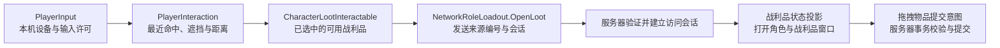

# 玩家准星交互

更新日期：2026-11-16。本文按当前工作树静态实现说明；正式入口经客户端登录、大厅与突袭进入在线场景，整体流程见[游戏运行流程图](../游戏运行流程图.md)。

`PlayerInteraction`（玩家交互）从相机视口中心发射射线，忽略玩家自身与 Trigger，只取最近碰撞体。墙壁等非交互物体会阻挡射线；距离以玩家根节点到命中点计算，默认 3 米。碰撞体可以位于交互组件的子节点。

- 键盘 **E** / 手柄 **西侧按钮（X / Square）** 提交一次交互，由 `PlayerInput`（玩家输入）采样并消费本机按下。
- 只有使用本地输入、拥有控制权、网络配装就绪、未打开配装窗口且交互相机可用的本机网络角色能交互；远端、服务器与无网络配装的旧离线角色不满足该条件。
- `PlayerInteraction`（玩家交互）在检测、执行前后刷新共享许可，开窗当帧清除当前目标，把目标提示和结果经输入组件写回角色表现；准心和文本由已有表现链显示。
- `interactionCamera`（交互相机）留空时使用主相机；`raycastLayers`（射线层）必须同时包含目标和遮挡物。距离检查与射线遮挡都通过后，才解析目标。
- 当前检测只查找最近碰撞体父级的 `CharacterLootInteractable`（战利品交互），并非任意实现 `IInteractable`（交互接口）的组件都会被准星发现。

## 当前交互链

`CharacterLootInteractable`（战利品交互）要求同物体上有 `NetworkLootSource`（战利品访问点），只接受本机准星当前选中的目标。来源须已网络生成、在客户端可用；无法打开时使用角色现有反馈文本，不动态拼装额外固定 UI。

`NetworkRoleLoadout`（网络配装）验证本地会话与窗口接线，再向服务器提交打开请求。服务器核对连接归属、会话、世代、来源可用性、同场景与距离，创建带访问凭证的会话并定向返回完整战利品状态；客户端完整解码后才绑定视图。移动物品时再次检查访问会话、版本与物品规则，客户端不直接持有权威库存端点。服务端访问点目前未额外做视线射线检查，客户端遮挡检测不能当作服务器视线验证。

## 已接入的资源与边界

- `Assets/_Project/Prefabs/player.prefab` 保留基础角色配置；正式在线角色由 `Assets/_Project/Prefabs/OnlinePlayer.prefab` 提供。交互脚本与 `Assets/_Project/Prefabs/CrosshairUI.prefab` 保留，准心引用由角色表现使用。
- 在线场景 `Assets/Scenes/OnlineGame.unity` 中存在固定箱子的脚本配置，使用 `FixedLootChest`（固定箱子）与新的战利品访问链。独立资产 `Assets/_Project/Prefabs/FixedLootChest.prefab` 当前没有接入场景；不能仅因预制体存在就宣称已经放置。
- `FixedLootChest`（固定箱子）只在服务器初始化，按配置格坐标创建物品。无效配置整体拒绝，不裁剪、不重排，也不重新播种已绑定的箱子。
- 角色战利品与地面物品也使用新的网络访问点；旧普通方块交互、旧库存箱及旧离线拾取链已退出当前准星检测。旧 `Main`（旧场景）演示实例已清理，不再提供原文所述方块日志、双栏旧箱子或红药拾取演示。

配装窗口当前用 **Tab** 切换，窗口自身负责光标与显隐，角色配装表现负责会话与拖拽生命周期。`GameplayUiBindingAdapter`（游戏界面绑定）按客户端会话、所属角色、初始状态、必需界面与模态窗口许可控制配装输入。离开战利品距离、来源失效、关窗、输入许可撤销或断线，会关闭访问并清理投影。Host 同样通过网络请求及独立投影，不绕过服务器直接改库存。

## 人工验证

本轮未启动 Unity、运行测试或构建，仅核对源码和资源引用。后续人工从正式客户端入口登录，进入大厅并开始突袭后，可检查以下相关行为：

- 对准在线可用战利品时显示提示，E 仅触发一次；非交互物、墙壁、自身碰撞体、超距与 Trigger 不应成为可交互目标。
- 打开固定箱子或角色战利品后，角色栏与战利品栏绑定正确；拖拽与交换应由服务器提交，拒绝与超时不能留下客户端私自修改的物品。
- Tab 关窗、超距、目标失效与断线后访问和拖拽均结束；模态界面、未就绪角色及远端角色不能继续提交本机交互。

以上是人工核对项，不表示这些运行结果已经通过。本轮也未验证当前暂停的战斗结算、消耗品完成或 AI 生成。

## 源码入口

- [PlayerInteraction（玩家交互）](PlayerInteraction.cs)、[CharacterLootInteractable（战利品交互）](CharacterLootInteractable.cs)、[CrosshairUI（准心界面）](CrosshairUI.cs)。
- [NetworkRoleLoadout.Loot（战利品网络边界）](../LoadoutTemplate/NetworkRoleLoadout.Loot.cs)、[NetworkLootSource（战利品访问点）](../LoadoutTemplate/NetworkLootSource.cs)、[FixedLootChest（固定箱子）](../LoadoutTemplate/FixedLootChest.cs)、[NetworkGroundLootItem（地面物品）](../LoadoutTemplate/NetworkGroundLootItem.cs)。
- [RoleLoadoutPresentation（配装表现）](../LoadoutTemplate/Presentation/RoleLoadoutPresentation.cs)、[LoadoutWindowUI（配装窗口）](../LoadoutTemplate/Presentation/LoadoutWindowUI.cs)、[GameplayUiBindingAdapter（游戏界面绑定）](../Frontend/GameplayUiBindingAdapter.cs)。
