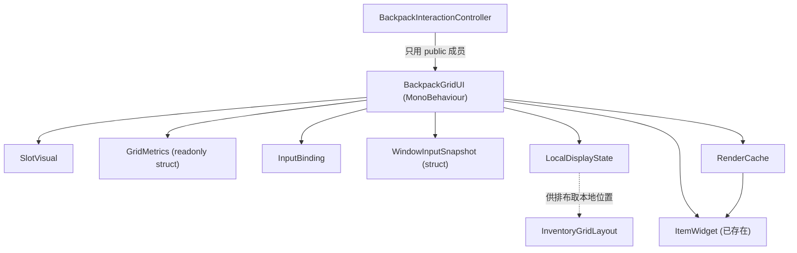

## 产品概述

对 `BackpackGridUI.cs`（1043 行、单类、约 30 个平铺私有字段）做一次**纯结构性整理**：按 `F1_F2_程序集与目录命名规范.md` §3.2.1 的要求，把语义相关的散字段收拢成内部类 / 内部结构体，并用 `#region / #endregion` 按职责对字段、属性与方法分区，让单文件层次清晰、职责可读，便于后续 `UI1` 文档规划的窗口骨架改造。整理后字段分组从 30 个降到约 8 组，方法区从「一长条无分段」变成 12 个命名分区。

## 核心功能（本次整理范围）

1. **格子视图合并**：`slots` / `slotImages` / `slotHoverStates` 三个必须同序维护的平行列表合并为一个 `SlotVisual` 列表，消除「漏同步一个列表」的隐患。
2. **网格度量收拢**：由 `cellSize` + `slotSpacing` 派生的全部像素换算（面板尺寸、物品像素尺寸、格坐标→像素、抓取格中心偏移、局部坐标→格参数与象限）集中到一个只读值类型，避免同一公式在 5 处各写一遍。
3. **输入订阅收拢**：开关 / 左键 / 右键三个 `InputAction` 与订阅、告警状态合并为一个内部类，订阅与退订成对出现。
4. **开窗快照收拢**：打开背包前保存的「输入组件启用态 + 光标可见态 + 光标锁定态」三个字段合并为一个结构体，采集与还原成对出现。
5. **本机显示状态收拢**：本地位置表、显示数量覆盖、清理缓冲、隐藏物、悬停物及其 12 个读写入口收成一个内部类，对外方法保留转发。
6. **重绘缓存收拢**：库存快照、本帧展示项、待回收标识、标识→数据 / 标识→视图索引、溢出文本缓冲收成一个内部类。
7. **字段、属性与方法分区（`#region`）**：用 `#region / #endregion` 把字段、属性与方法按职责切成 12 个命名区（序列化字段 / 内部类型 / 运行时状态与属性 / 生命周期 / 数据源绑定 / 网格构建与图层 / 重绘管线 / 输入与开关 / 本机显示状态 / 携带预览 / M6 查询与几何换算 / 私有换装工具），折叠后可直接看到类骨架。

## 不变项（验收硬约束）

- 不改运行时行为、不改 `asmdef` / 命名空间 / 序列化字段名（Inspector 赋值不能丢）。
- 保持单文件、内部类型以嵌套形式存在，不新增 `.cs`。
- `public` 成员签名默认保持，`BackpackInteractionController` 的 40+ 处调用不改。
- `#region` / `#endregion` 仅为编译期分组指令，**必须成对出现，区域内部不得再嵌套 `#region`、不得跨类型边界、不得影响任何代码语义**；字段、属性、生命周期方法、业务方法与私有工具必须归入明确职责区。

## 技术栈

- 语言 / 引擎：C# + Unity（`MonoBehaviour`，Unity 2022 风格；`Assets/backpack/Scripts/UI/RPG4.Backpack.UI.asmdef`）。
- 依赖：Mirror（`NetworkClient.localPlayer`）、Unity InputSystem、TextMeshPro；同程序集类型 `InventoryGridLayout` / `GridDisplayItem` / `GridDisplayPlacement` / `BackpackHoverState` / `TileParams` / `SpaceQueryResult<T>` / `BackpackFeedbackPalette` / `GridUtils` / `BackpackLog`。
- 编译核对：`dotnet build RPG4.Backpack.UI.csproj`（工程根 `e:/ue/RPG_4/`，已确认该 csproj 存在；UI1 文档记录基线为 0 错误 + 1 个 Mirror 既有警告）。
- 无新增第三方依赖。

## 实现方案

### 关键决策与理由

**决策 1：格子视图用 `sealed class` 而非 `struct`。**
`List<T>` 中的 `struct` 元素无法原地修改（`slots[i].hover = ...` 改的是副本），只能整体替换元素，反而更易错。格子实例数等于网格格数（重建时才新建），类对象开销可忽略；现状「三平行列表」正是重构要消灭的对象。→ 合并为 `List<SlotVisual>`。

**决策 2：`GridMetrics` 设计为 `readonly struct`，由序列化字段现取现建。**
`cellSize` / `slotSpacing` 是 Inspector 序列化 `public` 字段，必须留在 `MonoBehaviour` 上作为真源；用属性 `private GridMetrics Metrics => new GridMetrics(cellSize, slotSpacing);` 构造值类型，**零堆分配**、无缓存失效问题。同步把 `Mathf.Max(1f, cellSize + spacing)` 的步距下限、象限判定的 `Clamp01` 口径一并封装进类型内，保证与原 5 处公式**逐字等价**。
注意点：`TryResolveTile` 中「屏幕点→图层局部点」依赖 `RectTransformUtility` 与 `itemLayer`，保留在 `MonoBehaviour`，只把局部点之后的纯数学下沉为 `TryResolveLocal(...)`。

**决策 3：输入订阅与开窗快照拆成两个类型，职责分离。**
`InputBinding` 管「长期订阅」（含宿主缺失时只告警一次的重试语义），`WindowInputSnapshot` 是「开窗瞬时快照」（值类型，采集/还原成对）。二者生命周期完全不同，合并会混淆语义。
输入回调 `OnToggleAction` / `OnPrimaryClickAction` / `OnSecondaryClickAction` 与 `Toggle()` / `PushClick()` 仍留在 `MonoBehaviour`（属主行为），`InputBinding.TryBind(host)` 只负责取 `host.backpackInput` 的三个动作并按 `backpack/BackPackUI`、`backpack/leftButton`、`backpack/rightButton` 注册回调；`Unbind()` 只退订，**绝不触碰映射启用状态**（宿主独占，注释中已明确）。

**决策 4：`LocalDisplayState` / `RenderCache` 保持类（有复用缓冲，须为引用类型）。**
二者各持有需跨帧复用的 `List` / `Dictionary`（`snapshot`、`displayItems`、`obsolete`、`pruneBuffer`、`overflowMessage`），必须避免每帧新建——用类实例内的 `readonly` 字段，`Clear()` 复用语义与原实现完全一致。`BackpackGridUI` 的 12 个「本机显示状态」public 方法保留签名，内部一行转发，`BackpackInteractionController` 零改动。

**决策 5：public API 默认不动。**
40+ 处调用点、收益仅为命名层级，且 `UI1_面板接口与多窗口支持.md`（C3 / C4）已规划对同文件做结构性改造，此时改签名会与后续改造冲突。若想要 `grid.Local.SetPosition(...)` 这类分组属性风格，作为变更文档的**待决策项**单列，确认后再做（避免新旧两套写法并存）。

**决策 6：`#region` 用中文区名 + 固定 12 区骨架，覆盖字段、属性与方法。**
区名用中文（与项目「英文标识符 + 中文注释」约定一致，`#region` 是编译期指令不算标识符）；区域**顺序即阅读顺序**：字段在前、类型在后、运行时状态与属性紧随其后、生命周期居中、能力区在后；每个 `#region` 必须有配对的 `#endregion`，且**区名写在 `#region` 行尾**（`#region 数据源绑定`）保证折叠提示可读。深度固定一层（嵌套内部类型内部不再开新 region），避免 Rider / VS 折叠树过深。

### 字段、属性与方法分区（`#region`）设计

| # | 区名 | 内容 |
| --- | --- | --- |
| 1 | `序列化字段` | `slotPrefab` / `initialColumns` / `initialRows` / `cellSize` / `slotSpacing` / `slotLayer` / `itemLayer` / `hudHint` / `overflowText` / `uiFont` / `bindingCheckInterval` / `openKeyHint` / `cursorLayer` / `interaction` 及各自 `[Header]` |
| 2 | `内部类型` | `SlotVisual` / `GridMetrics` / `InputBinding` / `WindowInputSnapshot` / `LocalDisplayState` / `RenderCache` / `ItemWidget` |
| 3 | `运行时状态与属性` | `slotViews` / `metrics 属性` / 数据源绑定态（`Inventory` / `playerInput` / `dataSubscription` / `dataDirty` / `nextBindingCheck`）/ 输入绑定与光标快照实例 / 渲染与本机状态实例 / `rectTransform` / `layout` / `Columns` / `Rows` / `IsOpen` / `carriedPreview` |
| 4 | `生命周期` | `Awake` / `Start` / `OnEnable` / `Update` / `LateUpdate` / `OnDisable` / `OnDestroy` |
| 5 | `数据源绑定` | `ResolveSource` / `BindInventory` / `SyncGridSize` / `Unbind` / `OnInventoryChanged` / `DescribeSource` / `OpenKeyLabel` |
| 6 | `网格构建与图层` | `BuildGrid` / `EnsureItemLayer` / `EnsureCursorLayer` |
| 7 | `重绘管线` | `Refresh` / `Redraw` / `UpdateOverflow` / `ApplySlotColors` / `SetSlotHoverState` / `SlotColor` / `IsPlaced` |
| 8 | `输入与开关` | `BindInputActions` / `UnbindInputActions` / `OnToggleAction` / `OnPrimaryClickAction` / `OnSecondaryClickAction` / `PushClick` / `Toggle` / `ApplyOpenState` / `RestoreInput` / `SetWindowVisible` / `SetHint` |
| 9 | `本机显示状态` | `SetManualPosition` / `ClearManualPosition` / `SetStackDisplay` / `ClearStackDisplay` / `ClearAllStackDisplays` / `HasStackDisplayOverride` / `SetHiddenItem` / `ClearHiddenItem` / `SetItemHovered` / `ClearHoverHighlight` / `ApplyRegionHighlight` / `CopyItemIds` / `TryGetItem` / `TryGetPlacement` |
| 10 | `携带预览` | `TryShowCarriedPreview` / `SetCarriedPreviewCellPosition` / `TrySetCarriedPreviewScreenPosition` / `HideCarriedPreview` |
| 11 | `M6 查询与几何换算` | `TryGetCellOwner` / `QuerySpace` / `TryResolveTile` / `GetUpperLeftIndex` |
| 12 | `私有绘制工具` | `CreateWidget` / `ApplyWidget` / `CreateRect` / `CreateText` / `ApplyWidgetHover` / `SetWidgetAlpha` |


分组与 `#region` 边界**一次成型**：字段/类型收拢与分区在同一轮改动内完成，不先分类再补 region，避免二次搬运。

属性与方法的归区是验收项：新增成员必须放入既有职责区；只有职责边界新增时才更新 12 区表。每个 `#region` 仅对应一个 `#endregion`，不得跨越 `BackpackGridUI` 或其内部类型边界。

### 性能与可靠性

- `GridMetrics` 为值类型，取值零 GC；`Refresh` / `TryResolveTile` / `SetCarriedPreview` 等热路径内改为先取一次局部变量 `GridMetrics metrics = Metrics;`，避免重复构造。
- 所有复用缓冲（快照、展示项、待回收、清理缓冲、溢出文本）实例化后跨帧复用，**不新增每帧分配**；`SlotVisual` 仅在 `BuildGrid`（开窗 / 尺寸变化）时分配。
- 复杂度不变：重绘仍为 O(物品数 + 格数)，绑定重查仍为 `bindingCheckInterval` 节流。
- `#region` 为零运行时开销（编译期指令），不参与 IL 生成。

### 架构与依赖关系

单文件内聚，无新程序集边界：



### 执行注意（避免回退）

1. **先查全调用点再动手**：既有 grep 结果被截断（约 8 条未显示），实现前用语义检索补全 `BackpackInteractionController.cs` 的完整成员清单，作为「签名不变」的核对表。
2. **逐字搬运公式**：`BuildGrid` 面板尺寸、`EnsureItemLayer` / `EnsureCursorLayer` 图层尺寸（注意后者用 `Mathf.Max(0, n-1)`）、`ItemPixelSize`、`CellToPixel`、`TryResolveTile` 步距与象限、`TrySetCarriedPreviewScreenPosition` 抓取中心 —— 一律保持原表达式，只换承载位置。
3. **`SetSlotHoverState` 的短路**：`hover` 态未变化时提前 return 以避免多余 Canvas 重建，此优化必须保留；`ApplySlotColors` 遍历上界由两个列表改为单个列表长度。
4. **序列化字段名一个都不能改**；新增内部类型一律 `private`，不引入新 `public` / `internal` 成员。
5. **注释沿用项目约定**：英文标识符 + 简洁中文 `/// <summary>` 单行摘要与行尾注释；`#region` 名用中文，与类内既有 `// ── M6 交互支撑 … ──` 分段横幅共存时，**以 `#region` 为准，移除被其取代的横幅行**，避免两套分段符号并存。
6. **文档先行**：本次跨 2 个文件，按项目既有节奏先在 `Docs/核心契约/` 落变更文档（含待决策项与「明确不做」），该项目非 Git 仓库、无 diff 可回溯，文档是唯一决策留痕；`.meta` 需手写且 GUID 全仓查重。
7. **不做**：不跑单元测试（工程无测试工程），只做编译核对；不顺手改控制器逻辑；不实现 UI1 的 C3 / C4；不为 `#region` 额外写说明注释。

## 目录结构

```
e:/ue/RPG_4/Assets/backpack/
├── Docs/核心契约/
│   ├── UI2_网格主控内部结构整理.md        # [NEW] 变更文档。按「背景 → 变更总览 → 逐项方案 → 明确不做 → 验收清单 → 待决策项」组织，逐项列出 6 个内部类型的字段归属、12 个 #region 分区表与公式等价对照表、public API 不变承诺、状态标注（待实施 / 已落盘）。
│   └── UI2_网格主控内部结构整理.md.meta   # [NEW] 手写 Unity .meta：fileFormatVersion 2、guid 为随机 32 位十六进制（须在 e:/ue/RPG_4 全仓 grep 确认唯一）、DefaultImporter。
└── Scripts/UI/
    ├── BackpackGridUI.cs                  # [MODIFY] 主改动。新增 6 个 private 嵌套类型（SlotVisual / GridMetrics / InputBinding / WindowInputSnapshot / LocalDisplayState / RenderCache），保留 ItemWidget；合并三平行格子列表；换算改走 GridMetrics；BindInputActions / UnbindInputActions 改走 InputBinding；ApplyOpenState / RestoreInput 改走 WindowInputSnapshot；Refresh / Prune* / 显示覆盖与悬停逻辑改走 LocalDisplayState 与 RenderCache；全类按 12 个 #region 分区；public 成员签名与序列化字段名保持原样。
    └── BackpackInteractionController.cs  # [MODIFY 仅在必要时] 默认零改动；仅当最终确认存在 public 可见性调整时，按核对表同步全部调用点，禁止行为变更。
```

## 关键代码结构

```
public class BackpackGridUI : MonoBehaviour
{
    #region 序列化字段
    // slotPrefab / cellSize / slotSpacing / slotLayer / itemLayer / hudHint / ... / interaction
    #endregion

    #region 内部类型
    private sealed class SlotVisual { public GameObject root; public Image image; public BackpackHoverState hover; }
    private readonly struct GridMetrics { /* PaneSize / ItemPixelSize / CellToPixel / GrabCenterOffset / TryResolveLocal */ }
    private sealed class InputBinding { public bool TryBind(InputManager host); public void Unbind(); }
    private struct WindowInputSnapshot { public WindowInputSnapshot(PlayerInput p); public void Restore(PlayerInput p); }
    private sealed class LocalDisplayState { /* 位置表 / 显示覆盖 / 隐藏物 / 悬停物 + 清理缓冲 */ }
    private sealed class RenderCache { /* snapshot / displayItems / obsolete / itemsById / widgets / overflowMessage */ }
    private sealed class ItemWidget { /* 已存在，保留 */ }
    #endregion

    #region 运行时状态与属性
    // slotViews / Metrics / Inventory / ItemViews / Columns / Rows / IsOpen / dataSubscription / dataDirty / layout / binding / local / render / ...
    #endregion

    #region 生命周期
    // Awake / Start / OnEnable / Update / LateUpdate / OnDisable / OnDestroy
    #endregion

    #region 数据源绑定
    // ResolveSource / BindInventory / SyncGridSize / Unbind / OnInventoryChanged / DescribeSource / OpenKeyLabel
    #endregion

    #region 网格构建与图层
    // BuildGrid / EnsureItemLayer / EnsureCursorLayer
    #endregion

    #region 重绘管线
    // Refresh / Redraw / UpdateOverflow / ApplySlotColors / SetSlotHoverState / SlotColor / IsPlaced
    #endregion

    #region 输入与开关
    // BindInputActions / UnbindInputActions / On*Action / PushClick / Toggle / ApplyOpenState / RestoreInput / SetWindowVisible / SetHint
    #endregion

    #region 本机显示状态
    // SetManualPosition / ClearManualPosition / SetStackDisplay / ClearStackDisplay / ClearAllStackDisplays
    // HasStackDisplayOverride / SetHiddenItem / ClearHiddenItem / SetItemHovered / ClearHoverHighlight
    // ApplyRegionHighlight / CopyItemIds / TryGetItem / TryGetPlacement
    #endregion

    #region 携带预览
    // TryShowCarriedPreview / SetCarriedPreviewCellPosition / TrySetCarriedPreviewScreenPosition / HideCarriedPreview
    #endregion

    #region M6 查询与几何换算
    // TryGetCellOwner / QuerySpace / TryResolveTile / GetUpperLeftIndex
    #endregion

    #region 物品框视图工具
    // CreateWidget / ApplyWidget / ApplyWidgetHover / SetWidgetAlpha
    #endregion
}
```

## Agent Extensions

### Skill

- **Context Mode**
- Purpose: 精读 `BackpackGridUI.cs`（1043 行）与枚举调用点时收敛上下文占用，避免把整份大文件反复读入。
- Expected outcome: 产出「改用点 → 原公式 / 原字段」的等价对照清单，且不因大段原文挤占上下文。

- **ADHD友好输出**
- Purpose: 约束交付风格——行动先行、编号步骤、无客套开场与结束语，列表不超过 5 项。
- Expected outcome: 澄清结果、文档草稿与改动说明均为可直接执行的短条目形式。

- **command-execution-no-tests-no-comments**
- Purpose: 重构期不跑测试（工程无测试工程）、不为重构额外添加解释性注释（注释仍按项目约定的英文标识符 + 简洁中文摘要保留，`#region` 区名除外）。
- Expected outcome: 命令仅限一次 `dotnet build RPG4.Backpack.UI.csproj` 编译核对，注释无冗余新增。

- **lsp-code-analysis**
- Purpose: 用语义化「查找引用」补全 `BackpackGridUI` 全部 public 成员的调用点（此前 grep 结果被截断，约 8 条未显示）。
- Expected outcome: 得到完整调用点核对表，确认「public 签名不变」后控制器无需改动、或精确列出需同步的调用点。

### SubAgent

- **code-explorer**
- Purpose: 中等强度全仓核查：除 `BackpackInteractionController.cs` 外是否还有场景 / 预制体 / 其它程序集程序化引用 `BackpackGridUI` 与其 public 成员（含 `.Grid` 属性与 `Toggle()`）。
- Expected outcome: 明确的「引用面清单」结论（当前 grep 显示仅 2 个文件命中、`.Grid` 与 `.Toggle()` 全仓 0 引用，需要二次确认），作为改动半径可控的证据。
