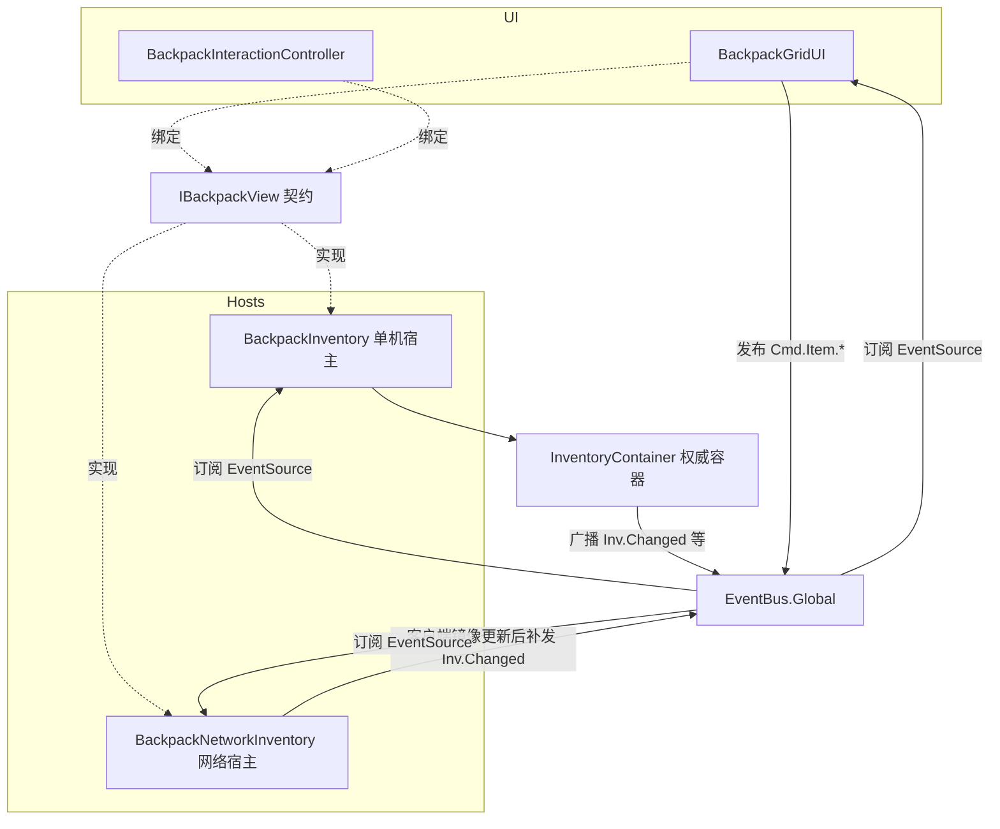

## 需求概述

对单机背包宿主 `BackpackInventory` 做"极简宿主"改造：它只负责创建并持有 `InventoryContainer`、完成注册、编排写入；物品读取、变更通知与写入意图全部改由 UI 直接对接数据层的**事件管线**，不再由宿主转发。

## 核心要求

1. 精简 `BackpackInventory`：删除只读转发（`ItemCount` / `Revision` / `Items` / `CopyItems` / `TryGetItem`）、标识索引（`itemsById` / `rebuildBuffer` / `RebuildItemIndex`）以及宿主的 `Changed` 事件与帧末合并（`LateUpdate` / `changedPending` / `observedRevision`）。
2. 通知走事件管线：数据变化经 `InvChannels` 广播，UI 订阅后以脏标记在帧末合并刷新一次。
3. 写入走事件管线：UI 只发布意图命令（拆分 / 设置堆叠数 / 移除），由宿主订阅执行，不再出现 `Request*` 直接方法调用。
4. 按标识定位下沉到容器：`InventoryContainer` 提供 `TryGetItemById`；同时把"设置堆叠数"收进容器，补齐数量直改不发通知的缺口。
5. 抽出统一的 UI 数据源契约，单机与网络两套宿主各实现一份，UI 一套代码零分支。
6. 绑定语义：打开界面时把该背包的事件管线键交给 UI，UI 用它订阅通知、发布命令；关闭界面时统一清理订阅。

## 边界约束

- 保持"先完整校验、后提交、失败零变更"的既有写入语义不变。
- 不破坏 `BackpackRegistry` 的登记与 Primary 语义、网络版服务端权威投影与客户端镜像、容器尺寸回退与 `MaxSlotCount` 语义。

## 技术栈

Unity（C#）、Mirror 网络库、自研 `EventBus.Global` + `EventChannels` 事件管线、asmdef 分层（Core / Items / Inventory / Runtime / Network / UI）。

## 实现策略（关键决策与理由）

1. **新增粗粒度频道 `InvChannels.Changed`（`Inv.Changed`，无载荷）**
现有三频道无法在纯客户端完整发出：`Inv.Stack.Changed` 的载荷 `SlotAvailabilityResult` 只有具备网格的容器才能产出。UI 只需要"数据已变"的脏信号，不需要载荷，因此新增无载荷变更频道；原三频道保留给业务系统订阅。

2. **写入意图新增 3 个 `CmdChannels` 常量**
`SetStackCount = "Cmd.Item.SetStackCount"`（载荷 `ItemId, int`）、`RemoveItem = "Cmd.Item.Remove"`（载荷 `ItemId`）、`SplitStack = "Cmd.Item.Split"`（载荷 `ItemId, int`），与现有 `Cmd.Item.Drop` / `Cmd.Item.Consume` 风格对齐。

3. **UI 数据源契约 `IBackpackView`**（新建于 `RPG4.Backpack.Inventory` 程序集，UI / Runtime / Network 三方均可引用）：

- `int ConfiguredRows` / `int ConfiguredColumns`
- `object EventSource`：事件管线键，单机 = 权威容器实例；网络 = 权威容器（服务端 / 主机）或宿主自身（纯客户端）
- `void CopyItems(List&lt;RuntimeItem&gt; destination)`
UI 全程只持有该接口；需要用 `GetComponent` / 日志时以 `source as Component` 兜底。

4. **容器能力下沉（`InventoryContainer`）**

- `TryGetItemById(ItemId, out RuntimeItem)`：线性扫描 `placements.Keys`（物品数通常 &lt; 100，仅在落放操作时调用）。
- `TrySetStackCount(RuntimeItem, int, out string error)`：校验在容器内 + 范围 1..单堆上限 → 直改 → `BumpRevision()` → `NotifyStackChanged`；无变化时不提交。
- `BumpRevision()`：把现有 4 处 `Revision++` 收敛为 `Revision++` + `Publish(InvChannels.Changed, this)`，使每次成功提交都产生一次粗粒度脏信号。

5. **事件管线键统一规则**

- 单机：`BackpackInventory.EventSource =&gt; Container`；UI 订阅 `Inv.Changed`（source = 容器）、发布 `Cmd.*`（source = 容器）；宿主在 `OnEnable` 以容器为 source 订阅 3 个命令频道。
- 网络：`EventSource =&gt; IsServerInventory ? container : (object)this`；服务端 / Host 由容器广播，纯客户端在 `RaiseChanged` 触发后的帧末补发 `Inv.Changed`（source = 宿主自身）；宿主订阅命令后转发到现有 `Request*`（Host 模式经 Mirror 的 `[Command(requiresAuthority = true)]` 本地执行，无需分支）。
- `InvChannels.MenuToggled` 的 source 由宿主改为 UI 组件自身（`this`），语义更正确且不受绑定对象切换影响（全工程仅 `BackpackGridUI` 自己使用）。

6. **UI 帧末合并**：订阅回调只置 `dataDirty`；`LateUpdate` 中 `if (dataDirty) { dataDirty = false; Refresh(); }`。`BackpackInteractionController` 的携带物检查回调本身轻量，直接执行。

7. **UI 绑定发现**：`BackpackGridUI.Update` 周期性查找——`NetworkClient.localPlayer` 存在时取其 `BackpackNetworkInventory`，否则回退 `BackpackRegistry.TryGetPrimary` 的单机宿主；`UI` 程序集需新增 `RPG4.Backpack.Runtime` 引用（Runtime 不引用 UI，无循环依赖）。

## 架构设计



**数据流**：写入（UI 发 `Cmd.Item.*` → 宿主订阅执行 → 单机直接改容器、网络 Host 本地执行或客户端发 Mirror Command → 容器 `BumpRevision` 广播 → UI 置脏 → 帧末刷新）；读取（UI 调 `CopyItems` 取快照）。

## 目录结构

```
Assets/backpack/Scripts/
├── Core/Events/EventChannels.cs          # [MODIFY] 新增 InvChannels.Changed 常量；CmdChannels 新增 SetStackCount / RemoveItem / SplitStack 三个意图频道
├── Inventory/IBackpackView.cs            # [NEW] UI 数据源契约：ConfiguredRows / ConfiguredColumns / EventSource / CopyItems，中文注释说明各部署形态下 EventSource 的取值
├── Inventory/InventoryContainer.cs       # [MODIFY] 新增 TryGetItemById、TrySetStackCount；新增 BumpRevision 私有方法（Revision++ 并广播 Inv.Changed）并替换 4 处裸 Revision++
├── Runtime/BackpackInventory.cs          # [MODIFY] 精简约 100 行：删除 12 项只读转发/索引/通知成员；保留 Awake 建容器、Registry 注册、Catalog、六类写入编排、EnsureContainer、TryBuildSplitInstance、FindFirstFreeRegion、Reject；实现 IBackpackView（EventSource => Container、CopyItems 转容器）；OnEnable/OnDisable 以容器为 source 订阅/退订 3 个命令频道并记录失败日志
├── Network/Inventory/BackpackNetworkInventory.cs  # [MODIFY] 实现 IBackpackView（EventSource 按 IsServerInventory 分支、已有 ConfiguredRows/Columns 与 CopyItems）；LateUpdate 内在非权威情形补发 Inv.Changed；订阅 3 个命令频道转发到现有 Request*（保持 CanSendRequest 前置校验）
├── UI/BackpackGridUI.cs                  # [MODIFY] Inventory 字段改 IBackpackView；BindInventory 签名改接口（playerInput 与日志经 asComponent 兜底）；Update 绑定发现改"网络优先、单机兜底"；订阅 Inv.Changed 置脏 + 新增 LateUpdate 帧末合并刷新；toggleSubscription 与新增的数据订阅句柄统一 Dispose；MenuToggled 发布/订阅 source 改为 this
├── UI/BackpackInteractionController.cs   # [MODIFY] 字段改 IBackpackView 并保存 EventSource；订阅 Inv.Changed；RequestSetStackCount / RequestRemoveItem / RequestSplitStack 调用点（7 处）改为 Publish 命令事件，source 统一用 EventSource；RequestDrop / RequestConsume 的 Publish source 同步改为 EventSource
└── UI/RPG4.Backpack.UI.asmdef            # [MODIFY] references 增加 "RPG4.Backpack.Runtime"（用于 BackpackRegistry 与单机宿主查找）
```

## 关键代码结构

```
/// <summary>UI 数据源契约：表现层只依赖本接口，单机与网络两套宿主各实现一份。
/// EventSource 为事件管线键——单机与主机模式传入权威容器实例，纯客户端传入宿主自身。</summary>
public interface IBackpackView
{
    int ConfiguredRows { get; }
    int ConfiguredColumns { get; }
    object EventSource { get; }
    void CopyItems(List&lt;RuntimeItem&gt; destination);
}
```

## 性能与可靠性

- `BumpRevision` 收敛广播：一次 `TryAddItem` 只产生 1 次 `Inv.Changed`（另有细粒度事件），配合 UI 脏标记，一帧多次写入只重绘一次；广播为同步遍历，订阅者仅 1-2 个，开销可忽略。
- `TryGetItemById` 线性扫描 O(n)，n 为背包物品数（通常 &lt; 100），仅落放时调用，无每帧开销。
- 所有写入路径保持"先校验后提交、失败零变更（含拆分回滚）"语义；命令处理失败只记 `BackpackLog.Warn`，不抛异常。
- `OnDisable` / `Unbind` 必须成对清理订阅（`EventSubscription.Dispose`），避免 Domain Reload 与场景切换后的残留回调。

## 验证要点

- 单机：打开界面 → 放入 / 移除 / 拆分 / 设数量 → 界面刷新且每帧最多一次；关闭界面 → 订阅全部清理。
- 网络 Host 与纯客户端：镜像更新后界面同步刷新；主机模式命令本地执行、客户端命令经 Mirror 到达服务端。
- 编译：UI / Runtime / Network / Inventory 四个 asmdef 无循环引用，无残留符号引用。

## Agent Extensions

### Skill

- **lsp-code-analysis**
- Purpose: 改造完成后核查关键符号（`Changed` / `TryGetItem` / `CopyItems` / `RequestSetStackCount` / `Revision`）的全部引用点与实现是否处理完毕
- Expected outcome: 产出零遗漏的引用清单，确认无残留调用点、无编译期断链，作为验收依据