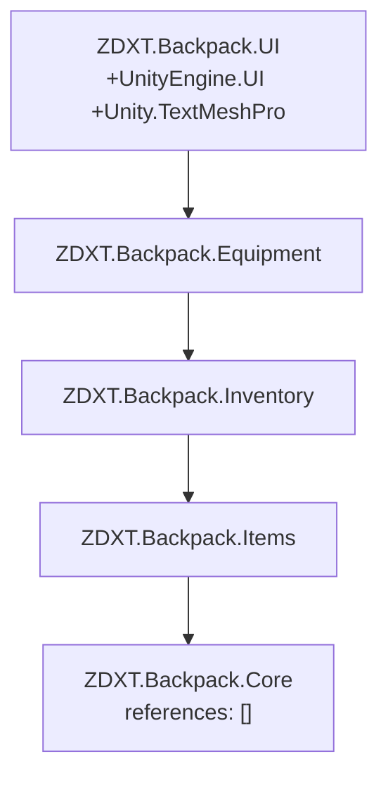

## 需求来源

按 `e:/github/ZDXT2/Assets/backpack/Docs/里程碑/路线图/Unity多人背包系统执行顺序方案.md` 第一节，在 Unity 工程 `e:/ue/RPG_4`（2022.3.62f3 LTS / URP）落地框架层前两项：

- **F1 工程与程序集划分**：把「谁能看见谁」变成编译期规则，完成标志 = 空工程可编译通过。
- **F2 目录结构与命名规范**：`Assets/backpack/` 目录树就位，并固化命名规范。

## 已确认决策

1. 落盘根 = `e:/ue/RPG_4/Assets/backpack/`（沿用规范文档的落盘方位修正）。
2. 程序集与命名空间前缀 = `ZDXT.Backpack.*`，与蓝本一致。
3. 本轮只建 **5 个运行时程序集**：Core / Items / Inventory / Equipment / UI；`Network` / `Core.Editor` / `Content.Editor` / `Tests` 留到 F5、F7。

## 核心交付

1. 5 个 `.asmdef`，依赖方向 `Core → Items → Inventory → {Equipment} → UI` 单向无环，`Core.references` 为空数组。
2. 完整目录树 + 每个目录/文件配一份 `.meta`，GUID 为 32 位十六进制且全局唯一（工程非 git 仓库，空目录必须先有 `.meta` 才能被 Unity 识别）。
3. 精简版命名规范文档，落 `Assets/backpack/Docs/工程架构/F1_F2_程序集与目录命名规范.md`。
4. 脚本化只读校验：程序集名唯一、references 无悬空、`Core` 零依赖、`UI` 不被任何程序集引用、GUID 唯一性。

## 边界（本轮不做）

不写任何 `.cs` 业务源码、不安装 Mirror / Input System、不改 `Packages/manifest.json`、不动 `Assets/Scenes` 等既有资产。

## 技术栈

- 引擎：Unity 2022.3.62f3 LTS（URP 14.0.12），目标工程 `e:/ue/RPG_4`。
- 程序集：Unity Assembly Definition（`.asmdef`）+ 手写 `.meta`（`folderAsset` / `AssemblyDefinitionImporter`）。
- 已有可用包：`com.unity.ugui 1.0.0`（asmdef 名 `UnityEngine.UI`，已核对 `Library/PackageCache/com.unity.ugui@1.0.0/Runtime/UnityEngine.UI.asmdef`）、`com.unity.textmeshpro 3.0.7`（asmdef 名 `Unity.TextMeshPro`，已核对 `Library/PackageCache/com.unity.textmeshpro@3.0.7/Scripts/Runtime/Unity.TextMeshPro.asmdef`）。
- 缺失包：无 Mirror、无 Input System → 本轮 `references` 中禁止出现 `Mirror` / `Unity.InputSystem`，否则 Unity 报 "Assembly Definition reference not found"，直接违反 F1 完成标志。

## 实现方案

1. **程序集划分（F1）**：按蓝本 `e:/github/ZDXT2/Assets/backpack/Scripts/**/*.asmdef` 的字段与顺序照抄，仅裁剪本轮不存在的依赖。

- `ZDXT.Backpack.Core` → `Scripts/Core/`，`references: []`（地基，唯一空依赖程序集）。
- `ZDXT.Backpack.Items` → `Scripts/Items/`，`["ZDXT.Backpack.Core"]`。
- `ZDXT.Backpack.Inventory` → `Scripts/Inventory/`，`["ZDXT.Backpack.Core","ZDXT.Backpack.Items"]`（修正项 H：不持 UI 引用）。
- `ZDXT.Backpack.Equipment` → `Scripts/Equipment/`，`["ZDXT.Backpack.Core","ZDXT.Backpack.Items","ZDXT.Backpack.Inventory"]`（目标态的 `Network`/`Mirror` 待 F7/M7 追加）。
- `ZDXT.Backpack.UI` → `Scripts/UI/`，`["ZDXT.Backpack.Core","ZDXT.Backpack.Items","ZDXT.Backpack.Inventory","ZDXT.Backpack.Equipment","UnityEngine.UI","Unity.TextMeshPro"]`（目标态的 `Network`/`Mirror`/`Unity.InputSystem` 待 F7 追加）。

2. **目录与 meta（F2）**：一次内联 PowerShell 批量建目录 → 写 asmdef → 为目录与 asmdef 各生成 32 位十六进制 GUID 的 `.meta`。解决「非 git 仓库 + 空目录不被 Unity 导入」的问题。
3. **命名规范文档**：精简版（现状 5 程序集 + 目标态 9 程序集说明、目录树、命名规则、验收清单、源文档绝对路径引用），落 `Assets/backpack/Docs/工程架构/F1_F2_程序集与目录命名规范.md`。
4. **只读校验**：解析 asmdef JSON 做架构断言 + 扫 GUID 唯一性 + 目录/meta 一一对应。

## 执行要点（防回归）

- **前置提醒**：若 Unity 编辑器正打开 RPG_4，先关闭或等其导入完成，避免 Unity 抢先生成 `.meta` 与我方 GUID 冲突/覆盖。
- **meta 格式照抄蓝本**（`e:/github/ZDXT2/Assets/backpack/Scripts/Core/ZDXT.Backpack.Core.asmdef.meta`）：`userData:` / `assetBundleName:` / `assetBundleVariant:` 三行行尾各带一个尾随空格，勿被编辑器裁掉。
- **asmdef 字段顺序照抄蓝本**：name / rootNamespace / references / includePlatforms / excludePlatforms / allowUnsafeCode / overrideReferences / precompiledReferences / autoReferenced / defineConstraints / versionDefines / noEngineReferences。
- 命名空间一层到底（`Scripts/Core/Events/EventBus.cs` → `namespace ZDXT.Backpack.Core`），子目录不再切分命名空间。
- 幂等：脚本重复执行不得改写已有 `.meta`（已存在则跳过，保留原 GUID）。

## 依赖方向（本轮落盘状态）



## 目录结构（全部 [NEW]，根 = `e:/ue/RPG_4/Assets/backpack/`）

```
Assets/backpack/                      [NEW] 工作区根（等价路线图的 Assets/_Project），配 .meta
├─ Scripts/                           [NEW] 源码根
│  ├─ Core/ZDXT.Backpack.Core.asmdef        [NEW] 事件总线·标签·Utils·类型契约（F3–F6）
│  │  ├─ Types/                        [NEW] F3 基础类型契约
│  │  ├─ Utils/                        [NEW] F4 坐标换算/Bounds/遍历/日志
│  │  ├─ Tags/                         [NEW] F5 层级标签与精确匹配
│  │  ├─ Events/                       [NEW] F6 事件总线
│  │  └─ Editor/                       [NEW] F5 Core.Editor 抽屉与校验（本轮无 asmdef）
│  ├─ Items/ZDXT.Backpack.Items.asmdef      [NEW] Fragment/Manifest/Runtime
│  │  ├─ Fragments/ Manifest/ Runtime/ Consumables/   [NEW] M1/M8 落点
│  ├─ Inventory/ZDXT.Backpack.Inventory.asmdef  [NEW] 真相源·占用矩阵·空间查询
│  ├─ Equipment/ZDXT.Backpack.Equipment.asmdef  [NEW] 装备组件/Actor（M7）
│  └─ UI/ZDXT.Backpack.UI.asmdef             [NEW] 网格/槽位/弹窗/HUD（M5–M6）
│     ├─ Grid/ HUD/                    [NEW] M5 落点
├─ Editor/                            [NEW] F7+ Content.Editor 落点（本轮无 asmdef）
├─ Data/Items/                        [NEW] Manifest 与 Fragment 资产
├─ Prefabs/                           [NEW] 拾取物/装备 Actor/UI 预制体
├─ Scenes/                            [NEW] 阶段场景
├─ Docs/                              [NEW] 本工程文档根
│  └─ 工程架构/F1_F2_程序集与目录命名规范.md  [NEW] F2 命名规范（精简版）
└─ Tests/{Content,Equipment,Inventory,Network,Support}/  [NEW] 测试落点（本轮无 asmdef）
```

> 每个目录与每个 `.asmdef` 均配一份 `.meta`（GUID 唯一）；空目录靠 `.meta` 在 Unity 中可见，这是本项目非 git 仓库的必需手段。

## 关键结构（asmdef 契约，照抄蓝本字段顺序）

```
{
    "name": "ZDXT.Backpack.UI",
    "rootNamespace": "ZDXT.Backpack.UI",
    "references": [
        "ZDXT.Backpack.Core",
        "ZDXT.Backpack.Items",
        "ZDXT.Backpack.Inventory",
        "ZDXT.Backpack.Equipment",
        "UnityEngine.UI",
        "Unity.TextMeshPro"
    ],
    "includePlatforms": [],
    "excludePlatforms": [],
    "allowUnsafeCode": false,
    "overrideReferences": false,
    "precompiledReferences": [],
    "autoReferenced": true,
    "defineConstraints": [],
    "versionDefines": [],
    "noEngineReferences": false
}
```

## Agent Extensions

### Skill

- **Context Mode**
- 用途：批量核对 ZDXT2 蓝本 asmdef / meta 与规范文档，避免逐文件读取挤占上下文。
- 预期结果：一次拿到 5 个 asmdef 与 meta 的精确格式与依赖清单。
- **ADHD友好输出**
- 用途：执行汇报行动先行、编号步骤、无寒暄。
- 预期结果：每步完成即给下一条具体动作，约 5 分钟一轮。