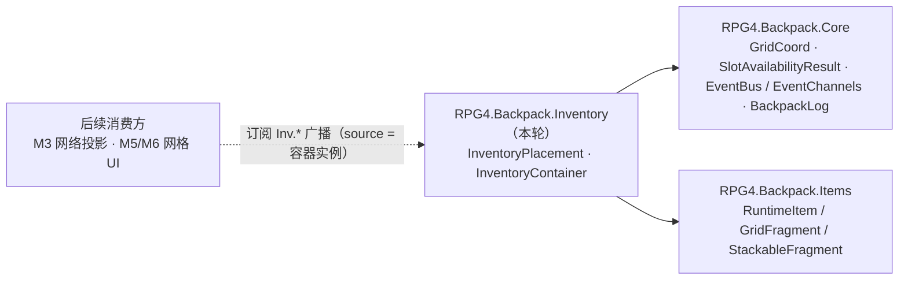

## 产品概述
在 RPG_4 工程里落盘背包系统的「库存真相源」：一个纯 C# 数据层容器，唯一权威地持有「物品集合 + 物品在网格中的上左位置 + 每格占用」，并能在没有任何 UI、没有任何网络的情况下独立判定「放得下吗、能放几个、还剩多少」。前置 M1（物品数据模型）已完成，本阶段后接 M3（网络同步）。

## 核心功能
1. **网格占用矩阵**：单一矩形网格（行列可配，上限 256×256），每格记录「是否被占 / 占位者 / 占位者的上左格」，多格物品的每个占格指向同一条放置记录；矩形互不重叠。
2. **位置真相源**：物品的上左位置与冻结尺寸由数据层持有，不由 UI 决定；物品尺寸取网格占位片段，缺失时按 1×1。
3. **空间查询（只读）**：
   - 落点查询 —— 全空可放 / 整块被同一个物品占据则可交换 / 其余无候选；
   - 容量查询 —— 逐槽位汇总「能补入多少、还能放几个、剩余多少、是否可堆叠」，支持结果实例复用做到逐帧零分配。
4. **原子变更**：指定落点放置、整件移除、并入既有堆叠（可部分并入、余量留在来源）、一次性收编（先并行并入已有堆叠、再落首个空白区）。全部先校验后提交，失败即零变更；物品已在容器内时不支持原地移动。
5. **堆叠数单一来源**：容器不缓存任何堆叠计数，任何容量计算都现取物品自身的堆叠数，从结构上杜绝双写不一致。
6. **变更广播**：放置 / 移除 / 堆叠变化成功后向事件总线发「新增物品 / 移除物品 / 堆叠变化」通知，供后续网格 UI、悬停预览订阅；查询路径不发任何消息。

## 交付边界
- 只落数据层代码与文档；不依赖 UI、不依赖网络、不依赖 MonoBehaviour。
- 既有自研只读映射层（两文件）**保留并标注为「原型、不接入」**，后续阶段不再引用。
- 不写单测；不新建测试程序集；不改动任何既有程序集定义。
- 网络同步形态（物品列表 + 堆叠数复制、位置本地化）留到 M3 定案，本阶段只提供按唯一标识升序的确定性快照排序供其使用。

## 验收
Unity 刷新后无编译报错；人工核对公开 API 与数据不变量；三项纯逻辑判定（放得下吗 / 放几个 / 剩多少）可由调用方在无 UI 环境下直接得到结果。


## 技术栈
- 引擎/语言：Unity 2022.3.62f3 LTS + C#（纯数据层，无 MonoBehaviour）。
- 落点：既有 `RPG4.Backpack.Inventory` 程序集（`references = ["RPG4.Backpack.Core","RPG4.Backpack.Items"]`，**无需改动**；`Core.asmdef` 仍为 `[]`）。
- 既有依赖齐备（已逐项核实，无需补实现）：`RuntimeItem`（`IsStackable` / `MaxStackSize` / `SetStackCount` / `StackCount` / `ItemType.MatchesTagExact` / `ItemId` / `GetFragment<T>`）、`GridFragment.Width/Height`、`StackableFragment.MaxStackSize`、`SlotAvailabilityResult<TItem>` / `SlotAvailability` / `SpaceQueryResult<TItem>` / `GridCoord`（F3）、`EventBus` / `EventChannels`（F6）、`BackpackLog`（F4）。
- 不新增任何包，不动 `Packages/manifest.json`，不动现有 6 个 asmdef。

## 实现方案
**策略：字节级复制 + 最小注入**（沿用 F6/F7 已验证的做法，保证「除有意偏差外逐字节一致」）。

- 源：`e:\github\ZDXT2\Assets\backpack\Scripts\Inventory\` 的 `InventoryPlacement.cs`（53 行）、`InventoryContainer.cs`（609 行）。
- 目标：`e:\ue\RPG_4\Assets\backpack\Scripts\Inventory\`（目录与目录 meta 已存在，**不要新建目录、不要动目录 meta、不要动同目录既有两文件**）。
- 做法：`Copy-Item` 复制 2 个 `.cs` + 2 个 `.meta` → 精确替换命名空间前缀（`ZDXT` → `RPG4`，落盘后用 `Select-String` 复核残留为 0）→ 仅在 4 个成功路径插入广播调用 → 校验「前缀替换后全等 + 白名单注入」。

**关键决策**

1. **广播接入（相对蓝本的唯一功能性偏差，必须登记）**：在 4 个 `Try*` 成功路径发布 3 类消息；发送方 source key 用**容器实例（`this`）**（M2 无组件实例，容器实例同样满足「同键不同实例不串台」的表结构语义）。
2. **新增 1 条频道键**：`InvChannels.ItemRemoved = "Inv.ItemRemoved"`（该键早已登记在 F6 规范的「M 阶段按需追加」清单；M2 的移除路径即其发送方，落入即非死键）。同批把 F6 契约文档的键表补上该行、并从「未落清单」中划掉。
3. **广播注入点精确锁定**（蓝本行号 → 动作）：
   - `TryPlaceItem`：`CommitPlacement(...)` + `Revision++` 之后 → `NotifyItemAdded(item)`
   - `TryRemoveItem`：`placements.Remove(item)` + `Revision++` 之后 → `NotifyItemRemoved(item)`
   - `TryStackItem`：`Revision++` 之后（此时 `movedCount ≥ 1` 已被 `room > 0` 保证）→ `NotifyStackChanged(target)`
   - `TryAddItem`：提交段之后——`placeIndex != NoIndex` 时 `NotifyItemAdded(item)`；再遍历内部 `stackSteps` 对每个 `step.Target` 发 `NotifyStackChanged`
4. **`.meta` 沿用蓝本 GUID**（已核对 RPG_4 内 0 命中）：`InventoryPlacement.cs` = `348768fcc57f30043b414a96c7fb0bcc`、`InventoryContainer.cs` = `1219d79b0df4b6c40ad9f0a7b72c5b8a`；M2 文档 meta 用新 GUID（落盘后校验唯一）。
5. **数据不变量照搬**（不得"优化"）：位置归数据层所有（修正项 H）；`cells[]` 与 `placements` 两份状态只在 `CommitPlacement` / `ClearCells` 写入，无第三份物品列表；尺寸冻结在放置记录内；堆叠数单一来源（修正项 K）；矩形不重叠；失败即零变更。
6. **蓝本主动偏差照搬**（勿改回源实现）：合并要求双方都可堆叠且标签精确匹配；容量受被占堆自身上限约束；收编为全量吸收（部分接收走容量查询的剩余量与并入的已移动量）；被完全并入的来源实例不清零；不提供原地移动。

**性能与可靠性**
- 单格读取 / 按物品定位 O(1)；落点查询 O(W×H) 只读零分配；容量查询最坏 O(R×C×W×H)，靠行优先 + 轮次戳跳过已检查区域 + 被占非上左格剪枝 + 剩余量归零提前退出；**刻意不引入**空间树/四叉树。
- 热路径无 LINQ、无闭包、无逐格临时集合；查询结果实例可复用（`FillAvailability`）。
- 广播只在变更成功路径触发（非查询、非逐帧）：一次字典查找 + 一次条目快照；`NotifyStackChanged` 内部调用一次只读容量查询（最坏 O(R×C×W×H)），变更频率下可接受，**不做额外优化**。事件总线已隔离单个回调异常，注入处**不需要** try/catch。
- 状态变更后 `Revision` 自增语义不变（广播插在 `Revision++` 之后，不改变版本号语义）。

## 架构设计



- 运行时数据流：调用方 `Try*` → 校验 → 提交段写 `cells` / `placements` → `Revision++` → 广播 `Inv.ItemAdded` / `Inv.ItemRemoved` / `Inv.StackChanged`（载荷：物品实例 / `SlotAvailabilityResult<RuntimeItem>`）→ 订阅方（M5/M6）刷新表现。
- 分层方向不变：数据层向下不持 UI 引用（修正项 H）；`Inventory` 之上只有 `Network`（M3 再落）。

## 目录结构

```
e:/ue/RPG_4/Assets/backpack/
├─ Scripts/Inventory/
│  ├─ InventoryPlacement.cs      # [NEW] 53 行照搬 + 命名空间改名；不可变放置记录（上左索引 + 冻结尺寸 + 占用格数），无效值为 Invalid
│  ├─ InventoryPlacement.cs.meta # [NEW] GUID 348768fcc57f30043b414a96c7fb0bcc
│  ├─ InventoryContainer.cs      # [NEW] 609 行照搬 + 命名空间改名 + 4 处广播注入 + 3 个 Notify* 私有方法；构造校验 / 只读查询 / 原子变更 / 确定性快照排序
│  ├─ InventoryContainer.cs.meta # [NEW] GUID 1219d79b0df4b6c40ad9f0a7b72c5b8a
│  ├─ Backpack.cs                # [KEEP] 自研原型层，零改动，仅文档标注「原型、不接入」
│  ├─ BackpackData.cs            # [KEEP] 同上（已被 InventoryContainer 覆盖职责，后续阶段不再引用）
│  └─ RPG4.Backpack.Inventory.asmdef  # [UNCHANGED] references 仍为 Core + Items
├─ Scripts/Core/Events/
│  └─ EventChannels.cs           # [MODIFY] InvChannels 追加 ItemRemoved = "Inv.ItemRemoved"（注释：载荷 (item)，M2 移除路径发送）；文件尾「未启用频道」注释里删掉该键
└─ Docs/
   ├─ 核心契约/M2_库存真相源与空间查询.md      # [NEW] 由蓝本 Docs/里程碑/阶段成果/M2_库存真相源与空间查询.md 改写：保留 API 一览 / 数据不变量 / 参考实现映射与主动偏差 / 性能 / M3 边界；删除测试章节；新增「F6 广播偏差」「自研原型层不接入」两节；登记 source key 待 M3 定案与 M3 双重广播去重风险
   ├─ 核心契约/M2_库存真相源与空间查询.md.meta # [NEW] TextAssetImporter 模板，新 GUID
   ├─ 核心契约/F6_事件总线.md                  # [MODIFY] §3.1 键表补 Inv.ItemRemoved；「本轮未落、M 阶段按需追加」清单划掉该键
   └─ 工程架构/F1_F2_程序集与目录命名规范.md    # [MODIFY] 目录树 Inventory/ 行补 M2 两文件与原型层标注；文末进度段追加 M2 条目
```

## 关键代码结构（仅接口级）

```csharp
// InventoryContainer 内部新增的 3 个广播辅助（私有，集中在 TryAddItem 之后的私有区）
private void NotifyItemAdded(RuntimeItem item);      // Publish(InvChannels.ItemAdded, this, item)
private void NotifyItemRemoved(RuntimeItem item);    // Publish(InvChannels.ItemRemoved, this, item)
private void NotifyStackChanged(RuntimeItem item);   // 先 QueryAvailability(item) 再 Publish(InvChannels.StackChanged, this, result)

// 对外契约（照搬，勿改签名）
public bool TryPlaceItem(RuntimeItem item, int startIndex, out string error);
public bool TryRemoveItem(RuntimeItem item, out string error);
public bool TryStackItem(RuntimeItem target, RuntimeItem incoming, out int movedCount, out string error);
public bool TryAddItem(RuntimeItem item, out int remainder, out string error);
public SpaceQueryResult<RuntimeItem> QuerySpace(int startIndex, GridCoord dimensions);
public SlotAvailabilityResult<RuntimeItem> QueryAvailability(RuntimeItem item, int amountOverride = -1);
public void FillAvailability(RuntimeItem item, int amountOverride, SlotAvailabilityResult<RuntimeItem> result);
public void FillItemsByItemId(List<RuntimeItem> destination); // M3 快照排序
```

## 执行注意
- **`.meta` 必须手写**（非 git 仓库）：`.cs.meta` 照抄 `Scripts/Core/Tags/BackpackTag.cs.meta` 模板；文档 meta 照抄 `Docs/核心契约/F7_Mirror网络基座.md.meta`。
- **照搬纪律**：复制后可先取到「前缀替换后全等」的基线，再施加 4 处注入；不得顺手重排、增删注释或换写法。
- **静态自检**：两文件 `ZDXT` 残留 = 0；`cells` / `placements` 写入点仍只有 `CommitPlacement` / `ClearCells`；`Inventory.asmdef` 与 `Core.asmdef` 零改动；IDE 诊断零 error。
- **Blast radius**：`Backpack.cs` / `BackpackData.cs` 仅互相引用（已核实无外部消费方），保留不影响编译；广播新增对 `EventBus.Global` 的调用是本轮唯一的运行时耦合。


## Agent Extensions
### Skill
- **Context Mode**
  - Purpose: 从 609 行 `InventoryContainer.cs` 与 M2 蓝本文档中按需定位证据片段（API 行号、注入锚点、数据不变量、主动偏差），避免整篇原文反复灌入上下文。
  - Expected outcome: 得到带行号的可复核证据链，支撑「字节级照搬 + 精确注入」的可信度。
- **ADHD友好输出**
  - Purpose: 交付验收清单与下一步时按「行动先行、编号步骤、进度可见」输出。
  - Expected outcome: 用户无需翻找即可完成编译验收与纯逻辑试跑，并明确知道还剩什么。
- **command-execution-no-tests-no-comments**
  - Purpose: 落盘过程只做复制 / 改名 / 校验，不运行任何测试、不给照搬代码添加新注释。
  - Expected outcome: 源码与蓝本逐字节可比，零注释噪音、零测试副作用。
### SubAgent
- **code-explorer**
  - Purpose: 落盘后逐行比对蓝本与目标两文件（前缀替换后应全等 + 仅 4 处注入差异）、核对 2 个沿用 GUID 工程内唯一、6 个 asmdef 零改动、`ZDXT` 残留为 0、原型层无外部引用。
  - Expected outcome: 一份差异报告，预期偏差仅「命名空间前缀 + 广播注入」，任何额外漂移列为待修项。
