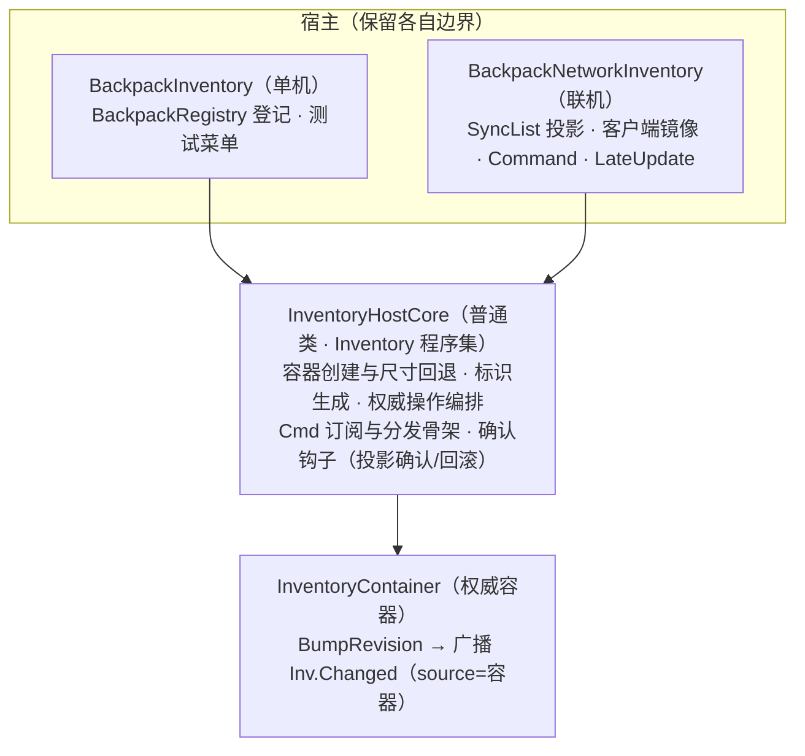

## Product Overview

在不改变现有背包 UI 与网络链路的前提下，为背包容器宿主建立一套共享实现：玩家背包、箱子等单机容器与联机容器宿主，全部复用同一份「容器持有 + 操作意图处理 + 物品编排」逻辑，单机与联网遵循同一个「UI 发操作请求 → 容器宿主自行判定并执行/转发 → 状态回传」的关系模型。

## Core Features

- 共享核心承载：权威容器创建与尺寸回退、标识生成、物品新增/堆叠设置/移除/拆分、操作意图的订阅与分发
- 单机宿主与联机宿主通过组合方式接入共享核心，双方保留各自边界：单机保留本地玩家背包登记与测试菜单；联机保留同步投影、客户端镜像与命令转发
- 权威模型统一：自己为主端则直接判定执行；别人为主端则转发请求，结果一律由状态广播回传
- 现有 UI 的绑定方式（只识别本地玩家背包）与外部接线保持不变

## 一、技术选型

- 沿用现有工程：Unity + C#（`RPG4.Backpack.*` 七程序集）+ Mirror，无新增第三方依赖
- 共享核心放入 `RPG4.Backpack.Inventory` 程序集（已引用 Core/Items，单机 Runtime、联机 Network、UI 均已引用它）——不新增、不修改任何 asmdef，依赖方向零改动
- 采用「普通类组合」而非继承：`BackpackNetworkInventory : NetworkBehaviour : MonoBehaviour` 与 `BackpackInventory : MonoBehaviour` 在 C# 单继承下无法共享 MonoBehaviour 派生父类（已向用户说明并确认）

## 二、实现方式

1. 新建普通类 `InventoryHostCore`（`Scripts/Inventory/InventoryHostCore.cs`，纯 C#、不引 UnityEngine），承载目前单机/联机两份宿主中重复或同构的逻辑：

- 容器创建与尺寸回退（非正或乘积超 65536 → 回退 6×8 并 Warn）
- 标识生成器（单机自建；联机注入 `NetworkManager` 解析器，保留兜底 Warn 语义）
- 权威操作：`TryAddItem`（创建 + 整批收纳）、`TrySetStackCount`、`TryRemoveItem`、`TrySplitStack`（快照恢复新实例 + 行优先找空位 + 失败回滚）
- 三个意图命令（`Cmd.SetStackCount / RemoveItem / SplitStack`）的订阅与分发骨架

2. 接缝用委托注入（宿主不反向依赖）：`IsAuthority`（自己/别人为主端）、`Forward*`（非权威端转发，纯客户端走 Mirror Command）、`CommitConfirm`（权威提交后的确认钩子，联机接 `SyncEntries`，返回 false 时核心回滚并补偿确认；单机为 null）
3. 宿主边界保留：单机保留 `BackpackRegistry` 登记、Inspector 字段、公开 API 签名与四个测试菜单；联机保留 SyncList 投影、`mirror` 镜像、`[Command]`、`isServer/isOwned` 判定、`LateUpdate` 帧末通知、`netId` 日志
4. UI 侧（`BackpackGridUI.ResolveSource/BindInventory`、`BackpackInteractionController`）与事件总线频道定义零改动

### 有意的语义微调（需登记，均为修正性统一）

- 联机权威端「设置堆叠数」由直改 `RuntimeItem` 统一为 `Container.TrySetStackCount`（对齐单机：推进 Revision 并广播，顺带修复主机端 UI 收不到 `Inv.Changed` 的缺口；容器校验已覆盖联机原校验）
- 联机服务端物品查找由「投影优先 + 扫描回退」统一为容器直查（O(n) 线性、零分配，语义等价）
- 错误文案、重复 Warn、尺寸回退日志文案统一（以核心文案为准）

### 性能

- 全部为事件驱动、无每帧新增开销；操作路径零额外分配（沿用复用缓冲与容器既有零 GC 查询），不引入 N+1 或额外遍历

## 三、架构设计



## 四、目录结构（改动清单）

```
Assets/backpack/
├── Scripts/
│   ├── Inventory/
│   │   └── InventoryHostCore.cs          # [NEW] 共享核心（含 .meta，GUID 全量查重）
│   ├── Runtime/
│   │   └── BackpackInventory.cs          # [MODIFY] 组合核心：删重复实现，保留登记/公开 API/测试菜单
│   └── Network/Inventory/
│       └── BackpackNetworkInventory.cs   # [MODIFY] 组合核心：权威操作与命令换核，投影确认/回滚接钩子
└── Docs/核心契约/
    └── S1_单机背包宿主与索引.md            # [MODIFY] 新增共享核心契约节 + 偏差登记
```

## 五、关键代码结构（核心公开面）

```
namespace RPG4.Backpack.Inventory
{
    /// <summary>权威提交后的确认回调（联机 = 投影同步）；返回 false 时核心回滚本次变更，并再执行一次补偿确认（requiredItem 传 None）。</summary>
    public delegate bool CommitConfirmHandler(ItemId requiredItem, out string error);

    /// <summary>背包宿主共享核心：单机与联机宿主各持一份，容器/命令/编排逻辑只在本类实现。</summary>
    public sealed class InventoryHostCore
    {
        public InventoryHostCore(LogModule logModule, string ownerName);                       // 纯客户端：无容器，只承载意图订阅与转发
        public InventoryHostCore(int rows, int columns, LogModule logModule, string ownerName); // 权威端：建容器，尺寸非法回退 6×8

        public InventoryContainer Container { get; }              // 纯客户端为 null
        public ItemManifestCatalog Catalog { get; set; }
        public Func<ItemIdGenerator> IdGeneratorProvider { get; set; } // 联机注入 ResolveGenerator；留空自建
        public Func<bool> IsAuthority { get; set; }               // 自己为主端 = true
        public Action<ItemId, int> ForwardSetStackCount { get; set; }
        public Action<ItemId> ForwardRemoveItem { get; set; }
        public Action<ItemId, int> ForwardSplitStack { get; set; }
        public CommitConfirmHandler CommitConfirm { get; set; }

        public void SubscribeCommands(object sourceKey);          // sourceKey = EventSource（权威=容器；客户端=宿主）
        public void UnsubscribeCommands();
        public bool TryGetItem(ItemId itemId, out RuntimeItem item);
        public bool TryAddItem(ItemManifest manifest, int stackCount, out RuntimeItem item, out string error);
        public bool TrySetStackCount(ItemId itemId, int stackCount, out string error);
        public bool TryRemoveItem(ItemId itemId, out string error);
        public bool TrySplitStack(RuntimeItem source, int splitCount, out ItemId newItemId, out string error);
        public bool TrySplitStack(ItemId itemId, int splitCount, out ItemId newItemId, out string error);
    }
}
```

## Agent Extensions

### SubAgent

- **code-explorer**
- Purpose: 重构前复核 `BackpackInventory` 与 `BackpackNetworkInventory` 的重复实现清单与全工程调用点；重构后核对残留死代码、裸字符串频道键与未迁移的旧路径
- Expected outcome: 影响面清单与 core 成员对照表（无遗漏），改动后无残留引用与重复实现