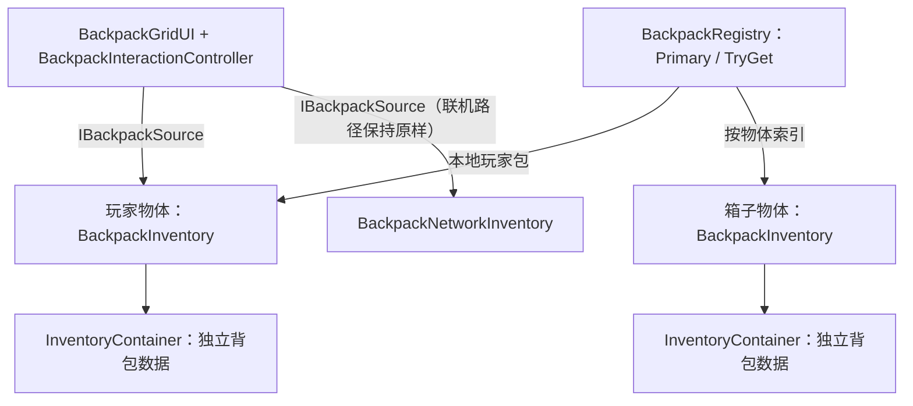

## User Requirements

- 单机环境下（无需联机、无需服务器）为游戏物体提供背包能力：玩家或箱子各自挂接一份独立背包数据，互不影响。
- 提供索引：可从任意物体取到它自己的背包；也可查询「本地玩家的背包」。
- 既有背包界面在单机下可用、表现不变：Tab 开关、格子与物品渲染、悬停反馈、拾起/放下/换位、堆叠三种分支（全部并入/部分填充/数量互换）、右键弹窗拆分、悬停描述。
- 界面操作在单机下直接落到本地背包数据并立即生效：新增、移除、合并堆叠、拆出独立实例（数值原样继承）、修改堆叠数量；失败不产生半改状态。
- 已确认边界：不新增界面视觉；摆放位置仍由界面本地排布（不写入数据）；本轮不做「打开箱子窗口」与跨容器转移；不写单元测试，验收按工程惯例（编译 + 人工 Play 冒烟）。

## Product Overview

为背包工程补齐单机形态：新增可挂载的背包宿主（玩家/箱子通用）与配套索引，并让既有背包界面在无联机场景中直接绑定、打开与操作，视觉与交互表现与联机形态保持一致。

## Core Features

1. 背包宿主：挂到玩家或箱子物体上，各自持有独立背包数据（行列可配）。
2. 索引查询：本地玩家背包的全局入口；任意物体背包的按物体查询。
3. 本地权威操作：增/删/堆叠/拆分/改数量的本地校验与原子提交。
4. 界面单机适配：现有界面与交互直接绑定单机背包；联机形态保持原路径不受影响。
5. 变更通知：背包数据变化后帧末合并通知一次，驱动界面重绘。

## Tech Stack

- 引擎与语言：Unity 2022.3.62f3 LTS + URP 14.0.12，C#；无新增包、无第三方库。
- 程序集：沿用现有 6 个（Core / Items / Inventory / Equipment / UI / Network），新增第 7 个 `RPG4.Backpack.Runtime`。
- 依赖变化：Runtime → Core / Items / Inventory；UI 追加 Runtime 引用；Network 不变（经 Inventory 中的接口实现，不引用 Runtime）。
- Mirror 仅联机路径继续使用，单机路径零依赖。

## Implementation Approach

策略：接口抽象（一份 UI 数据源契约）+ 宿主组件（数据归属）+ 静态索引（查找）+ UI 签名替换（复用既有表现）。

1. `IBackpackSource`（Inventory 程序集）承载界面所需 7 个成员。放 Inventory 的依据：Network 组件实现它无需引用 Runtime，UI 已引用 Inventory，避免新增环与多余依赖。
2. `BackpackInventory`（Runtime 程序集）为宿主：Awake 建 `InventoryContainer(rows, columns)` 与 `ItemIdGenerator`；本地权威 API 直接转发容器（复用其原子性与失败零变更语义）；`Request*` 在本地完成与服务端同构的校验与提交。「自身作为网络端」口径：拆分 = 快照抓取 → 目录取模板 → 新标识恢复实例 → 行优先空白区落位 → 任一步失败整体回滚；不抽共享工具、不改联机代码。
3. `BackpackRegistry`：组件 OnEnable/OnDisable 自动注册/注销；`Primary` / `TryGetPrimary` 指向本地玩家包（重复注册保留先注册者并记 Warn）；`TryGet(owner)` 供箱子等取包；静态状态按工程惯例做 Domain Reload 复位。
4. UI：`BackpackGridUI` 与 `BackpackInteractionController` 的绑定类型改为接口；自动绑定保持联机优先，非联机会话走注册表；配置校验、快照复制、开关事件源、交互分支逻辑全部不动。
5. 变更通知：每帧 O(1) 比较 `Container.Revision` + 组件本地脏标志，帧末合并派发一次 `Changed`（对齐联机组件的 LateUpdate 口径）。

关键决策与理由：

- 接口而非复制 UI：单机/联机共用同一套界面代码；对联机组件仅为类声明加一行，零行为变化。
- 独立 Runtime 程序集：保持 Inventory 纯 C# 数据层口径（M2 契约），宿主组件需要 MonoBehaviour 与 Unity 生命周期。
- 组件自任权威：单机无第二权威，避免引入共享工具的额外回归面。

性能与可靠性：

- 变更检测 O(1)/帧；Id 索引重建 O(n log n) 仅在变更时；单格/单物品查询 O(1)，容量/落点查询 O(R×C×W×H) 与既有容器一致；拆分空白扫描 O(R×C)（与联机同量级）。
- 缓冲复用、无逐帧分配、无 LINQ；仅拒绝路径写日志。

避免技术债：

- 复用容器原子 API、日志链路、事件常量与既有 `.meta` 格式；不动 `Backpack.cs` / `BackpackData.cs` 原型；不改 M6 视觉与交互语义。

## Implementation Notes

- `.meta` 手工生成（工程非 git 仓库）：目录用 `folderAsset: yes` + DefaultImporter、asmdef 用 AssemblyDefinitionImporter、脚本用 MonoImporter、文档照抄同目录文档 meta；GUID 为 32 位十六进制，用全局搜索查重。
- 尺寸校验：rows/columns 非正或 rows × columns 超 65536 时回退默认 6 × 8 并记 Warn（对齐联机组件的回退口径）。
- 拆分前置校验：不可堆叠 / 数量越界（1..当前堆叠数-1）/ 目录缺失或类型不匹配 / 快照抓取失败 / 无空白区域，任一失败即拒绝且记 Warn，不得半改状态。
- 重复 Primary（多个 isLocalPlayerInventory=true）保留先注册者并记 Warn。
- 日志：Runtime 组件统一 `BackpackLog` + `LogModule.Inventory`；仅拒绝路径 Warn，查询不写日志。
- UI 改造后核对 `BackpackInteractionController` 的 `using RPG4.Backpack.Network;` 是否失效（失效才清理）；`BackpackGridUI` 的 Mirror 相关 using 必须保留（联机分支仍用）。
- 联机回归保护：`BackpackNetworkInventory` 仅类声明加接口；UI 保持联机优先分支。

## Architecture Design



- 分层走向：Core → Items → Inventory →（Runtime / Network）→ UI；Runtime 与 Network 互不依赖，二者经 Inventory 的接口与 UI 对接。
- 数据流：界面操作 → `IBackpackSource.Request*` → 单机组件本地权威提交（或联机 Command）→ 容器变更 → 帧末 `Changed` → 界面重绘。

## Directory Structure

```
Assets/backpack/
├─ Scripts/
│  ├─ Runtime.meta                                # [NEW] 新目录 meta（folderAsset: yes）
│  ├─ Runtime/                                    # [NEW] 单机宿主层（第 7 程序集落点）
│  │  ├─ RPG4.Backpack.Runtime.asmdef             # [NEW] references = Core / Items / Inventory；autoReferenced = true
│  │  ├─ RPG4.Backpack.Runtime.asmdef.meta        # [NEW] 照抄 asmdef meta 格式
│  │  ├─ BackpackInventory.cs                     # [NEW] 宿主组件（详见下方实现要求）
│  │  ├─ BackpackInventory.cs.meta                # [NEW]
│  │  ├─ BackpackRegistry.cs                      # [NEW] 静态索引（详见下方实现要求）
│  │  └─ BackpackRegistry.cs.meta                 # [NEW]
│  ├─ Inventory/
│  │  ├─ IBackpackSource.cs                       # [NEW] UI 数据源契约，命名空间 RPG4.Backpack.Inventory
│  │  └─ IBackpackSource.cs.meta                  # [NEW]
│  ├─ Network/Inventory/
│  │  └─ BackpackNetworkInventory.cs              # [MODIFY] 类声明追加 IBackpackSource（唯一改动）
│  └─ UI/
│     ├─ RPG4.Backpack.UI.asmdef                  # [MODIFY] references 追加 RPG4.Backpack.Runtime
│     ├─ BackpackGridUI.cs                        # [MODIFY] 属性/绑定参数改接口；Update 加单机分支；netId 日志泛化；PlayerInput 取法改 (source as Component)
│     └─ BackpackInteractionController.cs         # [MODIFY] 字段与 Bind 改接口；核对后清理失效 using
├─ Docs/
│  ├─ 核心契约/
│  │  ├─ S1_单机背包宿主与索引.md                 # [NEW] 契约、索引语义、偏差登记、手搭清单、验收步骤
│  │  └─ S1_单机背包宿主与索引.md.meta            # [NEW]
│  └─ 工程架构/
│     └─ F1_F2_程序集与目录命名规范.md            # [MODIFY] 新增第 7 程序集行、依赖图、目录树、验收清单 6 → 7、下一步条目
```

关键文件实现要求：

1. `IBackpackSource.cs`：7 个成员（见 Key Code Structures）；纯契约、无实现、不依赖 UI。
2. `BackpackInventory.cs`：序列化 rows = 6 / columns = 8 / isLocalPlayerInventory = true / catalog（可空）；Awake 建容器与标识生成器（非法尺寸回退默认并 Warn）；OnEnable/OnDisable 注册/注销；LateUpdate 检测 `Revision` 与本地脏标志，帧末派发一次 `Changed`；本地权威 API：`TryAddItem(manifest, count, out item, out error)`、`TryAddItem(item, out remainder, out error)`、`TryRemoveItem`、`TryStackItem`、`TryPlaceItem`；意图实现：数量修改（校验 1..单堆上限，直改并置脏）、移除（转发容器）、拆分（自任权威，成功置脏）；内部维护 标识 → 物品 字典（变更时重建，未命中补一次重建再查）。
3. `BackpackRegistry.cs`：`Primary`（可能为 null）、`TryGetPrimary(out)`、`TryGet(GameObject owner, out)`（组件直取优先，注册表兜底）；`Register/Unregister` 由组件自动调用；`[RuntimeInitializeOnLoadMethod(SubsystemRegistration)]` 复位静态状态。
4. `BackpackGridUI.cs`：`Inventory` 属性与 `BindInventory` 参数改 `IBackpackSource`；`Update` 分支：联机本地玩家非空 → 原路径；非联机会话（`NetworkClient.active` 与 `NetworkServer.active` 同为 false）→ `BackpackRegistry.TryGetPrimary`；其余（联机等待本地玩家）维持绑定 null；绑定日志去掉 netId 改为类型名；`playerInput` 取法改为 `(source as Component)?.GetComponent<PlayerInput>()`。
5. `BackpackInteractionController.cs`：`inventory` 字段与 `Bind` 参数改 `IBackpackSource`，其余逻辑与事件源保持不变。

## Key Code Structures

```
public interface IBackpackSource
{
    int ConfiguredColumns { get; }
    int ConfiguredRows { get; }
    event Action Changed;
    void CopyItems(List&lt;RuntimeItem&gt; destination);
    bool TryGetItem(ItemId itemId, out RuntimeItem item);
    void RequestSetStackCount(ItemId itemId, int stackCount);
    void RequestRemoveItem(ItemId itemId);
    void RequestSplitStack(ItemId itemId, int splitCount);
}
```

## Agent Extensions

### SubAgent

- **code-explorer**
- Purpose: 收尾验收阶段做全工程复核（medium 强度）：接口改造后是否仍存在遗漏的旧类型调用点（`BindInventory` / `Inventory` 属性 / `Request*` 源）、新增 6 个 `.meta` 的 GUID 是否与现有资产冲突、程序集 `references` 是否悬空。
- Expected outcome: 输出「无遗漏与无冲突」结论或精确的遗漏/冲突清单；若发现问题则回到对应任务修正后复跑。