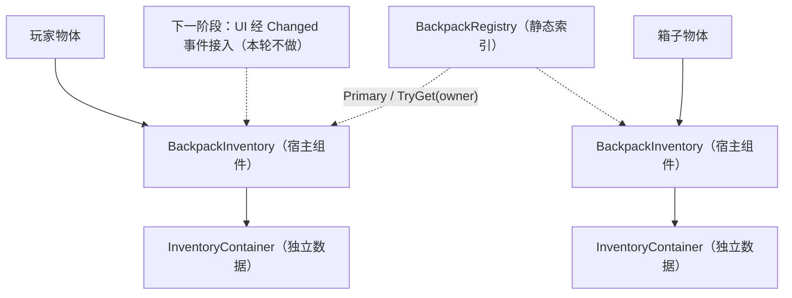

## Product Overview

为单机形态补齐背包数据能力：玩家或箱子等物体各自挂接一份独立背包数据，可被按物体或全局查找到；组件自身充当权威端，在本地完成放入、移除、并堆叠、拆分、改数量等操作，校验失败不留任何半改状态；数据变化后发出通知，为后续界面接入预留入口。本轮只做数据层，不涉及界面与联机改动。

## Core Features

- **背包宿主**：挂到玩家或箱子物体上，各自持有一份独立背包数据，行列可配置（默认 6×8）
- **索引查询**：全局入口查「本地玩家背包」；按任意物体查它自己的背包
- **本地权威操作**：放入（自动并堆叠 + 落首个空白区）、移除、并堆叠、拆分出新实例、修改堆叠数量，全部校验通过才提交
- **变更通知**：数据变化后帧末合并通知一次，供后续界面重绘
- **落地与文档**：新增宿主层与索引文件、契约文档，并更新工程架构文档

## Tech Stack

- Unity 2022.3.62f3 LTS + C#；无新增包与第三方库；Mirror 零依赖（本轮不涉及网络）
- 程序集：新增第 7 个 `RPG4.Backpack.Runtime`（references = `RPG4.Backpack.Core` / `RPG4.Backpack.Items` / `RPG4.Backpack.Inventory`，`autoReferenced: true`）
- 复用：`InventoryContainer` 原子 API、`ItemManifest` / `ItemManifestCatalog` / `ItemIdGenerator` / `RuntimeItemSnapshotCodec`、`BackpackLog`

## Implementation Approach

策略：宿主组件持容器 + 静态索引 + 组件自任权威；复用语义，不发明新机制。

1. **BackpackInventory（宿主组件）**：`Awake` 建 `InventoryContainer(rows, columns)` 与 `ItemIdGenerator`；本地 API 直接转发容器（复用其「失败零变更」原子语义）；拆分自任权威，流程对齐联机服务端纯逻辑（快照抓取 → 目录取模板 → 新标识恢复实例 → 行优先空白落位 → 任一步失败整体回滚），不抽共享工具、不改联机代码。
2. **BackpackRegistry（索引）**：组件 `OnEnable/OnDisable` 自动注册/注销；`Primary` 指向「本地玩家背包」（重复注册保留先注册者并 Warn，`SetPrimary` 可显式覆盖）；`TryGet(owner)` 供箱子等按物体取包；静态状态按 `EventBus` 同款口径做 Domain Reload 复位。
3. **变更通知**：`LateUpdate` 比较 `Container.Revision` 与内部脏标志，帧末合并派发一次 `Changed`（与联机组件口径一致；直改 `StackCount` 不推 `Revision`，靠脏标志兜底）。
4. **尺寸容错**：rows/columns 非正或乘积超 65536 → 回退默认 6×8 并记 Warn（对齐联机组件回退口径）。
5. **UI 接入延后**：本轮零 UI 改动；组件对外用数据层语义 `Try*`，`IBackpackSource` 接口与 UI 改绑登记为下一阶段待办。

性能与可靠性：变更检测 O(1)/帧；标识索引仅变更时重建（O(n)，复用缓冲）；拆分落点扫描最坏 O(R×C)；查询转发容器既有复杂度（单格 O(1)、落点 O(W×H)、容量最坏 O(R×C×W×H)）；无逐帧分配、无 LINQ；仅拒绝路径写 Warn 日志。

避免技术债：不动 `Backpack.cs` / `BackpackData.cs` 原型；不动 UI / Network / Inventory 既有代码（本轮唯一既有文件修改为 `F1_F2` 文档）；不写单测（工程「零单测」口径，C# 审计走编译 + 人工核对，Open Code Review 不覆盖 C#）。

## Implementation Notes

- `.meta` 手工生成（工程非 git 仓库）：目录用 `folderAsset: yes` + DefaultImporter、asmdef 用 AssemblyDefinitionImporter、脚本用 MonoImporter、文档照抄同目录文档 meta 格式；GUID 为 32 位十六进制且全局唯一，落盘后全工程搜索查重。
- 命名与注释：英文标识符 + 简洁中文注释（工程与用户约定）；私有序列化字段 camelCase 无下划线；布尔用 is 打头。
- 拆分前置校验：不可堆叠 / 数量越界（1..当前堆叠数-1）/ 目录缺失或类型不匹配 / 快照抓取失败 / 无空白区域，任一失败即拒绝并记 Warn，不得半改状态。
- 日志统一 `BackpackLog` + `LogModule.Inventory`；查询路径静默，仅拒绝路径 Warn。
- 联机回归保护：本轮不触碰 `BackpackNetworkInventory`、`BackpackGridUI`、`BackpackInteractionController` 与 UI asmdef。

## Architecture Design



- 分层走向：Core → Items → Inventory → Runtime；Runtime 不引用 UI / Network / Equipment
- 数据流：调用方 → BackpackInventory 本地权威校验 → 容器原子提交（Revision +1）→ 帧末 Changed 通知

## Directory Structure

```
Assets/backpack/
├─ Scripts/
│  ├─ Runtime.meta                                  # [NEW] 新目录 meta（folderAsset: yes；手工生成）
│  └─ Runtime/                                      # [NEW] 单机宿主层（第 7 程序集落点）
│     ├─ RPG4.Backpack.Runtime.asmdef               # [NEW] references = Core / Items / Inventory；rootNamespace 同名；autoReferenced = true；禁止写入未用引用
│     ├─ RPG4.Backpack.Runtime.asmdef.meta          # [NEW] 照抄现有 asmdef 的 meta 格式
│     ├─ BackpackInventory.cs                       # [NEW] 宿主组件（sealed MonoBehaviour）：序列化 rows=6 / columns=8 / isLocalPlayerInventory=true / catalog；Awake 建容器与标识生成器（非法尺寸回退并 Warn）；OnEnable/OnDisable 注册/注销；查询面（Container / ConfiguredRows / ConfiguredColumns / ItemCount / Items / Revision / TryGetItem / CopyItems）+ Changed 事件（帧末合并）；本地权威 API：TryAddItem(manifest,…) / TryAddItem(item,…) / TryRemoveItem×2 / TryStackItem / TryPlaceItem / TrySetStackCount / TrySplitStack（快照→模板恢复→空白落位→失败回滚）；仅拒绝路径 Warn；英文标识符 + 中文注释
│     ├─ BackpackInventory.cs.meta                  # [NEW] MonoImporter；GUID 唯一
│     ├─ BackpackRegistry.cs                        # [NEW] 静态索引：Primary（先注册者胜、重复 Warn）/ TryGetPrimary / TryGet(owner)（组件直取优先 + 注册表兜底）/ SetPrimary 显式覆盖 / internal Register、Unregister / SubsystemRegistration 复位静态状态
│     └─ BackpackRegistry.cs.meta                   # [NEW] MonoImporter；GUID 唯一
├─ Docs/
│  ├─ 核心契约/
│  │  ├─ S1_单机背包宿主与索引.md                   # [NEW] 契约（组件 API、索引语义、尺寸回退、拆分流程与边界）、偏差登记（组件自任权威、Changed 事件、UI 延后）、手搭清单、冒烟步骤、「UI 接入待办」节
│  │  └─ S1_单机背包宿主与索引.md.meta              # [NEW] 照抄同目录文档 meta 格式
│  └─ 工程架构/
│     └─ F1_F2_程序集与目录命名规范.md              # [MODIFY] §1.1 新增 Runtime 程序集行；§1.3 依赖图更新（Core→Items→Inventory→Runtime，标注 UI 后续阶段引用）；§2 目录树新增 Scripts/Runtime；§4 验收清单 6 → 7；§5 下一步追加 S1 条目（含 UI 延后说明）
```

## Key Code Structures

```
// Scripts/Runtime/BackpackInventory.cs（数据层宿主；UI 接入延后）
[DisallowMultipleComponent]
[AddComponentMenu("RPG4/Backpack Inventory")]
public sealed class BackpackInventory : MonoBehaviour
{
    public InventoryContainer Container { get; }              // Awake 创建
    public int ConfiguredRows { get; }
    public int ConfiguredColumns { get; }
    public int ItemCount { get; }
    public int Revision { get; }                              // 透传容器版本号
    public IReadOnlyCollection&lt;RuntimeItem&gt; Items { get; }
    public event Action Changed;                              // 帧末合并派发

    public bool TryGetItem(ItemId itemId, out RuntimeItem item);
    public void CopyItems(List&lt;RuntimeItem&gt; destination);      // ItemId 升序确定性输出

    public bool TryAddItem(ItemManifest manifest, int stackCount, out RuntimeItem item, out string error);
    public bool TryAddItem(RuntimeItem item, out int remainder, out string error);
    public bool TryRemoveItem(RuntimeItem item, out string error);
    public bool TryRemoveItem(ItemId itemId, out string error);
    public bool TryStackItem(RuntimeItem target, RuntimeItem incoming, out int movedCount, out string error);
    public bool TryPlaceItem(RuntimeItem item, int startIndex, out string error);
    public bool TrySetStackCount(ItemId itemId, int stackCount, out string error);
    public bool TrySplitStack(ItemId itemId, int splitCount, out ItemId newItemId, out string error);
}

// Scripts/Runtime/BackpackRegistry.cs
public static class BackpackRegistry
{
    public static BackpackInventory Primary { get; }          // 可能为 null
    public static bool TryGetPrimary(out BackpackInventory backpack);
    public static bool TryGet(GameObject owner, out BackpackInventory backpack);
    public static void SetPrimary(BackpackInventory backpack); // 显式覆盖（重复注册时 Warn）
}
```

## Agent Extensions

### SubAgent

- **code-explorer**
- Purpose: 收尾验收阶段做全工程复核（medium 强度）：新增 6 个 `.meta` 的 GUID 是否与现有资产冲突、7 个 asmdef 的 references 是否悬空、是否误改 UI / Network / Inventory 既有文件、组件调用面是否完整（`Try*` 与注册表接线）。
- Expected outcome: 输出「无冲突无遗漏」结论或精确问题清单；若发现问题回到对应任务修正后复跑。

### Skill

- **ADHD友好输出**
- Purpose: 落盘 `S1_单机背包宿主与索引.md` 与最终交付说明时遵循「行动先行、编号步骤、列表≤5 项、无开场白/结束语」，让验收步骤可直接执行。
- Expected outcome: 文档简洁可执行，冒烟与验收步骤全部编号化，无冗余铺陈。
- **Context Mode**
- Purpose: 控制 S1 文档与工程说明的信息密度，只保留契约、边界、验收三块有效内容，避免大段背景堆砌。
- Expected outcome: 文档精简且完整，阅读一次即可完成手搭与冒烟验证。