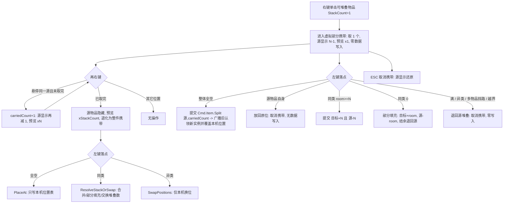

## 需求还原

在 RPG_4 背包（`e:/ue/RPG_4/Assets/backpack`）中新增「右键拆分」交互：

- 右键单击一个**可堆叠且堆叠数 > 1**的悬停物品 → 拆出 **1 个**到鼠标上跟随光标携带。
- **可对同一源物品连续右键累加**：每次 +1（1 → 2 → …），直到该堆叠被**全部取完**。
- 携带中再次右键：鼠标**仍在该源堆叠上** → 再取 1 个；鼠标在**其它位置 / 网格外** → **无操作**（取消携带只按 ESC）。
- 鼠标上携带的数量，左键点到**同类可堆叠**目标时与之合并。
- 合并后的**剩余**：目标装得下就全并入；装不满则按现有 `PartialFill` 口径部分填充、结余退回原源堆叠；目标已满 / 落到异类或挡路 → 这 N 个**退回原源堆叠**（等同取消携带）。
- 取完全部（源剩 0）→ 源物品从网格消失，携带态**退化为现有「整件携带」**口径。
- 现有的右键数量弹窗（−/+ 与拆分 / 丢弃 / 消耗）**本期先删除**。

## 核心功能

1. **右键取 1 个并可累加**：进入「部分携带」态；源物品仍留在原格，其显示数量为 `StackCount − 已取数量`（如 10 → 9 → 8 …），鼠标预览显示「×N」；全程**不写任何库存数据**。
2. **累加到取完**：已取数量 == `StackCount` 时，源物品从网格**隐藏**（与整件携带同形），预览显示「×StackCount」；ESC 取消即原样恢复。
3. **左键落到空格**：把这 N 个单位落到玩家所点格；源堆叠减 N。
4. **左键落到同类堆叠**：`room ≥ N` → 全部并入（目标 +N、源 −N）；`0 < room < N` → 部分填充（目标 +room、源 −room，结余退回源）；`room == 0` → 退回源堆叠并取消携带。
5. **携带中右键 / ESC**：右键只对**当前源堆叠**生效（再取 1 个），其它位置无操作；取消统一按 ESC，源显示数量还原。
6. **右键弹窗下线**：右键不再弹出面板，弹窗的丢弃 / 消耗入口一并消失（数据层 `Cmd.Item.Drop` / `Consume` 频道保留，留给 M8）。

## 技术栈与约束

- 沿用现有 Unity C# + Mirror + 自研 `EventBus` 事件管线（`InvChannels` / `CmdChannels` / `UiChannels`），不引入新框架、不改数据层协议。
- 命名约定：C# 标识符（字段 / 属性 / 参数 / 方法 / 局部变量）英文，注释简洁中文；`.asset` 名称与 `m_Name` 中文；`.meta` 手工生成并全量查重。
- 权威模型不变：UI 只发意图、主端判定；**例外**是「本地位置表 / 显示状态」属纯本机状态（修正项 B），可以直接改。

## 实现策略

采用「**本地虚拟部分携带 + 累加 + 落下时才提交**」：

1. **右键（首次）**：只在本机进入部分携带态，把源物品的**显示数量**覆盖为 `StackCount − 1`，预览层显示「×1」。库存数据不动 → 无延迟、无闪位。
2. **右键（携带中）**：`hoveredItemId == carried.ItemId && carriedCount < carried.StackCount` → `carriedCount++` 并刷新显示覆盖与预览数量；累加到等于 `StackCount` 时改用「隐藏源物品」；其余情况只记 Debug 日志，不改状态。
3. **左键落下**按「是否已取完全部」分两套：

**A. 部分携带（`carriedCount < carried.StackCount`）**

- 落点全空 → 提交一次 `Cmd.Item.Split`（源, `carriedCount`）让服务端生成新实例，再在广播回传时**认领**新实例并把本机位置表覆盖到玩家点击的那一格（位置不上网）。
- 落点是携带物自身（源物品占格）→ 视为放回原位，取消携带。
- 落点是同类可堆叠：`room ≥ carriedCount` → 全部并入；`0 < room < carriedCount` → 部分填充（目标 +room、源 −room）；`room == 0` → 退回源堆叠、取消携带。
- 异类占用、多物品挡路、越界 → 退回源堆叠：记日志 + 取消携带，零数据写入。

**B. 已取完全部（`carriedCount == carried.StackCount`）**

- 复用现有整件携带分支，零新逻辑：落空地 = `PlaceAt`（只写本机位置表，无网络请求）；落同类 = `ResolveStackOrSwap`（`MergeInto` / `PartialFill` / `SwapStackCounts`）；异类 = `SwapPositions`。

4. **显示覆盖自愈**（关键设计）：覆盖记的是「期望显示数量」，`Refresh` 时若真实 `StackCount ≤ 覆盖值`（说明主端已生效）就自动丢弃覆盖，改用真值。这样主机端与纯客户端都**不会闪帧**；只有「未提交的取消 / 放回」需要显式清除覆盖。
5. **认领机制**：落空格前记录「源标识 + 拆分数量 + 拆分前已知标识集合 + 期望落点格」，`Inv.Changed` 回调里 diff 出「同类型、数量 == 拆分数量、且此前不存在」的新标识 → 写位置表 → 结束携带；超时（如 0.5s）未出现则记 Warn 并结束携带（物品仍在服务端落点）。已知代价：新实例会先在服务端算出的空格出现一帧/一个往返再跳到点击格。

## 技术方案要点

- **视图层新增契约**（`BackpackGridUI`，供交互层与后续里程碑复用，interface 级）：
- `void SetStackDisplay(ItemId id, int displayStack)` / `void ClearStackDisplay(ItemId id)` / `void ClearAllStackDisplays()`
- `void CopyItemIds(List<ItemId> destination)`（用于认领拆分结果时的标识 diff）
- `bool TryShowCarriedPreview(RuntimeItem item, int displayStack)`（预览与源物品同 `ItemId`，数量必须走参数，不能用按 `ItemId` 的覆盖表）
- **交互层新增状态**：`carriedCount`（虚拟携带数量，1 .. `carried.StackCount`）、`carriedIsPartial`（= `carriedCount < carried.StackCount`，派生而非独立字段）、`previewStack`（预览数量缓存，累加时数量变化也要重刷预览）、`pendingSplitSourceId` / `pendingSplitCount` / `pendingSplitTargetCell` / `pendingSplitKnownIds` / `pendingSplitSince`；整件携带（左键拾起、`carriedCount == StackCount`）分支保持现有语义不变，两套语义在同一 `carried` 引用上以 `carriedIsPartial` 区分。
- **累加到取完的形态切换**：`carriedCount < StackCount` 时源物品**可见**（显示覆盖 = `StackCount − carriedCount`）；等于时改为 `grid.SetHiddenItem`，与整件携带的隐藏机制一致，ESC 取消走既有 `ClearHiddenItem`。
- **悬停高亮**：部分携带时落点区域着色口径与整件携带一致（空=绿、同类可放=黄、挡路/越界=红）；「落点是源物品自己」由现有 `ReferenceEquals(space.ValidItem, carried)` 分支改成「可放回」语义。
- **右键入口重写**：`HandleSecondaryClick` 由「携带中取消 / 否则开弹窗」改为「携带中 → 悬停源且未取完则累加，否则无操作；未携带 → `IsStackable && StackCount > 1` 则开始部分携带，否则记 Debug」。整件携带（左键拾起）的右键取消行为保持现状（M6 验收第 8 条不受影响）。
- **弹窗下线范围**（已全库扫清）：`BackpackInteractionController` 的 `popup` 字段、`PopupDismissDelay`、`popupLeftSince` / `popupEngaged`、`UpdatePopupLifetime`、`IsPointerOverPanel` 的 popup 分支、`HandlePrimaryClick` / `HandleSecondaryClick` / `HandleCancel` / `BeginCarry` / `ResetSession` 内 popup 调用；并把 `RequestSplit` / `RequestDrop` / `RequestConsume`（届时无调用者）删除，保留 `PublishSplitStack`。
- **不动的东西**：`BackpackItemPopupView.cs` 与 `.meta` 保留（避免丢失沿用蓝本的 GUID `533d8d83…` 与场景已挂节点），只断接线；`EventChannels.cs` 的 `Ui.Popup.Split` 死键保持原样；`InventoryHostCore.TrySplitStack` 与拆分协议不改。

## 性能与可靠性

- 右键与累加**不产生网络请求**；每次「合并」只发 2 条 `Cmd`，每次「落空格」只发 1 条 `Cmd`，均是低频用户操作，无每帧分配。
- 认领靠 `Inv.Changed` 置脏 + 帧末一次 `Refresh`，不引入逐帧遍历；标识 diff 只在有待认领拆分时执行，集合规模为背包物品数（可忽略）。
- 显示覆盖表随 `Refresh` 的 `itemsById` 同步清理，避免失效标识长期挂留；`Unbind` / `ResetSession` 兜底清空。
- 失败路径全部走既有 `BackpackLog`（`LogModule.Interaction` / `UI`）的 Warn/Debug，不抛异常、不新增无人读的诊断字段。

## 边界与假设

- 右键开始部分携带要求 `IsStackable && StackCount > 1`，否则记 Debug 忽略（不再有弹窗）。
- 累加条件：鼠标悬停的就是当前源物品且 `carriedCount < StackCount`；其它位置右键**无操作**，取消只按 ESC（这是对 M6 既有「右键取消携带」习惯的**有意变更**，仅作用于右键拆分的部分携带态）。
- 整件携带（左键拾起）保持现有行为不变，包括「右键取消携带」。
- 拆分结果只由服务端决定落点，本机仅覆盖位置；容器无空白区域时拆分失败 → 认领超时 → 记 Warn 并结束携带。
- 弹窗文件不物理删除；若需要物理删除（含 `.meta` 与场景节点）由用户另行确认。

## Agent Extensions

### Skill

- **lsp-code-analysis**
- Purpose: 在删除右键弹窗接线与新 API 落地前后做语义级影响分析（find references / call hierarchy），确认 `BackpackItemPopupView`、`RequestSplit`、`RequestDrop`、`RequestConsume` 已无任何调用者，且新的 `BackpackGridUI` 契约调用点正确。
- Expected outcome: 删除范围内的零残留引用证明 + 新 API 的调用点清单，避免出现悬空引用或漏删死代码。

### 说明

- 本项目的 Unity C# 不走 Open Code Review（该 skill 不覆盖 C#），改动完成后按项目既有口径走人工审计与 `read_lints` 检查。