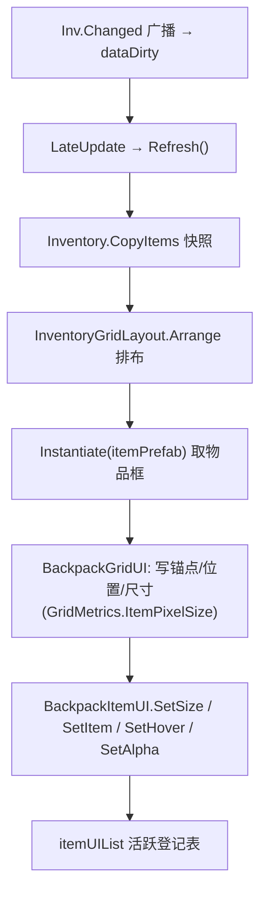

## 需求概述

把背包里「物品如何显示」的实现，从当前由脚本运行时动态拼装 UI，改为使用 `itemPrefab`（预制体 `背包/Prefabs/物品ui.prefab`，根节点挂物品 UI 组件）来生成与填充物品框。背包主控 `BackpackGridUI` 保留自己的网格度量，把算好的物品像素尺寸交给该组件，由它负责图标、数量与背景反馈。

同时按用户要求**把 `背包物品UI` 全套中文标识符改为英文**（类名 `BackpackItemUI`、字段 `backgroundImage` / `iconImage` / `stackText`、方法 `SetSize` / `SetItem` / `SetHover` / `SetAlpha`），且**不迁就 prefab 现存引用**——改名丢掉的序列化引用由本次直接改写 `物品ui.prefab` 的 YAML 一次性补齐。

## 核心功能

- 物品框改为实例化 `itemPrefab`；`itemPrefab` 为空时报一条警告并不显示物品（界面不崩）。
- `itemUIList` 作为「活跃登记表」：运行时记录当前正在显示的物品 UI，供外部查询/调试；实例仍按需创建与销毁，不做对象池复用；列表由代码独占维护（场景里不要预拖实例）。
- 尺寸口径统一：删除原 `设置物品图标` 里硬编码的 90，改由主控按格边长与间距算好的像素尺寸（含多格物品）传入；多格物品尺寸与位置与网格严格对齐。
- 图标：`ImageFragment.Icon` 有则显示并按宽高比内嵌缩放；无图标则**留空**，不再回落显示物品类型名。
- 数量：仅显示数量大于 1 的物品，文本格式只在 `BackpackItemUI` 一处定义，主控不再自己拼文本。
- 悬停反馈：`BackpackItemUI` 新增 `backgroundImage` 字段（prefab 里接线到根节点底图），悬停换色并保留 prefab 原有配色，取消悬停时还原为 prefab 初始色。
- 携带预览（跟随光标的半透明物品）同样改用 `itemPrefab`，保持半透明且不接收指针事件。

## 视觉预期

- 背包打开后，格子里的物品外观完全由 `物品ui.prefab` 决定（蓝色圆角底图 + 居中图标 + 右下角数量）。
- 多格物品的尺寸随格子边长与间距等比放大，边距与格子对齐；悬停时物品框底色变为高亮色，移开后恢复。
- 携带中的物品显示为半透明同款物品框，吸附在光标处；被携带期间原格位仍被占用，不产生物品回流抖动。

## 技术栈

沿用现有工程，不引入新依赖：

- Unity（UGUI + TextMeshPro），C#，Mirror 网络库
- 程序集：`Assets/backpack/Scripts/UI/RPG4.Backpack.UI.asmdef`（`BackpackItemUI` 与 `BackpackGridUI` 同程序集，无需改 asmdef）
- 命名空间：`RPG4.Backpack.UI`
- 运行时框架：`MonoBehaviour` + 手动图层管理（`itemLayer` / `cursorLayer`），无第三方 UI 框架

## 实现方案

核心策略：**视图生成方式替换，视图契约外移，玩法与交互层零改动**。

1. `背包物品UI` 重命名并全面英文化为 `BackpackItemUI`：从「自带尺寸算法的小组件」升级为「物品框视图的唯一契约」，保留图标等比内嵌算法，新增像素尺寸、图标/数量、悬停底色、透明度四类入口，并补齐空引用保护。删除硬编码 90，尺寸公式回到 `BackpackGridUI.GridMetrics` 一处定义（沿用项目既有「同一公式只有一处定义」的约定）。
2. `BackpackGridUI` 的 `ItemWidget` 由「持有一组自己拼出来的子节点引用」改为「持有 `BackpackItemUI` + 根节点 + 惰性 CanvasGroup」，`CreateWidget` 由 `new GameObject` 改为 `Instantiate(itemPrefab, layer)`，`ApplyWidget` / `ApplyWidgetHover` / `SetWidgetAlpha` 改为转调 `BackpackItemUI` 的接口。
3. `itemUIList` 采用活跃登记表语义：创建时登记、销毁/回收时移除，并在解绑与销毁时清空；对外暴露只读视图供调试查询，并说明该列表由代码独占维护。

关键取舍与理由：

- **尺寸由主控算、组件只应用**：避免 `cellSize` / `slotSpacing` 出现在两个地方（当前 prefab 内的 90 与场景的 100+10 已经漂移），且 `GridMetrics.ItemPixelSize` 已处理多格物品的间距累加，直接复用可保证尺寸与落点同源。
- **无图标置空而非回落文字**：`itemPrefab` 里只有一个数量文本、没有名称文本；强行回落需要改 prefab 结构增加文本节点，收益低。
- **悬停色保留 prefab 配色**：`backgroundImage` 指向根节点底图，`Awake` 缓存初始色作为常态色，悬停切 `BackpackFeedbackPalette.ItemFrameHovered`，取消悬停还原缓存色，避免脚本把 prefab 的自定义蓝底覆盖成固定色。
- **不做对象池**：当前每次重绘只在物品增删时创建/销毁框（`LateUpdate` 脏标记合并、非逐帧），对象池带来的状态管理成本大于收益。
- **携带预览复用同一 prefab**：保证预览与网格内物品外观一致。

性能与可靠性：

- 物品框创建/销毁仍只在库存变化或网格重建时发生，复杂度与现状同阶（O(物品数)），无新增逐帧开销。
- 活跃登记表使用 `List` 线性增删，物品规模在小数量级，无热点；每次重绘后做一次失效项清理，避免 Unity 伪空引用长期挂留。
- 实例化后立即写入 `anchorMin/anchorMax/pivot = (0, 1)`，防止 prefab 的居中锚点导致半格偏移；`layer` 沿用 prefab 的 5。
- 所有可空引用（`itemPrefab`、`backgroundImage`、`iconImage`、`stackText`、`Sprite`）都做保护，缺失只记一条警告、不刷屏、不崩。

## 命名与代码风格

- 类名 `背包物品UI` → `BackpackItemUI`，文件 `背包物品UI.cs` → `BackpackItemUI.cs`，`.meta` 一并改名且**保留原 guid `d1cd5627c5a799a4480c7f3aac5f5b26`**（`物品ui.prefab` 的 `m_Script` 引用依赖 guid，因此 prefab 挂载不会丢）。
- 序列化字段：`物品数量` → `stackText`、`物品图标` → `iconImage`、新增 `物品背景` → `backgroundImage`。字段改名会丢 prefab 上的已有序列化引用，**本次不接受该损失**：直接改写 `物品ui.prefab` 的 YAML 用新键名重新接线（原 `物品图标` 本就丢失或错接的问题一并解决）。
- 方法：`设置物品数量` / `设置物品图标` → `SetSize` / `SetItem` / `SetHover` / `SetAlpha`，注释保持简洁中文。
- 与项目通用偏好（英文标识符 + 中文注释）一致，无额外例外需要记录。

## 实现要点（防回归）

- **prefab 现状必须先修**：`物品ui.prefab` 里原 `物品数量` 是 `{fileID: 0}`（未接线），数量接口会 NRE；本次连同改名一起在 YAML 中补齐 `stackText` / `backgroundImage` / `iconImage` 三个引用。
- **场景未接线**：`backpack/Scenes/New Scene.unity` 中 `BackpackGridUI` 尚无 `itemPrefab` / `itemUIList` 序列化值，需要在 Unity 里把 `物品ui.prefab` 拖到 `itemPrefab`，并保存场景；`itemUIList` 保持为空。
- **回调/引用不扩展**：`BackpackInteractionController` 只使用 `grid.SetItemHovered` / `TryGetPlacement` / `TryGetItem` 等公开 API，不触碰 `ItemWidget`，本次替换不得改动其调用契约。
- **删除死代码**：`CreateRect` / `CreateText` 若无其它调用点需一并删除；除格子 / HUD 文本外的拼装逻辑全部移除。
- **文本字体口径变化**：物品框文本改由 prefab 自带 TMP 字体渲染，`BackpackGridUI.uiFont` 不再作用于物品框（仅继续作用于脚本新建的格子/HUD 文本）。
- **日志**：延用 `BackpackLog.Warn(LogModule.UI, ...)`，仅在 `itemPrefab` 缺失、`backgroundImage` 缺失等状态翻转时打一条，避免逐帧刷屏。
- **影响面控制**：不改数据层、不改输入层、不改交互层判定逻辑、不改网络复制；改动集中在 2 个脚本（含 1 次改名）+ 1 个 prefab（+ 场景接线）。

## 架构与数据流



## 目录结构

```
Assets/backpack/
├── Prefabs/
│   └── 物品ui.prefab                       # [MODIFY] 根节点挂 BackpackItemUI（itemPrefab 目标）
├── Scenes/
│   └── New Scene.unity                     # [MODIFY] BackpackGridUI.itemPrefab 接线（需在 Unity 内保存）
├── Docs/核心契约/
│   └── BackpackItemUI接入itemPrefab.md     # [NEW] 变更文档
└── Scripts/UI/
    ├── BackpackItemUI.cs                   # [RENAME+MODIFY] 原 背包物品UI.cs，升级为物品框视图契约
    ├── BackpackItemUI.cs.meta               # [RENAME] guid 保持不变
    └── BackpackGridUI.cs                    # [MODIFY] 改为实例化 itemPrefab + 活跃登记
```

### 文件级实现要求

**`Assets/backpack/Scripts/UI/BackpackItemUI.cs`（重命名 + 修改）**

- 目的：成为物品框对外唯一视图契约，承担尺寸、图标、数量、悬停底色、透明度。
- 内容：
- 字段：`backgroundImage`(Image，新增，prefab 接线到根节点底图)、`iconImage`(Image)、`stackText`(TMP_Text)。
- `Awake` 缓存 `rectTransform` 与 `backgroundImage` 的初始颜色作为常态色（缺失则跳过换色）。
- 方法：`SetSize(Vector2)`、`SetItem(Sprite, int)`、`SetHover(bool)`、`SetAlpha(float)`。
- 图标等比内嵌算法移入 `SetItem`，以 `SetSize` 传入的像素尺寸作为可用区域；`Sprite` 为空时隐藏 `iconImage` 并留空。
- 数量文本：数量 ≤ 1 显示空串；否则显示统一前缀（主控不再自己拼数量文本）；`stackText` 未接线时跳过而不报错。
- 透明度：按需 `AddComponent<CanvasGroup>` 并固定 `interactable = false` / `blocksRaycasts = false`。
- 空引用一律跳过并只告警一次。

**`Assets/backpack/Scripts/UI/BackpackGridUI.cs`（修改）**

- 目的：物品框的创建/定位/回收改为使用 prefab，并维护活跃登记表。
- 内容：
- 序列化字段：`itemPrefab` 注释更新为「需挂 BackpackItemUI 的物品框预制体」；`itemUIList` 类型改为 `List<BackpackItemUI>`，注释更新为「运行时活跃的物品 UI 登记表（代码独占维护，勿在场景中预拖）」。
- 私有类 `ItemWidget` 收敛为：`root`(GameObject)、`view`(BackpackItemUI)、`group`(CanvasGroup，惰性)。
- `CreateWidget(RectTransform parent)`：`Instantiate(itemPrefab, parent)`，强制 `anchorMin = anchorMax = pivot = (0, 1)`，`layer = 5`，取 `BackpackItemUI` 组件；缺失组件或 `itemPrefab` 为空时记一条警告并返回空（调用方跳过渲染）。
- `Refresh()`：物品框创建/回收处同步登记与注销 `itemUIList`；放置仍用 `GridMetrics.CellToPixel` 与 `ItemPixelSize`，尺寸通过 `SetSize` 传入；隐藏携带中物品仍用 `SetActive(false)`。
- `ApplyWidget` → 转调 `SetItem(图标, 显示数量)`；`ApplyWidgetHover` → 转调 `SetHover(bool)`；`SetWidgetAlpha` → 转调 `SetAlpha`（`group` 缓存保留）。
- 携带预览：`TryShowCarriedPreview` / `SetCarriedPreviewCellPosition` / `TrySetCarriedPreviewScreenPosition` / `HideCarriedPreview` 复用同一 `CreateWidget`（父级为 `cursorLayer`）与半透明设置，不再有第二套拼装代码。
- `Unbind()` / `OnDestroy()`：清空 `itemUIList`。
- 删除类型名回落与 `Content` / `Icon` / `Stack` 的手工拼装，以及随后无调用点的 `CreateRect` / `CreateText`。

**`Assets/backpack/Prefabs/物品ui.prefab`（修改）**

- 目的：按新字段名重接线，补全缺失引用。
- 内容：`BackpackItemUI.iconImage` 指向子节点 `Image` 的 Image 组件（fileID 4560813680279190635）；`BackpackItemUI.stackText` 指向子节点 `Text (TMP)` 的 TMP 组件（fileID 8259297500555138283）；新增 `BackpackItemUI.backgroundImage` 指向根节点的 Image 组件（fileID 8928634845197331061）；根节点 Image 保留现有蓝色与 Sliced 设置（悬停常态色取自它）；`m_Script` guid 保持 `d1cd5627c5a799a4480c7f3aac5f5b26` 不变。

**`Assets/backpack/Scenes/New Scene.unity`（修改，需在 Unity 内操作）**

- 目的：把 `物品ui.prefab` 接到 `BackpackGridUI.itemPrefab`；`itemUIList` 留空；保存场景。

## 关键接口（新增契约，仅签名）

```
public class BackpackItemUI : MonoBehaviour
{
    [SerializeField] private Image backgroundImage; // 物品框底图（悬停换色；prefab 接线到根节点）。
    [SerializeField] private Image iconImage;       // 物品图标（无图标时隐藏）。
    [SerializeField] private TMP_Text stackText;    // 堆叠数量（大于 1 才显示）。

    public void SetSize(Vector2 pixelSize);             // 主控按 GridMetrics 算好的物品像素尺寸。
    public void SetItem(Sprite icon, int displayStack); // 图标为空则留空；数量 ≤ 1 不显示。
    public void SetHover(bool hovered);                 // 常态色 = Awake 缓存的 prefab 初始色。
    public void SetAlpha(float alpha);                  // 按需挂 CanvasGroup，携带预览用。
}
```

## Agent Extensions

### Skill

- **lsp-code-analysis**
- Purpose：改造前做语义级影响面核查 —— 查找 `ItemWidget` / `CreateWidget` / `ApplyWidget` / `ApplyWidgetHover` / `SetWidgetAlpha` 的所有引用，确认除 `BackpackGridUI` 外无其它调用点；并列出 `背包物品UI` 在代码与 prefab 中的全部使用点（改名影响面）。
- Expected outcome：得到一份准确的引用清单，确认删除死代码与改名不会破坏其他文件，并确认 `BackpackInteractionController` 仅依赖公开 API。

### SubAgent

- **code-explorer**
- Purpose：全仓（含 `.prefab` / `.unity` 文本资产）复核 `itemPrefab`、`itemUIList`、`背包物品UI` 的引用现状、场景接线情况，以及是否还有其它动态拼装物品框的遗留实现。
- Expected outcome：输出「引用点 + 场景/prefab 接线状态 + 待修字段」的确认结论，作为变更文档与后续修改的依据。

> 说明：Open Code Review 技能不覆盖 C#（其支持范围为 TS/JS/Python/Java/Go/Kotlin），本次 Unity C# 改动不走该技能，改由人工审计。