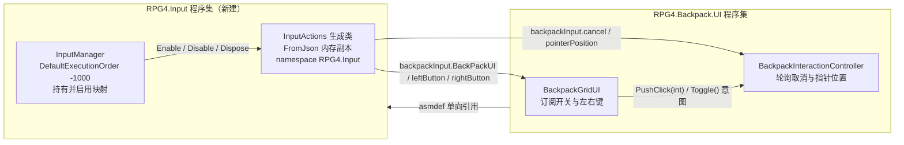

## 用户需求

把背包 UI 的输入来源从「BackpackGridUI 自己引用输入资产」改为统一走 `Assets/input/InputManager.cs` 暴露的 `backpackInput`，并顺带把输入代码从 `Assets/input/` 迁出、建成独立的输入层程序集。已与用户确认四项决策：输入代码迁到 `Assets/Scripts/Input/` 并新建程序集；生成的输入包装类归入 `RPG4.Input` 命名空间；InputManager 缺失时只记警告、完全不做输入回退；ESC 取消与鼠标坐标一并收编进输入资产。

## 产品概述

背包输入收归单一入口：一个常驻的输入宿主持有输入资产并统一负责映射的启用与释放，UI 侧只订阅动作、不再各自持有输入资产。对外可观察行为完全不变。

## 核心功能

- 背包窗口开关（B 键）与左右键拾取 / 拆分改为从输入宿主读取，不再由 UI 直接持有输入资产
- 新增两个输入动作：取消（ESC）与指针位置（鼠标屏幕坐标），把交互层原先的两处直读设备收编为同源输入
- 输入资产与生成的包装代码从 `Assets/input/` 迁入 `Assets/Scripts/Input/`，建立独立输入层程序集并让背包 UI 单向引用它
- 补齐输入宿主的映射启用、实例释放、跨场景常驻与执行顺序
- 场景补挂一个常驻输入宿主，并清理界面组件上失效的输入资产引用
- 界面视觉、鼠标光标行为、既有交互手感与网络行为均保持不变
- 输入宿主缺失时：日志记一条警告，背包无按键 / 鼠标响应（界面仍可正常显示）

## 技术栈

- 引擎 / 语言：Unity（C#），工程既有程序集分层（asmdef）
- 输入：Unity Input System 1.14.2（`InputActions.inputactions` + 代码生成包装类 + `MonoBehaviour` 宿主）
- 网络：Mirror（本次改动不触碰任何网络协议、命令通道与容器 / 宿主判定逻辑）
- 文档：工程内 `backpack/Docs/里程碑/` Markdown

## 实现方式

### 核心策略

把输入从「UI 组件自带资产副本」改为「单一常驻宿主持有 + 只读订阅」，通过新建 asmdef 打破「asmdef 程序集无法引用 `Assembly-CSharp`」的硬约束，让 UI 能看见输入宿主。

**关键决策与理由：**

1. **新建 `RPG4.Input` 程序集（而非把输入并入 `RPG4.Backpack.UI`）**

- 现状：`Assets/input/` 无 asmdef，`InputManager` + 生成的 `InputActions` 落在 `Assembly-CSharp`；而 `RPG4.Backpack.UI.asmdef` 无法引用预定义程序集 → `BackpackGridUI` 根本看不见 `InputManager`，直接改会编译失败。
- 并入 UI 程序集虽少一个程序集，但会把输入锁死在背包模块内，后续 M4 世界拾取 / M7 装备槽 / M8 消耗都要复用时又要迁一次。独立程序集一次到位。

2. **手写生成的包装类而不是「删掉让 Unity 重新生成」**

- `InputActions.cs` 是 `Assets/input/InputActions.inputactions.meta` 里 `generateWrapperCode: 1` 每次导入时自动重写的产物。
- 若先删后等 Unity 生成，中间态整个工程编译失败。改为**先按 import 器设置手写到位**，新工程状态立刻可编译；Unity 下次导入会按同一资产重新生成，内容确定性一致（自愈，不会漂移）。

3. **映射的 Enable/Disable 所有权收归宿主**

- 现状 `BackpackGridUI.UnbindInputActions()` 会调用 `backpackMap.Disable()`。映射一旦共享，UI 的 `OnDisable` 会把宿主和其他订阅者正在用的映射一起关掉。
- 约定：`InputManager` 独占 `Enable` / `Disable` / `Dispose`，UI 只 `+=` / `-=` 回调。

4. **ESC 与指针位置用「每帧轮询」而非回调**

- 交互层原本就是每帧轮询判 ESC、每帧读鼠标坐标，改成回调会引入一套订阅 / 退订生命周期，收益为负。
- `cancel` 用 `WasPressedThisFrame()`，`pointerPosition` 用 `ReadValue<Vector2>()`，语义与改前严格等价，且不需要在窗口关 / 开时切换订阅。

5. **设备存在性只在输入层判定**

- 原 `TryGetPointer` 用 `Mouse.current == null` 判空。收编后该判断下沉到宿主 `HasPointer`，保持「无鼠标 → 丢弃点击并记警告」的原语义。

### 性能与可靠性

- `BackpackActions` 是 **struct**（`public BackpackActions @backpack => new BackpackActions(this)`），属性访问只构造栈上值类型、无堆分配；底层 `InputAction` 实例唯一。
- 每帧新增成本：UI 层 1 次静态引用比较（`InputManager.Instance == null`）+ 交互层 1 次 `WasPressedThisFrame` + 1 次 `ReadValue<Vector2>`，与改前直读设备等价。
- 重试只在未绑定态进行，不会重复订阅（`inputBound` 标志 + `BindInputActions` 首行先退订）。
- 缺失告警只在状态翻转时输出一次，避免每帧刷日志。

## 实现注意（执行细节）

### 执行顺序（必须成批完成，避免中间态编译失败）

1. 先建目录与 asmdef、改 `.inputactions` 内容、改 `.inputactions.meta` 的 wrapper 三项设置、手写新位置的 `InputActions.cs` 与迁移 `InputManager.cs`、删除 `Assets/input/` 下两个旧 C# 及其 meta —— 这些属于同一批，中途不运行 Unity 即可。
2. 再改 UI 层两个脚本 + `RPG4.Backpack.UI.asmdef` 的引用。
3. 最后改场景与文档。
4. 收口：打开 Unity 触发重导入，确认 `.inputactions` 重新生成的包装类落在 `Assets/Scripts/Input/InputActions.cs` 且带 `namespace RPG4.Input`。

### 生成代码重定位要点

- `InputActions.inputactions.meta` 的 `wrapperCodePath` 是**工程根相对路径**，写 `Assets/Scripts/Input/InputActions.cs`；`wrapperClassName: InputActions`；`wrapperCodeNamespace: RPG4.Input`。
- 新位置手写的包装类必须与三项设置一致：文件顶部 `using` 在命名空间外，整个 `partial class @InputActions` 包进 `namespace RPG4.Input { ... }`，`IBackpackActions` 接口同步加上 `OnCancel` 与 `OnPointerPosition`。
- 迁移文件必须连 `.meta` 一起移动以保留 GUID：`InputManager.cs.meta` 保留 `c79eac3e7a4554d438d5b68c64a2ec6e`（它是 `MonoBehaviour`，GUID 需稳定）；`InputActions.cs.meta` 沿用 `7d7323e7504d1da46b0e99ae00e87270`（无外部引用，复用即视为同一资产移动）。
- 新建目录与 asmdef 的 `.meta` 需新 GUID 并全量查重：`Assets/Scripts.meta`、`Assets/Scripts/Input.meta`（folder meta，格式照抄 `Assets/input.meta`）、`Assets/Scripts/Input/RPG4.Input.asmdef.meta`（格式照抄 `Assets/backpack/Scripts/UI/RPG4.Backpack.UI.asmdef.meta` 的 `AssemblyDefinitionImporter` 结构）。
- `Assets/input/` 目录**保留**（`.inputactions` 资产留在原处，`Assets/input.meta` 不动），只把 C# 挪走。

### 程序集方向（防循环）

`RPG4.Backpack.UI` → `RPG4.Input` 单向。`RPG4.Input` 只引用 `Unity.InputSystem`，**不得**引用任何 `RPG4.Backpack.*`；宿主只提供动作与查询，绝不回调 UI。

### 场景编辑要点与风险

- 现状 `New Scene.unity` 内无任何挂 `InputManager` 的对象；`BackpackGridUI` 的 MonoBehaviour 块（fileID `737851992`）第 406 行是唯一的输入资产引用。
- 采用「新增一个根物体」：新增 `GameObject` / `Transform` / `MonoBehaviour` 三个块，并把这个 Transform 的 fileID 追加进文件末尾 `SceneRoots.m_Roots` 列表。Transform 块结构照抄 EventSystem 的 Transform 块（`@486251559`）；`MonoBehaviour` 块只需 `m_GameObject` / `m_Enabled: 1` / `m_Script: {fileID: 11500000, guid: c79eac3e7a4554d438d5b68c64a2ec6e, type: 3}`（宿主无序列化字段）。
- 新 fileID 必须避开既有 `280755950/486251556/737851989/904921746/1203370238/1246035267/1282446373/1556506766/1916202764` 等；建议用一段不冲突的区段（如 `1500000101/102/103`）。
- 同时删除第 406 行 `backpackActions:` 序列化行（字段已从 C# 移除，Unity 会忽略残留，但清掉更干净）。
- **风险**：若用户的 Unity 编辑器正开着该场景，磁盘改动会在编辑器保存场景时被覆盖。执行前需确认场景未在编辑器中打开；若无法确认，退路是保留场景不动，改为给出手搭步骤（新建空物体 → Add Component → InputManager）。

### 日志与文档口径

- `BackpackGridUI` 原第 331 行「未接线输入资产（InputActions.inputactions）」改为宿主口径，且只在状态翻转时输出。
- 顺带修正第 252 行写死的 `"TAB   /   打开背包"`（实际绑定为 B 键）。
- `backpack/Docs/里程碑/M6_点击拾取与堆叠操作.md` 需同步：第一节第 19 行（已不存在的 `BackpackInputBridge.cs` 记录）、第二节第 2 条（点击来源与「ESC / 鼠标仍直读」的表述）、第三节第 5 条（输入桥接线清单）、第四节验收第 1 条、第五节「不做」列表。

### 回滚面（改动可控）

触碰文件共 8 个（新建 2 个 C# / 1 个 asmdef + 若干 meta，修改 2 个 C# / 1 个 asmdef / 1 个输入资产 + meta / 1 个场景 / 1 篇文档）。不涉及 Mirror 协议、容器、宿主判定、事件总线，权威模型（UI 只发 `PushClick` / `Toggle` 意图）保持不变。

## 架构设计



### 输入动作契约（`backpack` 映射，宿主统一启用）

| 动作 | 类型 | 绑定 | 消费方与读法 |
| --- | --- | --- | --- |
| `BackPackUI` | Button | `<Keyboard>/b` | `BackpackGridUI`：`performed` 回调 → `Toggle()` |
| `leftButton` | Button | `<Mouse>/leftButton` | `BackpackGridUI`：`performed` 回调 → `PushClick(Left)` |
| `rightButton` | Button | `<Mouse>/rightButton` | `BackpackGridUI`：`performed` 回调 → `PushClick(Right)` |
| `cancel` | Button（新增） | `<Keyboard>/escape` | `BackpackInteractionController`：每帧 `WasPressedThisFrame()` → `HandleCancel()` |
| `pointerPosition` | Value / Vector2（新增） | `<Mouse>/position` | `BackpackInteractionController`：每帧 `ReadValue<Vector2>()` |


`cancel` 常驻启用不会造成误操作：`HandleCancel()` 只在 `IsInteractive()`（要求 `grid.IsOpen`）成立时才被调用，与改前一致。

## 目录结构

```
e:/ue/RPG_4/Assets/
├── Scripts/                                          # [NEW] 新目录（含 .meta）
│   └── Input/                                        # [NEW] 新目录（含 .meta）；asmdef 边界 = 目录边界
│       ├── RPG4.Input.asmdef                         # [NEW] 输入层程序集：references 仅 ["Unity.InputSystem"]，rootNamespace "RPG4.Input"，autoReferenced true
│       ├── RPG4.Input.asmdef.meta                    # [NEW] 结构照抄 RPG4.Backpack.UI.asmdef.meta，GUID 需查重
│       ├── InputManager.cs                           # [NEW/MOVE] 从 Assets/input/ 迁入并重写。namespace RPG4.Input；[DefaultExecutionOrder(-1000)]；Awake 做单例判定 → DontDestroyOnLoad → new InputActions() → backpack.Enable()（new 必须在单例判定之后，消除被回收实例的泄漏）；OnDestroy 做 Disable + Dispose + Instance=null；公开背包动作集与指针可用性查询
│       └── InputManager.cs.meta                      # [MOVE] 保留原 GUID c79eac3e7a4554d438d5b68c64a2ec6e
│       └── InputActions.cs                            # [NEW/MOVE] 从 Assets/input/ 迁入；手写带 namespace RPG4.Input 的包装类，动作集含新增的 cancel 与 pointerPosition，IBackpackActions 同步加两个回调方法；Unity 下次导入会按资产重新生成（内容一致，自愈）
│       └── InputActions.cs.meta                       # [MOVE] 沿用 GUID 7d7323e7504d1da46b0e99ae00e87270
├── input/
│   ├── InputActions.inputactions                     # [MODIFY] backpack 映射新增 cancel（Button，<Keyboard>/escape）与 pointerPosition（Value/Vector2，<Mouse>/position）；原有三个动作与绑定不动
│   ├── InputActions.inputactions.meta                # [MODIFY] wrapperCodePath: Assets/Scripts/Input/InputActions.cs；wrapperClassName: InputActions；wrapperCodeNamespace: RPG4.Input
│   ├── InputManager.cs                               # [DELETE] 已迁出（连同 .meta）
│   ├── InputManager.cs.meta                          # [DELETE]
│   ├── InputActions.cs                               # [DELETE] 已迁出（连同 .meta），不留在 Assembly-CSharp 造成同名残留
│   └── InputActions.cs.meta                          # [DELETE]
└── backpack/
    ├── Scripts/UI/RPG4.Backpack.UI.asmdef            # [MODIFY] references 追加 "RPG4.Input"（保持其余 9 项不变）
    ├── Scripts/UI/BackpackGridUI.cs                  # [MODIFY] 删除 backpackActions 字段与映射名 / 动作名解析；BindInputActions 改为取 InputManager.Instance.backpackInput 的三个动作，宿主缺失只记一次警告并返回、不订阅不 Disable；新增 inputBound 标志，Update 里宿主为空则退订、有宿主且未绑定则重试；UnbindInputActions 只 -= 不再 Disable；OnToggle/Primary/Secondary 回调逻辑不变；加 using RPG4.Input；顺带修正写死 TAB 的提示文案
    ├── Scripts/UI/BackpackInteractionController.cs   # [MODIFY] 新增 cancelAction / pointerAction 私有字段与懒解析（从 InputManager.Instance.backpackInput 取，宿主缺失每帧重试）；HandleInput 里的 ESC 直读换为 cancel 轮询；TryGetPointer 由静态改实例，先判 pointerAction 与 HasPointer 再 ReadValue<Vector2>；加 using RPG4.Input
    ├── Scenes/New Scene.unity                        # [MODIFY] 新增一个根物体挂 InputManager（GameObject/Transform/MonoBehaviour 三块 + SceneRoots.m_Roots 追加其 Transform），删除 BackpackGridUI 块里失效的 backpackActions 序列化行
    └── Docs/里程碑/M6_点击拾取与堆叠操作.md           # [MODIFY] 同步输入来源口径：删除已不存在的 BackpackInputBridge 记录、改写「ESC 与鼠标仍直读」表述、把第三节输入桥接线清单改为 InputManager 接线、更新验收第 1 条与第五节范围
```

## 关键代码结构

```
namespace RPG4.Input
{
    /// <summary>全局输入宿主：持有输入资产实例并统一启用 / 释放映射，对外只提供动作集与指针可用性查询。</summary>
    [DefaultExecutionOrder(-1000)] // 早于 UI 的 OnEnable 就绪。
    public class InputManager : MonoBehaviour
    {
        public static InputManager Instance { get; private set; }          // 未挂场景时为 null
        public InputActions.BackpackActions backpackInput { get; }          // 底层 InputAction 实例唯一；订阅方只增删回调
        public static bool HasPointer { get; }                              // 本机是否存在指针设备
    }
}
```

以上为对外契约；`Awake` / `OnDestroy` 的生命周期细节见目录结构中对 `InputManager.cs` 的说明。

## Agent Extensions

### Skill

- **lsp-code-analysis**
- Purpose: 在重构收口阶段做语义级校验，确认「迁移后无残留引用」与「程序集引用方向正确」。
- Expected outcome: 定位 `InputActions` / `InputManager` 的全部定义与引用点（应只出现在 `Assets/Scripts/Input/` 与两个背包 UI 脚本中）；确认 `BackpackGridUI` / `BackpackInteractionController` 能解析到 `RPG4.Input` 类型；确认工程内不再有对已删除的 `backpackActions` 字段或全局 `InputActions` 的引用；无循环依赖告警。
- **command-execution-no-tests-no-comments**
- Purpose: 约束本次执行方式——本工程无单测体系，执行过程中不新增测试、不写未被要求的注释。
- Expected outcome: 改动只落在既定的 8 个文件上，不产生测试工程或脚手架文件；同时保留项目既有约定（标识符英文 + 简洁中文注释，用户既有明确要求，优先级高于该 skill 的默认「不加注释」）。