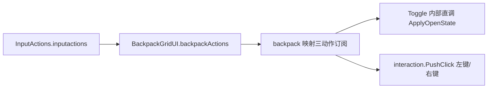

## 需求概述

把独立挂在背包窗口上的输入转发组件 `Assets/input/BackpackInputBridge.cs` 合并进 `BackpackGridUI`（两者本来就在同一个 GameObject 上），消除一个中转组件与两处 Inspector 接线，同时保持现有按键行为完全不变。

## 核心功能

1. 背包窗口自己订阅输入资产 `InputActions.inputactions` 的 `backpack` 映射三个动作：`BackPackUI`（B 键）开关窗口、`leftButton` / `rightButton` 转发给交互控制层。
2. 开关不再经事件总线中转：`BackPackUI` 触发后直接调用窗口内部开关逻辑，行为与现在一致（打开时接管光标并暂停本地玩家输入，关闭时还原）。
3. 点击行为不变：背包关闭时点击被丢弃，打开时左键拾取 / 放下、右键拆分，按键仍可在 `.inputactions` 资产里改，不改代码。
4. 清理并入后的遗留：删除输入桥脚本、删除只服务于该中转的开关事件频道常量、关闭并删除已无人使用的输入代码生成文件。
5. 资产与场景接线保持可用：网格未接输入资产或无背包数据源时不报错、不刷日志，仅记一条警告，界面照常显示。
6. 交付后需在 Unity 中验收：B 键开 / 关、左键拾取与放下、右键拆分、ESC 取消、关闭后光标与输入恢复正常。

## 技术选型

- 引擎与语言：Unity + C#（沿用现有工程，不新增包）。
- 程序集：`RPG4.Backpack.UI`（`RPG4.Backpack.UI.asmdef`），已引用 `Unity.InputSystem` / `UnityEngine.UI` / `Unity.TextMeshPro` / `Mirror` 及 Core/Items/Inventory/Equipment/Network/Runtime，**无需新增引用**。
- 输入接入方式：序列化 `InputActionAsset` 资产引用 + `FindActionMap` / `FindAction` 订阅 `performed`（不使用生成的 `InputActions` 类）。

## 实现思路与关键决策

1. **为什么必须用资产引用**：生成的 `Assets/input/InputActions.cs`（全局命名空间 `InputActions`）位于无 asmdef 的 `Assets/input/`，属于 Assembly-CSharp；Unity 编译顺序为 asmdef 程序集先、Assembly-CSharp 后，因此 asmdef 程序集**无法**引用它（反向可行，这正是现有桥能 `using RPG4.Backpack.UI` 的原因）。故桥里 `new InputActions()` + `IBackpackActions` 的实现无法原样搬进 `BackpackGridUI`。项目记忆（`project_rpg4_backpack_port.md` 第 38 行）已记录该结论并指明解法为「序列化 `InputActionAsset` / `InputActionReference` 引用接入」。
2. **合并目标选择**：合并进 `BackpackGridUI`。桥的两个出口在 `BackpackGridUI` 内均可直达（`Toggle()` 为自身方法，`interaction` 字段已存在），无需 `ui` / `target` 接线，也无需「`ui` 为空时反查 `target.Grid`」的兜底。不合并进交互控制层，避免新增 grid→controller 反向依赖，保持「UI 只发意图」的既有关系模型。
3. **开关改直调**：`InvChannels.MenuToggled` 当前唯一的发布者与订阅者都是 `BackpackGridUI`（已全量核对），合并后取消 `EventBus` 往返，把原 `OnMenuToggled(bool)` 的函数体原样保留为一个私有 `ApplyOpenState(bool)`，由 `Toggle()` 直接调用；`Toggle()` 保持 public（作为「开关意图」入口被输入回调使用，也为将来按钮接线保留），守卫逻辑 `Inventory == null || Columns < 1 || Rows < 1` 时直接返回不变。
4. **点击链路不变**：`leftButton` / `rightButton` 回调仍调用 `interaction.PushClick(UiChannels.MouseButton.Left/Right)`（`UiChannels` 位于 `RPG4.Backpack.Core`，网格已 `using`），点击仍走 `.inputactions` 绑定；`interaction` 为空时保持原桥语义记一条 `BackpackLog.Warn(LogModule.UI, ...)`，避免静默丢失点击。
5. **生成类下线**：`InputActionAsset` 引用不需要生成类，按用户选择关闭 `Generate C# Class` 并删除 `InputActions.cs`（先改 meta 的 `generateWrapperCode: 0`，否则重新导入会再次生成）。
6. **性能**：订阅只在 `OnEnable` 建立、`OnDisable` 释放，代理数量固定 3 个，无逐帧轮询、无闭包分配，帧开销与现状一致（桥原本也是事件驱动）。

## 实施要点（执行细节）

- `BindInputActions()` 先调用一次 `UnbindInputActions()` 保证幂等（避免重复启用导致同一动作被订阅两次）；`backpackActions == null` 或找不到 `backpack` 映射 / 动作时，记一条 `BackpackLog.Warn(LogModule.UI, ...)` 后返回，界面保持可用（只是无输入）。
- 只 `Enable()` / `Disable()` 自己的 `InputActionMap`，**不要** `backpackActions.Disable()` 或 `Dispose()` 资产（资产由 Unity 管理，且可能被其它组件共用）；场景里 `InputSystemUIInputModule` 引用的是另一个动作资产（`ca9f5fa95ffab41fb9a615ab714db018`），**保持不动**。
- 退订必须使用与订阅相同的动作实例（缓存三个 `InputAction` 引用后 `-=`），不要用 `Update` 里订阅。
- 删除脚本的顺序：先删场景里的组件块，再删 `BackpackInputBridge.cs` 与 `.meta`（反之 Unity 会在场景中留下 Missing MonoBehaviour）。
- 删除 `InvChannels.MenuToggled` 前后用「全工程正则检索」核对无残留引用（现仅 `EventChannels.cs` 定义 + `BackpackGridUI.cs` 发布/订阅）；`EventChannels.cs` 里其它常量与排版不动。
- 场景 YAML 可直接编辑（该场景内不存在任何 `m_MethodName` 方法绑定，改字段/删组件安全）；`BackpackGridUI` 新增字段按声明顺序写在 `openKeyHint` 之前。若手改后的引用在 Inspector 里显示为空，重新拖一次 `InputActions.inputactions` 即可。
- 不做 `openKeyHint` 的自动按键名读取（用户已明确不做），提示文案行为保持现状；顺带留意 `BindInventory` 里的硬编码提示 `"TAB   /   打开背包"` 与实际 B 键不一致属既有问题，不在本次范围。

## 系统架构与数据流



## 目录结构（仅列增删改文件）

```
Assets/
├── input/
│   ├── BackpackInputBridge.cs            # [DELETE] 职责并入 BackpackGridUI，连同 .meta 一起删除（GUID 3b91d7c4af2e40d8b0c75e9a1d6f2c83）
│   ├── InputActions.cs                   # [DELETE] 关闭生成后删除，连同 .meta（全工程已无引用）
│   └── InputActions.inputactions.meta    # [MODIFY] generateWrapperCode: 1 → 0（先改再删生成文件，否则重新导入会再生成）
├── backpack/
│   ├── Scripts/UI/BackpackGridUI.cs      # [MODIFY] 新增 backpackActions 资产字段与三动作订阅/退订；Toggle 改直调；删除 toggleSubscription 与 MenuToggled 订阅；更新类注释、Update 注释、openKeyHint 注释
│   ├── Scripts/UI/BackpackInteractionController.cs  # [MODIFY] 仅注释：PushClick 与 pendingXxx 的「输入桥」措辞改为「背包主控转发」
│   ├── Scripts/Core/Events/EventChannels.cs         # [MODIFY] 删除 InvChannels.MenuToggled 常量（已无人引用）
│   └── Scenes/New Scene.unity            # [MODIFY] 删除 BackpackInputBridge 组件块；在 BackpackGridUI 块补 backpackActions 资产引用
└── (工程外) .codebuddy/projects/.../memory/project_rpg4_backpack_port.md  # [MODIFY] 同步第 14/25/38 行关于输入桥与生成类的描述
```

## 关键代码结构

```
// 接线（[Header("输入")] 下，保留 openKeyHint）
public InputActionAsset backpackActions; // 背包输入资产（InputActions.inputactions）；留空则无输入。
public string openKeyHint;               // 关闭态提示里显示的按键名（仅文案）。

private const string BackpackMapName = "backpack";
private const string ToggleActionName = "BackPackUI";
private const string PrimaryClickActionName = "leftButton";
private const string SecondaryClickActionName = "rightButton";

private InputActionMap backpackMap;        // backpack 映射（OnEnable 解析，OnDisable 释放）。
private InputAction toggleAction;          // B 键：开关背包。
private InputAction primaryClickAction;    // 左键：转发拾取/放下。
private InputAction secondaryClickAction;  // 右键：转发拆分。

private void BindInputActions();                                  // OnEnable：先退订再解析并订阅三动作 + map.Enable()。
private void UnbindInputActions();                                // OnDisable：-= 三动作 + map.Disable()。
private void OnToggleAction(InputAction.CallbackContext c);       // performed → Toggle()。
private void OnPrimaryClickAction(InputAction.CallbackContext c); // performed → interaction.PushClick(UiChannels.MouseButton.Left)。
private void OnSecondaryClickAction(InputAction.CallbackContext c);
private void ApplyOpenState(bool open);                           // 原 OnMenuToggled 函数体原样保留。
public void Toggle();                                             // 守卫后调用 ApplyOpenState(!isOpen)。
```

场景中 `BackpackGridUI` 组件块新增（写在 `openKeyHint: ` 之前）：

```
  backpackActions: {fileID: -944628639613478452, guid: 00a1b370ce6d6524eb4d201a676d9a28,
    type: 3}
```

（`-944628639613478452` 为 `.inputactions` 资产主对象 fileID，同场景 `m_ActionsAsset` 已有同款写法可对照；如手改后在 Inspector 显示为空，重新拖一次资产即可。）

## Agent Extensions

### Skill

- **lsp-code-analysis**
- Purpose: 在删除 `BackpackInputBridge`、私有化/移除成员后，用语义引用查询复核 `Toggle` / `PushClick` / `MenuToggled` / `packpackActions` 等符号在工程内确无其它调用点（C# 语义引用优先于文本检索）。
- Expected outcome: 得到每个被改动符号的引用清单，确认「零残留引用」，并把无法通过语义查询确认的项回退为文本检索复核结果一并记录。