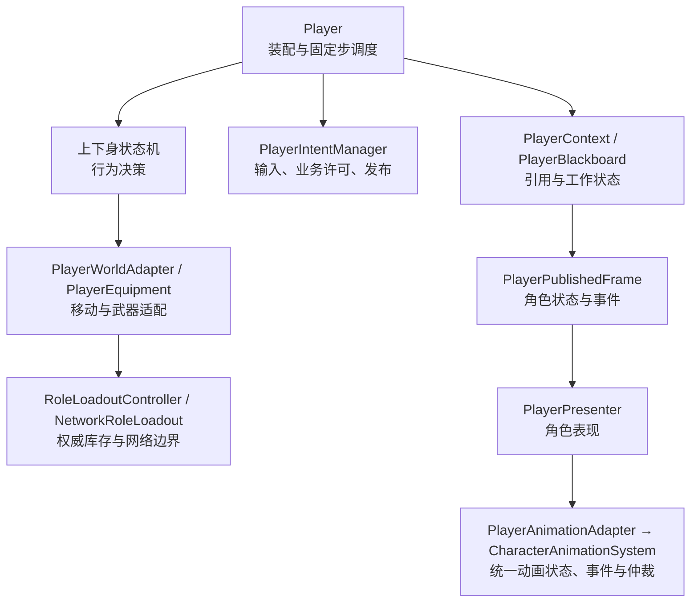
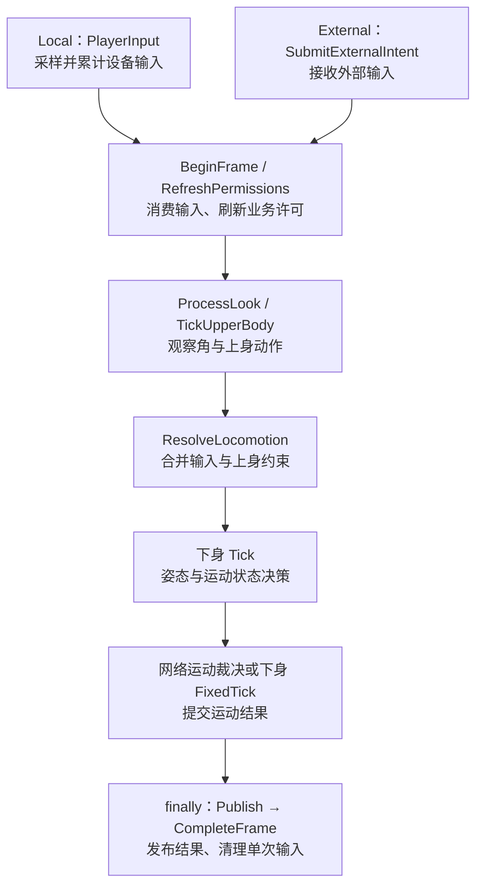
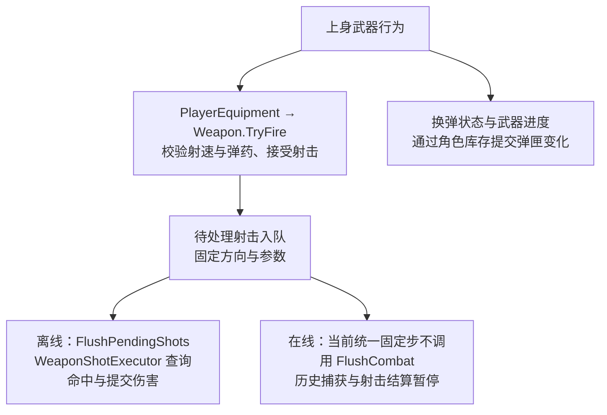
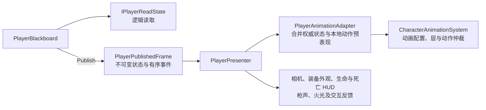
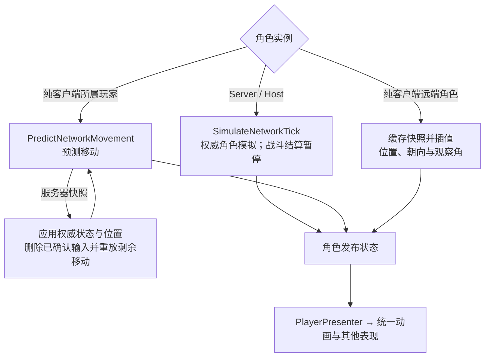

# Player 组件架构与调用时序

更新日期：2026-11-16。以当前工作树的静态实现为准；应用入口与会话切换见[游戏运行流程图](游戏运行流程图.md)，网络部署与库存同步见[网络权威处理与部署方向](网络权威处理与部署方向.md)。

本文描述角色生成后的组件调度。当前客户端从 `ClientBootstrap`（客户端入口）进入 `MainMenu`（主菜单），认证后进入 `Lobby`（大厅），获准开始突袭后加载 `OnlineGame`（在线战场）。服务器从 `ServerBootstrap`（服务器入口）启动并加载在线世界。旧 `Main`（旧场景）不是完整 Host 或拾取演示入口。

## 组件总览

`Player`（角色调度）负责装配与调度，`PlayerContext`（角色上下文）持有每个角色的配置与运行时引用。库存、物品和表现已拆到独立模块，命名空间保留原有名称不代表旧目录仍存在。

角色移动依赖刚体、胶囊体和输入状态。`Foundation`（基础模块）承载标签与事件，`Items`（物品模块）承载清单和运行物品，`LoadoutContracts`（配装契约）与 `LoadoutTemplate`（配装模块）承载库存接口及实现，`WeaponRuntime`（武器运行）承载武器执行，`CombatUI`（战斗界面模块）承载武器与消耗品 HUD 及其契约。模型、相机和动画不决定移动、扣弹或伤害是否成立。

## 输入与固定步

下图表示存活角色一次 `SimulateTick`（模拟步）的主流程。

- 离线由 `Player.FixedUpdate`（离线固定步）驱动；Server / Host 由 `SimulateNetworkTick`（网络模拟步）驱动。死亡分支跳过行为状态机，仍进入发布清理。
- 焦点、会话与窗口共同控制本地输入；存活、刚体和武器事实决定业务许可。单次按下和观察增量只消费一次，切换输入来源会清空旧输入。
- 移动计划与实际姿态分开，站起仍须通过碰撞检查。网络使用运动学移动，不依赖动画根运动。

## 射击与换弹

武器执行代码仍保留如下边界；这张图表示调用职责，不能据此认为当前在线命中结算已启用。

`NetworkPlayerSimulation.FixedStep`（统一固定步）当前在移动后直接调用 `PublishServer`（权威发布），明确暂停战斗历史、射击结算与消耗品完成。`MoveServer`（服务端运动）仍调用角色模拟，保留动作请求和武器状态代码；动作接受、动画或扣弹状态不等于伤害已完成。AI 生成同样暂停。

射击使用逻辑观察角和身体锚点，不读取模型枪口。武器与弹匣变化经过角色库存接口；不得用表现回调直接修改权威物品。

## 数据与表现

`PlayerAnimationAdapter`（动画适配）把移动、观察、射击、换弹、消耗与受伤状态整理为统一动画输入；`CharacterAnimationSystem`（统一动画）接收状态和事件，处理动画表现。其他业务模块提供数据，不各自直接控制角色动画。表现关闭不代表业务停止；当前仍在 Unity 主线程运行，发布快照不代表支持并发写入。

| 显示内容 | 当前数据来源 |
|---|---|
| 四类容器与六个装备槽 | `NetworkRoleLoadout`（网络配装）发布的拥有者独立只读投影；Host 也使用请求与投影链。 |
| 战利品窗口 | 服务器验证打开请求后返回的战利品投影；客户端不直接读取服务器端点。 |
| 武器 HUD | `PlayerEquipment`（角色装备）提供武器快照，`GameplayUiBindingAdapter`（游戏界面绑定）将本机角色装备绑定到 HUD。 |

`GameplayUiBindingAdapter`（游戏界面绑定）同时绑定 `NetworkRoleLoadout`（网络配装），仅在会话、所属角色、初始状态和必需界面均就绪且没有模态界面阻止时开放库存输入。窗口与拖拽由角色配装表现管理。

## 网络角色分工

认证身份、突袭准入和可操作角色是不同阶段。服务器获准生成后先完成可信初始化，再发布角色；客户端等待权威状态、身份、网络配装和场景绑定就绪，`ClientSessionController`（客户端会话）进入 `Playing`（游戏中）后才开放本地游戏输入。

- Host 本地输入进入服务器缓冲，不再执行客户端移动预测；独立服务器关闭客户端表现。纯客户端不重放伤害或库存事务。
- `ApplyNetworkPresentation`（应用网络表现）与 `ApplyNetworkShot`（应用射击反馈）负责投影，不重新执行业务；保留反馈代码不表示当前固定步启用了射击结算。
- 死亡停止角色行为并更新界面；返回大厅由突袭会话处理，不以本地重载旧场景替代结算。

## 源码入口

| 关注点 | 入口 |
|---|---|
| 装配与黑板 | [Player（角色调度）](PlayerMovement/Player.cs)、[PlayerContext（角色上下文）](PlayerMovement/PlayerContext.cs)、[PlayerBlackboard（角色黑板）](PlayerIntent/PlayerBlackboard.cs) |
| 输入与上下身 | [PlayerIntentManager（意图管理）](PlayerMovement/PlayerIntentManager.cs)、[UpperBodyRootState（上身根状态）](PlayerMovement/UpperBodyRootState.cs)、[LowerBodyRootState（下身根状态）](PlayerMovement/LowerBodyRootState.cs) |
| 移动与武器 | [PlayerWorldAdapter（世界适配）](PlayerMovement/PlayerWorldAdapter.cs)、[PlayerEquipment（角色装备）](PlayerMovement/PlayerEquipment.cs)、[Weapon（武器执行）](WeaponRuntime/Weapon.cs) |
| 发布与统一动画 | [PlayerPublishedFrame（角色发布帧）](PlayerIntent/PlayerPublishedFrame.cs)、[PlayerPresenter（角色表现）](PlayerMovement/PlayerPresenter.cs)、[PlayerAnimationAdapter（动画适配）](PlayerMovement/PlayerAnimationAdapter.cs)、[CharacterAnimationSystem（统一动画）](CharacterAnimation/CharacterAnimationSystem.cs) |
| 库存与界面绑定 | [NetworkRoleLoadout（网络配装）](LoadoutTemplate/NetworkRoleLoadout.cs)、[GameplayUiBindingAdapter（游戏界面绑定）](Frontend/GameplayUiBindingAdapter.cs) |
| 网络与会话 | [NetworkPlayerController（网络角色）](Networking/NetworkPlayerController.cs)、[NetworkPlayerSimulation（统一模拟）](Networking/NetworkPlayerSimulation.cs)、[AuthoritativeNetworkManager（权威网络管理）](Networking/AuthoritativeNetworkManager.cs)、[ClientSessionController（客户端会话）](Frontend/ClientSessionController.cs) |

本文仅核对静态调用关系；未启动 Unity、运行测试或构建，多客户端、动画与交互效果仍需人工运行验证。
