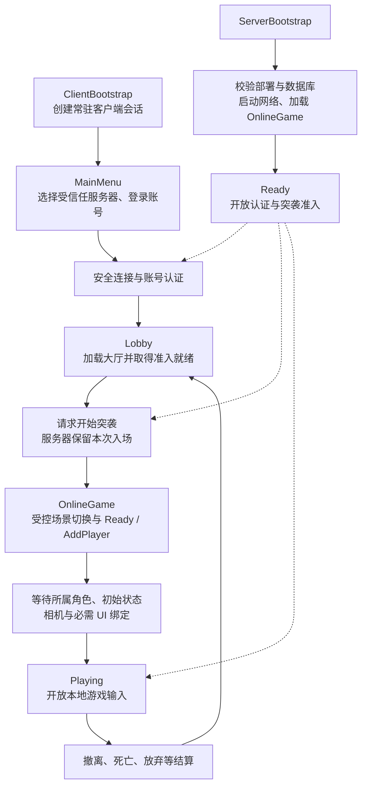
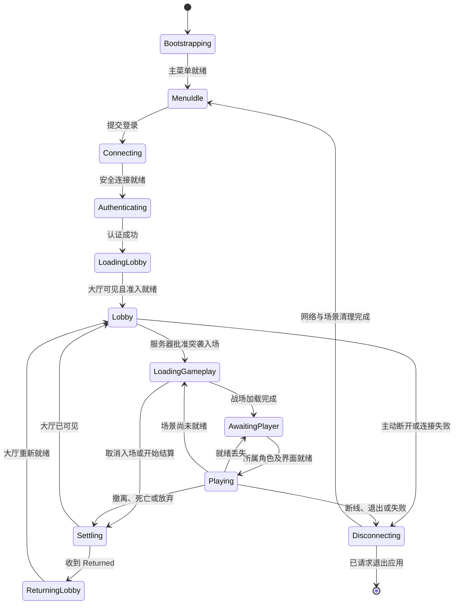
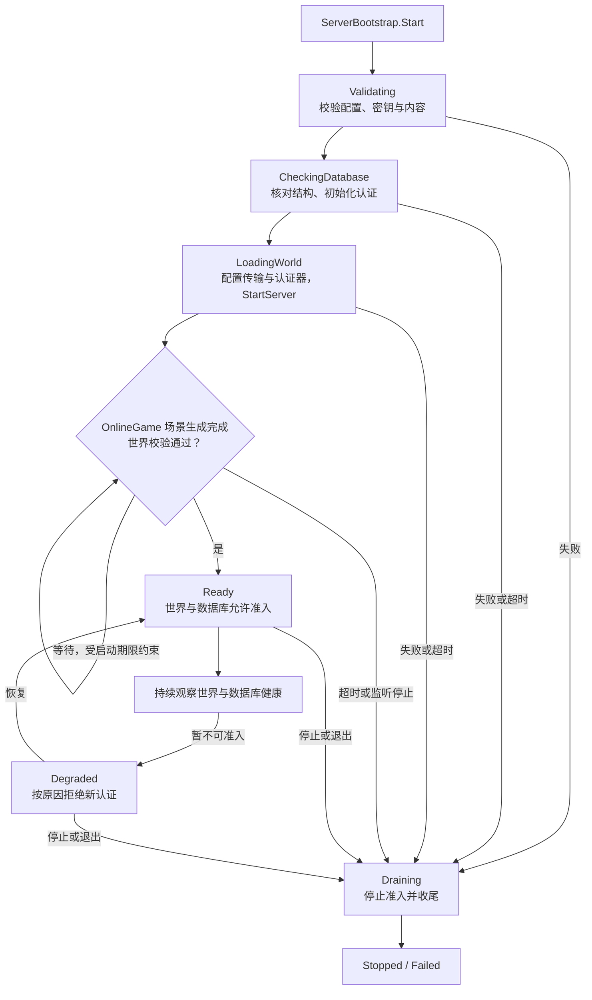
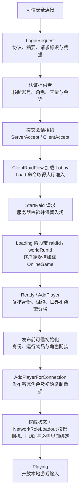
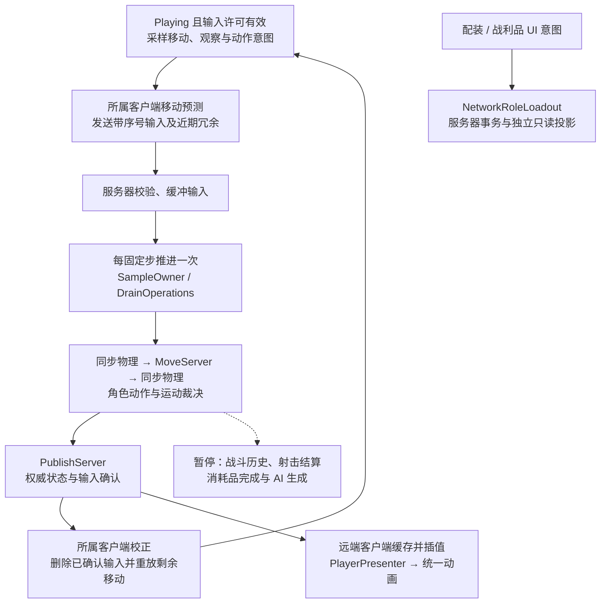
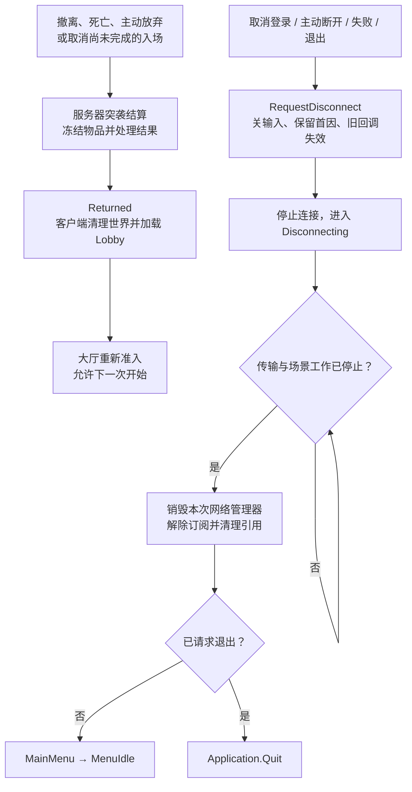

# 游戏运行流程图

更新日期：2026-11-16。依据当前工作树静态实现，描述客户端登录、大厅准入、突袭与回流；未启动 Unity、游戏、服务器或数据库进行运行验证。

角色内部调用见[Player 组件架构与调用时序](Player组件框架与调用时序.md)，权威处理和部署边界见[网络权威处理与部署方向](网络权威处理与部署方向.md)。

## 入口与场景关系

客户端构建列表为 `ClientBootstrap`（客户端入口）、`MainMenu`（主菜单）、`Lobby`（大厅）、`OnlineGame`（在线战场）；服务器单独使用 `ServerBootstrap`（服务器入口）与在线战场。服务器世界已加载不意味着客户端认证后立即生成角色；大厅由客户端受控加载，突袭准入批准后才进入战场。

`MainMenuPresenter`（主菜单交互）驱动登录界面，`LobbyPresenter`（大厅交互）提交开始游戏等操作，`ClientSessionController`（客户端会话）跨场景管理会话。直接打开主菜单缺少会话控制器时会提示从客户端入口启动。旧 `Main`（旧场景）不在正式构建列表，旧演示实例已清理，不再是完整 Host 或旧拾取演示入口。

源码：[GameBuild（构建入口与场景列表）](../../Editor/Build/GameBuild.cs)、[ClientSessionController（客户端会话）](Frontend/ClientSessionController.cs)、[MainMenuPresenter（主菜单交互）](Frontend/MainMenuPresenter.cs)、[LobbyPresenter（大厅交互）](Frontend/LobbyPresenter.cs)。

## 客户端会话状态

控制器当前有十二个状态；图示主要路径，取消、失败和超时可从其他阶段进入断线清理，未逐一展开异常边。网络与场景回调先记录事实，状态转换随后消费事实，旧尝试与旧生命周期回调被过滤。

| 阶段 | 当前判定与效果 |
|---|---|
| `Bootstrapping / MenuIdle`（初始化与菜单空闲） | 准备主菜单，上一会话已释放后才允许登录。 |
| `Connecting`（连接中） | 建立加密传输，按受信任目录校验服务器公钥指纹。地址和端口不替代可信身份。 |
| `Authenticating`（认证中） | 提交账号，核对请求标识、协议、内容摘要、地图及会话字段。 |
| `LoadingLobby / Lobby`（等待大厅与大厅） | 大厅场景可见，并收到服务器大厅准入响应后才允许开始突袭。 |
| `LoadingGameplay`（加载战场） | 必须持有服务器下发的突袭与世界运行标识；受控加载战场后进入 Mirror 就绪及角色请求。 |
| `AwaitingPlayer`（等待角色） | 等待本次连接、场景中的所属角色，初始权威状态、身份与网络配装就绪，并完成相机及必需 UI 绑定。 |
| `Playing`（游戏中） | 开放本地游戏输入；就绪失效立即关闭输入。 |
| `Settling / ReturningLobby`（结算与回厅） | 等待服务器结束结果并清理本地世界，重新加载大厅和取得准入。 |
| `Disconnecting`（断线清理） | 禁止新登录，等待传输、角色与场景工作停止，再销毁本次管理器。 |

`ClientRaidFlow`（客户端突袭流程）另行跟踪大厅和突袭阶段、请求及服务器结果；未收到响应的大厅命令会保留原操作编号重发，不等同于重新登录。`SessionStatusView`（会话状态界面）显示阶段与失败原因；密码不保存到偏好设置。

源码：[ClientSessionController（状态与清理）](Frontend/ClientSessionController.cs)、[ClientSessionStates（状态节点）](Frontend/ClientSessionStates.cs)、[ClientRaidFlow（客户端突袭流程）](Raid/Application/ClientRaidFlow.cs)、[ClientServerCatalog（服务器信任目录）](Frontend/ClientServerCatalog.cs)、[SessionStatusView（状态界面）](Frontend/SessionStatusView.cs)。

## 独立服务器启动与就绪

数据库初始化在网络启动前发生。加载世界时监听可先建立，认证仍须通过世界和提供者就绪检查；监听成功不等于服务器就绪。启动核对现有数据库结构和部署密钥，不自动执行结构迁移或生成部署密钥。

停止时先关闭准入并取消后台工作，停止服务器，再有界等待认证、租约释放、健康检查和不可取消的场景加载收尾。清理超时会保留失败结果；数据库健康恢复不触发客户端自动重连。

源码：[ServerBootstrap（服务器启动与关闭）](Server/ServerBootstrap.cs)、[MySqlAuthenticationProvider（数据库认证）](Server/MySqlAuthenticationProvider.cs)、[AuthoritativeNetworkManager（世界与准入）](Networking/AuthoritativeNetworkManager.cs)、[GameplaySceneBindings（场景绑定校验）](Networking/GameplaySceneBindings.cs)。

## 认证准入到可操作角色

认证成功只取得会话身份，不能跳过大厅或直接请求默认角色。`ServerRaidApplication`（服务器突袭应用）管理入场与结算，`UnityRaidWorld`（突袭世界适配）衔接角色生成、冻结和清理。发布角色前先完成可信初始化，失败不会先发布空角色再补数据。

当前物品初始化使用可信出生配置和角色配装数据；存在状态捕获、恢复与结算接口不意味着所有游戏进度和突袭库存都已完成数据库持久化。客户端角色、数据和 UI 回调可以交错，最后进入游戏状态取决于汇合条件。

源码：[AccountAuthenticator（账号认证器）](Networking/AccountAuthenticator.cs)、[EntryProtocol（入口协议）](Networking/Contracts/EntryProtocol.cs)、[ClientRaidFlow（客户端突袭流程）](Raid/Application/ClientRaidFlow.cs)、[ServerRaidApplication（服务器突袭应用）](Raid/Application/ServerRaidApplication.cs)、[UnityRaidWorld（突袭世界适配）](Networking/UnityRaidWorld.cs)、[OnlineSpawnConfiguration（可信出生配置）](Networking/OnlineSpawnConfiguration.cs)、[GameplayUiBindingAdapter（游戏界面绑定）](Frontend/GameplayUiBindingAdapter.cs)。

## 游戏运行循环

移动预测用于响应与校正，不重放伤害或库存事务。当前统一固定步在移动后直接发布，保留动作、武器与反馈代码不代表命中伤害已结算。角色库存经新的配装网络边界提交和同步；交互仅解析当前战利品入口，详见[玩家准星交互](Interaction/README.md)。

源码：[NetworkPlayerSimulation（统一固定步）](Networking/NetworkPlayerSimulation.cs)、[NetworkPlayerController（输入与复制）](Networking/NetworkPlayerController.cs)、[NetworkRoleLoadout（网络配装）](LoadoutTemplate/NetworkRoleLoadout.cs)、[ServerMatchAiSpawner（AI 生成适配）](ServerMatchAiSpawner.cs)。

## 结算、取消、断线与退出回流

主动回大厅通过 `TryReturnToLobby`（返回大厅）与突袭命令走结算；它不同于断开连接回菜单。连接中取消、主动离开服务器及连接故障共用会话清理路径。断线通知不等于清理结束，仍需等待不可取消的场景工作，完成后才允许新登录。

服务端有断线角色保留、重新准入和待结算处理代码；客户端没有自动重连或自动重试登录循环。本轮未验证重连与结算效果，不能把“返回大厅”或“捕获库存状态”解释为已完成所有数据库背包写回。

源码：[ClientSessionController（取消与退出）](Frontend/ClientSessionController.cs)、[ClientRaidFlow（结算回厅）](Raid/Application/ClientRaidFlow.cs)、[AuthoritativeNetworkManager.RaidSettlement（死亡与断线处理）](Networking/AuthoritativeNetworkManager.RaidSettlement.cs)、[AccountAuthenticator（认证租约释放）](Networking/AccountAuthenticator.cs)。
