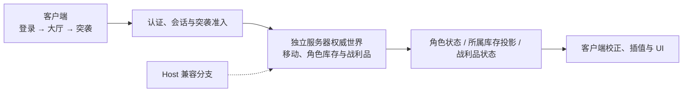
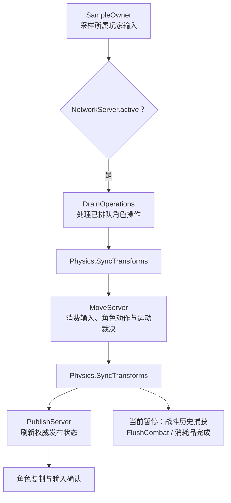
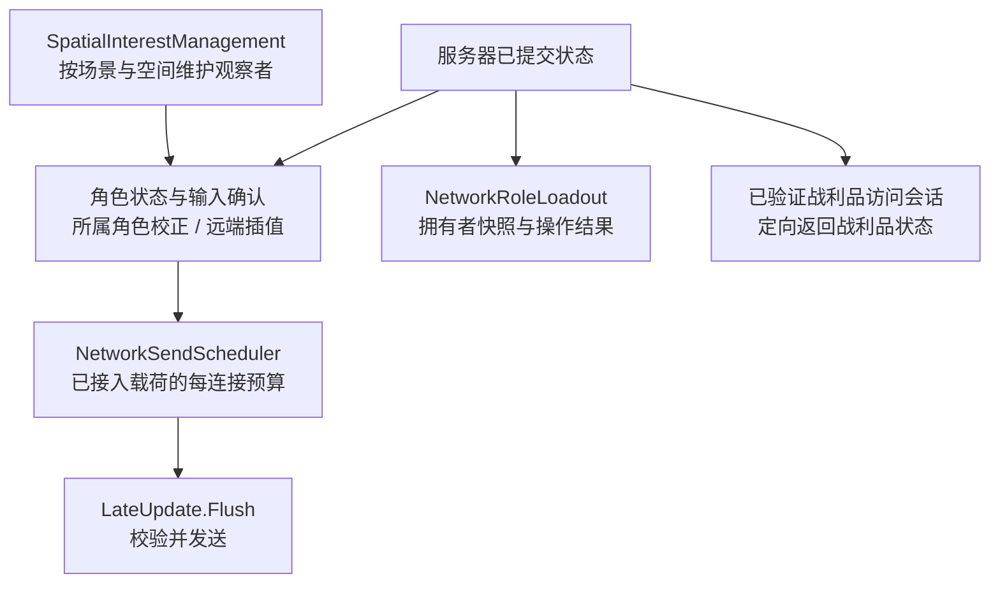
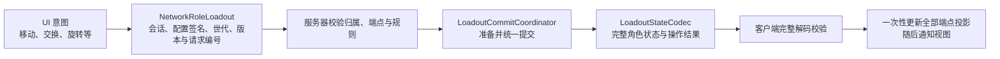
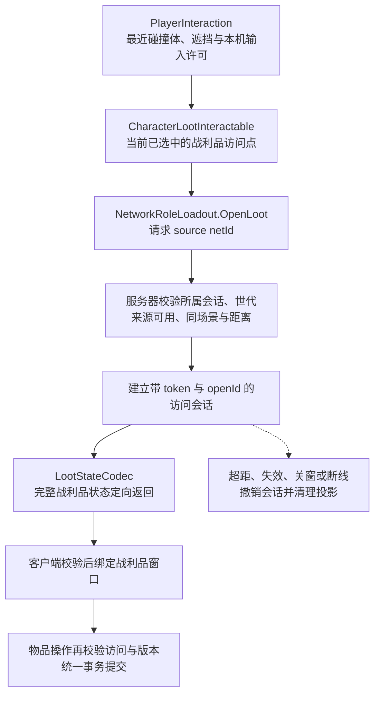

# 网络权威处理与部署方向

更新日期：2026-11-16。以当前工作树的静态实现为准；入口与会话流程见[游戏运行流程图](游戏运行流程图.md)，角色内部流程见[Player 组件架构与调用时序](Player组件框架与调用时序.md)。

## 部署目标与现状

**当前产品入口是客户端连接独立服务器，经大厅准入后进入突袭。**

客户端构建场景列表为 `ClientBootstrap`（客户端入口）、`MainMenu`（主菜单）、`Lobby`（大厅）、`OnlineGame`（在线战场）；服务器构建使用 `ServerBootstrap`（服务器入口）与在线战场。`ClientSessionController`（客户端会话）管理登录、等待大厅、游戏就绪、结算回厅和断线清理；`ClientRaidFlow`（客户端突袭流程）管理大厅及突袭命令与阶段。

旧 `Main`（旧场景）不在正式构建入口中，旧演示对象已清理，不能再把它当作完整离线、Host 或旧拾取演示。`AuthoritativeNetworkManager`（权威网络管理）类仍是正式联网核心，继承 `RuntimeNetworkManager`（运行网络管理）；旧同名预制体的移除不代表该类被移除。Host 分支仍有兼容代码，单人 Host 产品流程需要另行设计与验证。

监听成功、认证通过、大厅就绪和可操作角色分别有独立条件。服务器先校验部署身份、内容和数据库结构，再加载世界，世界与数据库均可准入时才进入 `Ready`（就绪）。本说明不代表部署、数据库或联机已在本轮验证。

## 权威 Tick

`NetworkPlayerSimulation`（统一模拟）在每个 Unity 固定步只推进一次，角色按 `netId`（网络编号）排序。

数据包增加输入缓冲，不增加模拟步数。当前移动后直接发布，未调用战斗历史捕获、`FlushCombat`（战斗结算）与 `CompleteDueUse`（完成消耗）；保留的开火、扣弹、动作请求和射击反馈代码不能当作在线伤害闭环已运行的证据。`ServerMatchAiSpawner.Spawn`（生成 AI）当前也为空实现。

## 复制与发送预算

- `NetworkSendScheduler`（发送调度）只覆盖接入其队列的载荷，不是所有网络消息的总带宽上限；不能把角色库存的定向 RPC 自动视为同一路分片预算。
- `SpatialInterestManagement`（空间兴趣管理）维护场景与空间观察关系。看见战利品外壳不等于客户端已经获得其内容。
- 角色快照用于校正与插值，不复制整块黑板，不通过预测重放物品事务。射击反馈通道仍保留，但当前统一模拟暂停射击结算。

## 库存同步与事务

旧库存增量链已由角色配装网络边界取代。`NetworkRoleLoadout`（网络配装）服务器端持有 `RoleLoadoutController`（角色配装），客户端界面只持有独立只读投影，Host 同样走请求管线。

四个容器和六个装备槽共同组成角色配装；容器本体槽和内部网格是不同端点。请求仅提交操作意图，服务器解析实际物品并执行规则；世代、会话、版本与请求结果缓存用于防止旧请求或重复执行。超时与失步会触发重新同步。状态恢复接口保留持久数据读取能力，但并不等于所有突袭背包变化都已经写回数据库。

`LoadoutStateCodec`（配装编解码）与 `LootStateCodec`（战利品编解码）负责完整状态编解码和验证，当前不使用旧的结构基线加运行字段 SET 增量流，也没有旧文档所述每片 1 KiB 的共享容器分片恢复流程。

## 共享容器与战利品访问

角色战利品、固定箱子和地面物品通过 `NetworkLootSource`（战利品访问点）接入。`FixedLootChest`（固定箱子）在服务器按配置坐标初始化，不重播已使用箱子的种子。脚本用于在线场景；独立 `FixedLootChest.prefab`（固定箱子预制体）当前未接入场景，不能把资产存在当作已放置的证据。

客户端准星遮挡检查与服务端场景、距离校验承担不同职责；当前服务端访问点校验并没有额外的视线射线步骤。旧访问会话回复会被忽略，解码失败关闭访问；操作时仍需再次校验访问凭证与版本。

## 单人 Host 迁移与当前边界

- 正式在线流程在认证后先入大厅，由突袭准入控制加载战场及生成角色；结束与放弃通过突袭结算回厅。断线清理和返回主菜单属于会话层，不能混为同一种退出。
- 服务端保留断线角色及重连准入相关代码，客户端没有自动登录或自动重连循环；不能宣称断线必定销毁整个战局，也不能宣称已验证恢复成功。
- 地面物品使用新的网络战利品链，不再依赖旧离线拾取组件。单人迁移不能只更改默认启动模式。
- 当前战斗结算、消耗品完成及 AI 生成暂停。多客户端争抢、丢包校正、重连、库存恢复与实际带宽均未在本轮运行验证。

## 源码入口

| 关注点 | 入口 |
|---|---|
| 会话与固定步 | [AuthoritativeNetworkManager（权威网络管理）](Networking/AuthoritativeNetworkManager.cs)、[RuntimeNetworkManager（运行网络管理）](Networking/RuntimeNetworkManager.cs)、[NetworkPlayerSimulation（统一模拟）](Networking/NetworkPlayerSimulation.cs) |
| 客户端与部署入口 | [ClientSessionController（客户端会话）](Frontend/ClientSessionController.cs)、[ServerBootstrap（服务器入口）](Server/ServerBootstrap.cs)、[GameBuild（构建入口）](../../Editor/Build/GameBuild.cs) |
| 大厅与突袭 | [ClientRaidFlow（客户端突袭流程）](Raid/Application/ClientRaidFlow.cs)、[ServerRaidApplication（服务器突袭应用）](Raid/Application/ServerRaidApplication.cs) |
| 输入与角色复制 | [NetworkPlayerController（网络角色）](Networking/NetworkPlayerController.cs)、[PlayerInputPacket（输入包）](Networking/PlayerInputPacket.cs)、[SpatialInterestManagement（空间兴趣管理）](Networking/SpatialInterestManagement.cs)、[NetworkSendScheduler（发送调度）](Networking/Transport/NetworkSendScheduler.cs) |
| 配装、事务与同步 | [NetworkRoleLoadout（网络配装）](LoadoutTemplate/NetworkRoleLoadout.cs)、[LoadoutCommitCoordinator（配装提交协调）](LoadoutTemplate/LoadoutCommitCoordinator.cs)、[LoadoutStateCodec（配装编解码）](LoadoutTemplate/LoadoutStateCodec.cs) |
| 战利品访问 | [NetworkRoleLoadout.Loot（战利品网络边界）](LoadoutTemplate/NetworkRoleLoadout.Loot.cs)、[NetworkLootSource（战利品访问点）](LoadoutTemplate/NetworkLootSource.cs)、[LootStateCodec（战利品编解码）](LoadoutTemplate/LootStateCodec.cs)、[FixedLootChest（固定箱子）](LoadoutTemplate/FixedLootChest.cs) |

本文仅核对静态实现；未启动 Unity、运行测试或构建，部署与运行效果仍需人工验证。
