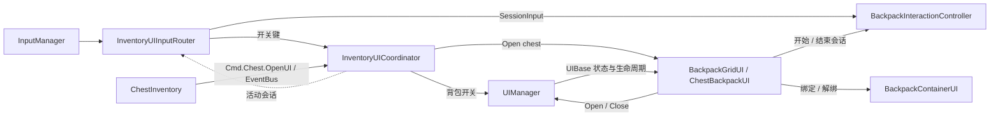

# 背包系统架构（当前实现）

> 范围：`Assets/backpack`。核对日期：2026-10-18。以当前代码与场景为准。

---

## 1. 概览

背包系统同时支持**单机**与 **Mirror 联机**，核心特征：

- **权威核心纯 C#**：`InventoryContainer` 持有唯一物品集合与占格映射，`InventoryHostCore` 负责宿主共享编排；两者不依赖 UI、MonoBehaviour、Mirror。
- **数据与表现分离**：UI 通过 `IBackpackView` 读数据、通过事件总线发意图，不直接拥有库存。
- **唯一权威坐标**：容器保存物品的上左格索引、冻结占格尺寸与逐格映射；UI 只读投影这些放置记录，不另存或猜测物品位置。网络同步同一坐标与尺寸。
- **服务端权威、客户端镜像**：服务端持容器；客户端只持由 `SyncList<NetworkInventoryEntry>` 恢复的只读 `RuntimeItem` 镜像。
- **原子提交**：先校验 / 规划、再一次性提交；跨容器转移与拆分事务失败时双方零变更。
- **同步事件、方向单一**：客户端意图 → Command → 服务端复核 → 容器提交 → 投影 → 客户端镜像。

当前可用交互：单栏按指定位置移动、交换和堆叠；双栏按指定位置转移与拆分，Ctrl + 左键自动转移并优先合并同类堆叠；Shift + 右键选择拆分数量。世界拾取目前仅单机可用，装备、消耗、丢弃与联机世界拾取尚未接入。

---

## 2. 分层与程序集

| 程序集 | 目录 | 职责 |
|---|---|---|
| `RPG4.Backpack.Core` | `Scripts/Core` | 事件总线、标签、网格类型 / 工具、日志 |
| `RPG4.Backpack.Items` | `Scripts/Items` | 片段、物品清单、运行时物品、数值快照 |
| `RPG4.Backpack.Inventory` | `Scripts/Inventory` | 权威容器、放置记录、宿主共享核心、视图契约 |
| `RPG4.Backpack.Equipment` | `Scripts/Equipment` | 预留，当前只有 asmdef |
| `RPG4.Backpack.Runtime` | `Scripts/Runtime` | 单机 / 场景宿主与本地玩家索引 |
| `RPG4.Backpack.Network` | `Scripts/Network` | Mirror 生命周期、服务端权威、客户端镜像、投影 |
| `RPG4.Backpack.UI` | `Scripts/UI` | 窗口、网格表现、输入与交互 |

```text
Core ← Items ← Inventory ← { Runtime, Equipment, Network } ← UI
                                  Network 额外依赖 Mirror
                                  UI 额外依赖 Input / Mirror / UI / TMP / InputSystem
```

约束：Core 不反向依赖业务层；Items 不感知容器；Inventory 不引用 Unity UI / Mirror；UI 只依赖接口与事件。

---

## 3. 数据模型

### 3.1 标签

`BackpackTag` 是点分层级值类型（如 `GameItems.Equipment.Weapons.Sword`）：

- `MatchesTagExact`：整串序数相等，用于物品类型、堆叠合并、目录查找。
- `MatchesTag`：层级包含。
- 空标签在匹配 API 中恒为 `false`；标签权威来源是代码常量与资产字段，`TagRegistry` 只做校验 / 下拉 / 层级枚举。

### 3.2 片段

```text
ItemFragment
├─ GridFragment             宽 / 高 / padding；缺省按 1×1
├─ StackableFragment        单堆上限；缺省不可堆叠
└─ InventoryItemFragment
   ├─ ImageFragment         图标
   ├─ TextFragment          说明文本
   ├─ LabeledNumberFragment 可随机化数值（唯一进入数值快照的类型）
   │  ├─ ConsumeModifier
   │  └─ EquipModifier
   ├─ ConsumableFragment    Modifiers
   └─ EquipmentFragment     equipmentType / equipPrefab / socket / Modifiers
```

`ItemManifest`（ScriptableObject）保存类型 + 片段模板：

- 创建：克隆片段并首次随机化。
- 恢复：结构取自模板、数值来自快照，**不重新随机化**。
- `ItemManifestCatalog` 按类型标签索引清单；客户端恢复、宿主拆分都必须能取到模板。

### 3.3 运行时物品

`RuntimeItem` = `ItemId` + `ItemType` + 片段列表 + `StackCount`。

- `ItemId` 不可变；`0` 表示未登记；由 `ItemIdGenerator` 发放，耗尽时抛异常不回绕。
- 堆叠数唯一来源是 `RuntimeItem.StackCount`；`SetStackCount` 只校验 `1..MaxStackSize`。
- `RuntimeItem` 未重写相等，容器字典按**引用**区分实例；跨网络更新后应按 `ItemId` 重新查询。
- 单机共享 `InventoryHostCore.SharedGenerator`；联机注入 `BackpackNetworkManager.ServerItemIds`。

### 3.4 数值快照

`RuntimeItemSnapshot` 只包含：`ItemId + ItemType + StackCount + 数值节点`。

二进制格式（`RuntimeItemSnapshotCodec`）：

| 区域 | 字节 | 内容 |
|---|---:|---|
| Header | 1 + 2 | 版本（当前 1）+ 节点数（小端） |
| Node | 2 + 2 + 4 | 片段下标 + Modifier 下标（-1 = 自身）+ float 位模式 |

限制：最多 64 个节点、最大 515 字节、类型标签最长 128。解码严格校验版本、长度、节点数、有限数值与尾随字节；应用数值时要求节点顺序与模板一致且落在 `Min..Max`。

---

## 4. 库存核心

### 4.1 `InventoryContainer`

唯一权威状态：

1. `Dictionary<RuntimeItem, InventoryPlacement>`：物品 → 放置记录。
2. `InventoryPlacement[] cells`：逐格占用；空格为 `Invalid`。
3. `Revision`：每次成功提交 +1，供网络投影判断变更。

不变量：

- 两份状态只在提交阶段同源写入，不存在中间态。
- 放置记录冻结尺寸；移除按冻结尺寸释放，不重新读模板。
- 行优先索引：`index = y * Columns + x`；上限 `65536` 格。
- 主线程单线程、不加锁；查询尽量复用缓冲。
- 移动与交换是权威事务：`TryMoveItem` / `TrySwapItems` 校验目标位置并原子提交。UI 不能直接改写放置记录。

主要能力：

- 查询：`FillItemsByItemId` / `TryGetItem` / `IndexOf` / `TryGetItemById` / `TryGetPlacement` / `TryGetCellIndices`。
- 空间：`QuerySpace`（落点全空 / 单个挡路物品 / 多物品阻塞）、`QueryAvailability` / `FillAvailability`（行优先容量）。
- 变更：`TryPlaceItem` / `TryMoveItem` / `TrySwapItems` / `TryRemoveItem` / `TryStackItem` / `TrySetStackCount` / `TryChangeStackPair` / `TryReceiveItem` / `TryTransferItem` / `TryTransferItemToEmptySpace` / `TrySplitStackToEmptySpace`。指定位置移动、交换、拆分与转移在校验后提交；失败时状态零变更。
- 自检：`TryValidateMapping`。

接收规则：先按行优先合并同类堆叠（类型精确匹配、双方可堆叠、未满），剩余量放入首个合法空白矩形；整批成功或整体失败。

原子性：变更先完整校验 / 规划，再一次性提交。合堆与数量交换由 `TryChangeStackPair` 同时更新双方；跨容器转移与拆分统一执行双方的确认钩子，确认失败则回滚数据并补偿投影。

### 4.2 `InventoryHostCore`

单机与联机共用：

- 创建 / 持有权威容器（纯客户端不创建）。
- 提供 `Catalog`、`IdGeneratorProvider`、`IsAuthority`。
- 只订阅 `InventoryOperation` 完整意图：权威端执行 `ExecuteOperation`，非权威端通过 `ForwardOperation` 转发。
- UI 操作包含合堆、交换数量、拆分和整件转移；核心按来源 / 目标宿主统一校验、提交与确认，不由 UI 拼接设数量、移除等原语。
- `CommitConfirm` 在联机时负责投影同步；完整操作确认失败回滚。结果包含请求 ID、成功状态、确切物品 ID、数量及错误，通过 `OperationCompleted` 返回。
- 保留 `TryAddItem`、`TrySetStackCount`、`TryRemoveItem`、`TrySplitStack` 等宿主 API，供库存内部与其他运行逻辑使用。

### 4.3 `IBackpackView`

```csharp
int ConfiguredRows { get; }
int ConfiguredColumns { get; }
object EventSource { get; }
void CopyItems(List<RuntimeItem> destination); // 按 ItemId 升序
```

`EventSource` 同时用于订阅 `Inv.*` 和发布 `Cmd.*`：单机 / 服务端 / 主机是**容器实例**；纯客户端是**宿主自身**。这是同一套 UI 能适配两种形态的关键。

写入能力单独通过 `IInventoryOperations.CanSubmitTo(destination)` / `HasEmptySpace(dimensions)` 预检；物品读取仍依赖 `IBackpackView`，视图不暴露可变容器。

---

## 5. 事件与命令

`EventBus` 按 **频道 + 来源** 定向投递，来源按引用相等：

- 同步派发；回调异常被隔离；单个订阅异常不影响其他订阅者。
- 监听者弱引用，Unity 对象销毁后惰性剔除；`listener = null` 为常驻强订阅并记警告。
- 订阅签名必须与发布泛型参数一致，不一致跳过并记 `Warn`。
- 仅主线程；派发期间新增订阅不参与本轮，派发结束后才压实集合。

频道（`EventChannels.cs`）：

| 频道 | 载荷 / 语义 |
|---|---|
| `Inv.Item.Added` / `Inv.ItemRemoved` | 物品进入 / 离开容器；当前无订阅者 |
| `Inv.Stack.Changed` | 堆叠变化（`SlotAvailabilityResult`）；当前无订阅者 |
| `Inv.Changed` | 粗粒度脏信号；UI 置脏、帧末合并重绘 |
| `Cmd.Inventory.Operation` | 完整库存意图（`InventoryOperation`） |
| `Cmd.Chest.OpenUI` | 展示指定箱子（`ChestInventory`）；由场景的 `InventoryUICoordinator` 通配来源订阅 |
| `Inv.Operation.Completed` | 对应请求的结果（`InventoryOperationResult`，含确切结果物品 ID） |
| `Cmd.Item.Drop` / `Cmd.Item.Consume` / `Cmd.EquipSlot.Clicked` | 已定义，无处理者 |
| `Ui.*` | 已定义；当前点击走 `PushClick` 直接调用，未使用 |

主数据流：

```text
UI → Publish(Cmd.*, source = EventSource)
   → InventoryHostCore
       ├─ 权威端：直接执行
       └─ 非权威端：ForwardOperation → RequestInventoryOperation → [Command] → 服务端
   → InventoryContainer 校验 / 规划 / 原子提交 → 广播 Inv.*（source = 容器）
   → UI 置脏 → LateUpdate 重绘
   → OperationCompleted（按请求 ID 匹配结果；纯客户端经 TargetRpc 返回）
```

纯客户端没有容器：服务端容器变化 → `SyncList` → 客户端镜像 → `BackpackNetworkInventory.LateUpdate` 代发 `Inv.Changed`（source = 宿主）→ UI 重绘。

单双栏都走同一完整操作入口；双栏转移 / 拆分的目标宿主解析与双方确认由核心处理。

---

## 6. 单机运行时

- `BackpackInventory`：组合 `InventoryHostCore`；`Awake` 创建容器，`OnEnable` 订阅命令；`EventSource = Container`；尺寸非法回退 6×8。
- `CharacterBackpack`：角色归属；`isLocalPlayer` 时登记到 `BackpackRegistry`；含测试用 ContextMenu。
- `ChestInventory`：箱子归属；实现 `IInteractable`，准心命中且在距离内时按 E 调用 `OpenUI()`，通过 `CmdChannels.OpenChestUI` 请求打开双栏窗口；不登记到 Registry，不持有 UI 引用。
- `WorldPickup`：单机世界物品交互；首次有效接收前按 manifest / 数量创建并缓存一个运行时实例（含首次随机值），由玩家 `BackpackInventory.TryReceiveItem` 原子接收。背包空间不足或配置无效时实例与地面物品保留，成功后才交出实例并隐藏拾取对象。无服务端物品身份与交互会话协议，Host、客户端、网络身份或网络库存玩家均拒绝此本地入口。
- `BackpackRegistry`：`Primary` 本地玩家背包；重复登记保留先注册者。

启动链：

```text
BackpackInventory.Awake → 核心 + 容器
BackpackInventory.OnEnable → 订阅命令
CharacterBackpack.OnEnable → 登记 Primary
BackpackGridUI.Update（每 0.25s）→ 解析本地玩家 → 绑定显示
BackpackContainerUI.BindInventory → 订阅 Inv.Changed
窗口 OnOpened → BackpackInteractionController.BeginSession（单栏或双栏）
InventoryUIInputRouter.Update → ReceiveInput（本帧指针、左右键与取消）→ 交互组件 Update 消费
窗口 OnClosed → EndSession → 清理携带、临时显示与操作结果订阅
```

---

## 7. 网络层

### 7.1 拓扑

```text
服务端 / 主机
  ├─ InventoryHostCore + InventoryContainer（权威）
  ├─ SyncList<NetworkInventoryEntry>
  └─ ServerItemIds 发放物品标识

纯客户端
  ├─ InventoryHostCore（无容器，只转发意图）
  ├─ SyncList（只读）
  └─ 客户端镜像 Dictionary<ulong, RuntimeItem>
```

数据流单向：客户端意图 → Command → 服务端复核 → 容器提交 → 投影差异 → 客户端镜像。不允许反向写回。

### 7.2 组件

| 组件 | 职责 |
|---|---|
| `BackpackNetworkManager : NetworkManager` | 网络生命周期日志；`OnStartServer` 创建 `ServerItemIds`，`OnStopServer` 释放；可配置自动 Host / Client / Server |
| `BackpackNetworkPlayer : NetworkBehaviour` | 网络身份与归属配色；不含移动 / 输入 / 库存 |
| `BackpackNetworkInventory : NetworkBehaviour, IBackpackView` | 服务端权威容器 / 纯客户端镜像；命令收口；投影同步；`Changed` 事件与诊断 |
| `InventoryNetworkProjection` | 纯 C# 投影：抓条目、恢复物品、容器差异同步、整体重建镜像 |
| `NetworkInventoryEntry` | 同步条目：`itemId / itemType / stackCount / fragmentState`（public 字段供 Weaver） |

生命周期：

- 服务端：创建核心与容器；`CommitConfirm = SyncEntries`；订阅命令（source = 容器）；客户端连接后通过 `SyncList` 收到快照。
- 纯客户端：创建无容器核心；`IsAuthority = false`；`RebuildMirror()`；订阅命令（source = 自身）；条目回调增量维护镜像。
- 主机：`isServer == true`，不建镜像，权威容器就是本地视图。

### 7.3 同步内容与投影

同步：标识、类型标签、堆叠数、数值快照、权威上左格索引与冻结占格尺寸。不同步：Unity 引用、非数值模板字段、片段对象。

- 客户端凭自己的 `ItemManifestCatalog` 按类型恢复模板，应用快照数值，不重新随机化。
- `SyncContainer` 只产生实际 Add / Set / Remove；`StateEquals` 逐字节比较载荷，未变化不下发。
- 投影拒绝（标识无效、载荷不可编码、模板缺失）计入 `DesyncCount` 与 `LastError`。
- 服务端操作只有在 `requiredItem` 成功进入投影时才算成功，否则核心回滚。
- 外部直接改服务端容器后必须调用 `SyncNow`。

### 7.4 客户端命令

同库存操作通过一条 `CmdExecuteInventoryOperation`（`requiresAuthority = true`）提交：携带请求 ID、操作类型、来源 / 目标物品 ID、数量与目标上左格索引。同库存移动、交换、合堆及指定位置拆分均支持网络提交，位置和冻结占格尺寸随 `SyncList` 投影同步。发送前检查客户端已启动、`isOwned`、标识有效；服务端完成校验与提交后，通过 `TargetInventoryOperationCompleted` 返回对应结果。纯客户端跨库存转移 / 拆分因没有目标库存访问会话而拒绝。

拆分由服务端创建新实例：取模板 → 抓源快照 → 新标识恢复（数值继承）→ 校验请求的上左落点（未指定时才扫描首个空白区）→ 扣减来源并放置 → 投影。

### 7.5 当前限制

- 纯客户端无权威容器，跨库存转移 / 拆分与世界拾取仍拒绝：服务端没有库存访问会话或世界物品身份校验时，不扩大权限或走本地旁路。
- 当前网络组件为裁剪版：不含拾取；装备 / 消耗网络分片未编入。
- 客户端目录必须与服务端模板一致（数值节点数量 / 顺序一致）。

---

## 8. UI 与交互

### 8.1 组件

| 组件 | 职责 |
|---|---|
| `UIManager` | 场景 UI 统一入口：启动时生成并注册窗口预制体，按类型查找、开关、置顶、全部关闭及处理互斥组 |
| `UIBase` | 窗口基类：统一 `IsOpen`、`CanvasGroup` 显隐、禁用 / 销毁清理；通过 `CanOpen`、`OnOpened`、`OnClosed` 扩展业务 |
| `BackpackGridUI` | 继承 `UIBase` 的单栏窗口：打开前验证玩家来源，打开后绑定显示与交互会话，关闭时解绑；窗口尺寸跟随网格 |
| `BackpackContainerUI` | 可复用网格显示：独占网格与外观配置，绑定库存、显示格子和物品框、维护本地显示状态与坐标换算 |
| `InventoryUICoordinator` | 配置在 `UIManager` 上的库存窗口入口：唯一订阅箱子展示请求，处理背包开关策略，并提供当前活动窗口与交互会话 |
| `InventoryUIInputRouter` | 采集库存输入：将开关键交给协调器，把本帧指针与点击转发给协调器提供的活动会话；不选择窗口类型 |
| `InventoryInputScope` | 普通 C# 类；捕获、暂停并恢复角色输入和鼠标状态，处理玩家来源晚初始化或更换 |
| `LocalBackpackSourceResolver` | 普通查询工具；网络本地玩家优先，回退到本地注册表，仅返回已就绪来源 |
| `InventoryGridLayout` | 只读投影库存的权威放置记录；缺失、越界或冲突的位置进入未显示列表，不自动寻位 |
| `BackpackItemUI` | 物品框：图标、数量、悬停色、透明度 |
| `BackpackInteractionController` | 单双栏共用交互会话；以 `MoveItem` / `SwapItems` / 堆叠 / 指定位置拆分与转移提交完整操作，独占携带预览 |
| `ChestBackpackUI` | 继承 `UIBase` 的双栏窗口：协调玩家和箱子来源、会话、标题与双栏布局 |



### 8.2 绑定与重绘

单栏数据源优先级：

1. `NetworkClient.localPlayer` 上的 `BackpackNetworkInventory`；
2. `BackpackRegistry.Primary`；
3. 无 → 拒绝打开；已打开的单栏窗口失去来源时关闭并解绑。

两个窗口只在打开期间绑定库存和维护展示订阅，每 0.25s 检查来源或事件键是否变化；关闭时结束会话、解绑视图并恢复输入。个人背包的打开准备只验证来源与显示配置，绑定在 `OnOpened` 执行，失败不影响当前互斥窗口。关闭后的可选快捷键提示只查询玩家是否就绪，不绑定库存。

箱子双栏窗口默认关闭，由场景的 `InventoryUICoordinator` 监听打开请求。`ChestInventory.OpenUI()` 同步发送箱子实例，协调器调用窗口 `Open(chest)`，窗口再经管理器打开；箱子来源尚未初始化时仍可显示占位并等待。窗口关闭时解绑双方库存并清空箱子引用；箱子被销毁后在来源检查时关闭。重复展示同一箱子不重建交互会话，切换箱子或显式玩家来源时先清理旧交互再改绑。禁用窗口不影响协调器接收后续请求；禁用协调器时释放请求订阅。

交互会话只在窗口打开期间存在：单栏传入一个 `BackpackContainerUI`，双栏传入左右两个容器。`InventoryUIInputRouter` 在执行顺序 50 收集本帧输入，以 `SessionInput` 传给 `ReceiveInput`；交互组件在执行顺序 100 消费当帧输入。窗口和容器先刷新来源与显示。关闭、禁用或销毁时调用 `EndSession`，取消操作结果等待、恢复临时数量与隐藏状态，并销毁携带预览。取消交互只清理本机状态，不撤回已经提交的库存操作。

显示配置直接保存在 `BackpackContainerUI`，单栏窗口不再复制格子、物品框、行列、尺寸或字体字段。`itemUIList` 是容器内部的运行时列表。携带预览层统一在 `BackpackInteractionController.cursorLayer` 接线，两个箱子栏共用窗口根节点下的同一图层；容器只提供几何换算，不管理携带预览层。`ChestBackpackUIData` 只保存左右视图、交互组件和标题引用，窗口的 `CanvasGroup` 由 `UIBase` 保存。

重新绑定来源时，先结束旧会话，再改绑视图。箱子窗口会同时比较左右数据源及其事件键，任一侧变化都会重建会话；单栏玩家来源或事件键变化时同样重建会话，保持窗口打开。相同来源和事件键的定期检查不会打断当前携带。

`UIManager` 是场景内的单例，不跨场景保留窗口引用，也不订阅库存业务事件。核心场景 `Assets/Scenes/Main.unity` 的 `UIManager` 对象预先配置 `InventoryUICoordinator`（执行顺序 -800）和 `InventoryUIInputRouter`（50），其下保留 `UICanvas`；管理器的 `windowRoot` 引用该 Canvas，`windowPrefabs` 引用 `Prefabs/背包UI.prefab` 和 `Prefabs/和箱子交互ui.prefab`。管理器在 `Awake`（-900）中各实例化并注册一次，窗口直接放在 `UICanvas` 下。固定子节点、`CanvasGroup` 和组件引用保存于预制体中；场景不保留窗口副本。两者的 `exclusiveGroup` 均为 `Inventory`，打开其中一个时先关闭另一个，再由新窗口的 `InventoryInputScope` 捕获输入与光标状态。窗口默认隐藏，打开时置于同级末尾；玩家来源通过共用查询工具获取，不在预制体中引用场景对象。

两个窗口预制体在编辑器中默认可见。单栏容器保存 4×5 格预览，箱子窗口的左右容器分别保存 8×6 格预览；每个容器的 `DefaultPreview` 都标记为 `EditorOnly`，复用已有格子和物品预制体，展示剑、大剑、药水和果实及示例堆叠数量。预览只保存视觉内容，不创建运行时物品、不绑定库存，也不加入 `itemUIList`。`BackpackContainerUI.Awake` 停用预览节点，`UIBase.Awake` 将游戏中的窗口关闭；打开背包时沿用 `Redraw()` 读取玩家库存，打开箱子时沿用 `RefreshBindings()` 绑定并显示双方实际库存。

普通窗口通过 `UIManager.Instance.Open<T>()`、`Close<T>()`、`Toggle<T>()` 管理；也可使用窗口继承的 `Open()`、`Close()`、`Toggle()`，最终都经过管理器。库存业务入口使用同物体上的 `InventoryUICoordinator.ToggleInventory()` / `OpenChest(chest)`，或沿用 `ChestInventory.OpenUI()` 事件；需要指定玩家时仍可直接调用箱子窗口的 `Open(player, chest)`。窗口关闭按钮保留直接调用 `Close()`。`CloseAll()` 统一关闭已注册窗口。启动窗口在管理器的 `windowPrefabs` 中接线，父节点由 `windowRoot` 指定；实例在启用时自动注册，管理器也会显式 `Register`，注册去重且不会修改父节点。

重绘链：

```text
Inv.Changed → dataDirty
→ LateUpdate → Redraw
→ CopyItems → GridFragment 尺寸 → InventoryGridLayout.Arrange
→ 格子配色 → 回收已消失 / 放不下的物品框
→ 复用 / 创建物品框 → 位置、尺寸、图标、数量、悬停 → 溢出文本
```

### 8.3 本地显示状态

`BackpackContainerUI` 仅保存四类临时显示状态，不包括物品坐标：

| 状态 | 用途 |
|---|---|
| 堆叠显示覆盖 | 逐个拆分携带时暂显“总数 − 已取”，不改运行时数量 |
| 拆分面板会话 | 暂存来源物品与原数量，确认前不提交操作 |
| `HiddenItemId` | 携带期间隐藏但仍占格 |
| `HoveredItemId` | 悬停高亮 |

**坐标只有一个真相源**：容器放置记录同时决定容量、落点、转移、拆分和显示位置。UI 布局器只投影权威坐标并提供本地命中与反馈；移动 / 交换 / 合堆 / 指定位置拆分或转移都提交完整 `InventoryOperation`，显示等待同步结果，不做乐观落点改写。Ctrl + 左键快捷转移使用目标接收规则，先合并同类堆叠，再放入首个可用空白矩形；Shift + 右键打开数量面板，确认数量后由用户选拆分落点。

### 8.4 交互

单栏：

| 操作 | 行为 | 触达数据层 |
|---|---|---|
| 左键点物品 | 建立临时携带预览，隐藏来源显示；权威物品仍留在原格 | 否 |
| 左键点空位 | 提交 `MoveItem` 或指定位置 `TransferItem` | 是（完整操作） |
| 左键点同类可堆叠 | 提交 `MergeStack`，按事务结果合并 / 部分填充 | 是（完整操作） |
| 左键点异类 / 不可堆叠 | 提交 `SwapItems` 交换权威位置 | 是（完整操作） |
| 左键点同类已满 | 提交 `SwapStackCounts`；无法换量时位置交换仍由 `SwapItems` 完成 | 是（完整操作） |
| 右键可堆叠物品 | 暂时携带 1 个；在原堆继续右键增加数量 | 否，确认落点后提交 |
| Shift + 右键可堆叠物品 | 打开数量面板，确认数量后携带并选定落点 | 确认落点后提交 |
| 部分携带落合法位置 | 提交带上左格索引的 `SplitStack`；位置与堆叠数由权威事务一次提交 | 是（完整操作） |
| 整件携带右键 / ESC | 取消临时携带显示，不提交变更 | 否 |

单栏绑定一个视图，双栏绑定两个视图；两者共用拾取、部分携带、落点判定、提交与取消流程。一次会话只有一个预览物，跨栏时调整其尺寸和位置。

提交后按请求 ID 等待显式结果，最长 5s；位置与数量始终由库存变更事件和权威投影驱动。失败、超时或取消会恢复真实库存显示；停止等待不撤销已经提交的权威操作。

数量弹窗期间不解释背后的指针点击为库存操作；若来源库存、物品数量、放置位置或占格尺寸在确认前改变，会关闭本次选择并提示重新操作。

双栏：

- 右键从目标堆叠取 1 个；继续右键源物品再取 1 个。Shift + 右键通过数量面板选择拆出数量。
- 左键：空位放下时按目标上左格提交；对准物品时按合法规则合堆或交换。部分携带提交指定位置 `SplitStack`；跨栏整件提交 `TransferItem`。
- Ctrl + 左键在目标栏自动转移整件 / 整堆，目标按行优先先合并同类堆叠，再放入空白矩形；失败不修改双方。
- 通过 `IInventoryOperations` 预检写入与权威宿主；纯客户端没有跨库存访问会话，转移 / 拆分继续拒绝。
- 核心负责目标宿主解析、容量校验与双方投影确认；UI 只消费结果，不直接调用容器、确认钩子或 `SyncNow`。

### 8.5 悬停、输入与窗口

- 悬停四态：`None` / `Available`（绿）/ `Blocked`（红）/ `Swap`（黄）。
- 落点与悬停全部由指针坐标 + 网格几何计算，不依赖 uGUI 射线；格子 `raycastTarget = false`。
- `InventoryUIInputRouter` 统一读取 `InputManager.backpackInput`：`BackPackUI`、`leftButton`、`rightButton`、`cancel`、`pointerPosition`。开关键交给 `InventoryUICoordinator`，协调器每帧最多处理一次：有库存窗口时关闭当前窗口，否则打开玩家背包。输入路由通过协调器获取活动会话；点击同时记录窗口和会话版本，避免窗口切换、重新打开或来源重绑后重放旧点击。
- 打开窗口时由 `InventoryInputScope` 采集并暂停 `PlayerInput`、解锁光标；关闭时原样还原。玩家来源改变时先恢复旧玩家，再暂停新玩家。
- 双栏窗口打开时由 `UIManager` 关闭单栏窗口，统一输入路由负责消费开关键，两个窗口不再互相查询输入拦截状态。

---

## 9. 关键不变量

1. 物品集合、权威占格、`Revision` 只在 `InventoryContainer`；堆叠数只在 `RuntimeItem`。
2. 变更先规划后提交，失败即零变更；放置记录尺寸冻结。
3. 接收 / 转移先合堆再落格；类型必须 `MatchesTagExact`。
4. 物品标识由权威端发放；容器拒绝重复标识；客户端不接受 `None` 条目。
5. UI 只保存显示覆盖、携带隐藏、悬停态等临时状态；物品位置由容器唯一持有，并随网络条目同步。
6. 事件订阅 / 发布必须使用同一 `EventSource`；频道键只能来自 `EventChannels.cs`。
7. 主线程单线程访问，不加锁；`EventBus` 同步派发。
8. 客户端不创建 `RuntimeItem`、不发放标识、不直接改容器；服务端投影成功才算操作成功。
9. 跨网络更新后不要长期持有 `RuntimeItem` 引用，按 `ItemId` 重新查询。

---

## 10. 配置、当前范围与关键文件

### 10.1 资产与场景

- 物品模板：`Data/Items/*.asset`；目录：`Data/Items/物品清单目录.asset`；标签：`Data/TagRegistry.asset`；日志：`Data/LogSettings.asset`。
- 当前场景：
  - `player`：`BackpackInventory`（6×8）+ `CharacterBackpack`。
  - `Prefabs/Chest.prefab`：非 Trigger BoxCollider + `BackpackInventory`（6×8）+ `ChestInventory`；示例场景实例位于玩家右前方（1.5, 0.4, 1.8），准心对准后按 E 打开双栏。仅场景实例启用目录测试填充，预制体默认关闭。
  - `UIManager/UICanvas`：场景中预置的窗口父节点，统一 Canvas、缩放和射线检测；两个窗口由管理器在启动时生成。
  - `Prefabs/背包UI.prefab`：根节点保存 `BackpackGridUI` + `BackpackInteractionController`，子节点使用共用网格预制体；启动时生成并注册为单栏背包窗口。
  - `Prefabs/和箱子交互ui.prefab`：根节点保存 `ChestBackpackUI` + `ChestBackpackUIData` + 交互组件，左右子节点使用共用网格的大尺寸变体；启动时生成并注册为双栏窗口，默认关闭且不预绑定箱子。标题、图层在预制体中创建并接线。
  - `Scenes/Main.unity`：示例场景的单机世界物品包含红药水 ×3 与火蕨果 ×12，分别由 `WorldPickup` 指向对应 manifest。
  - `Prefabs/InventoryGridView.prefab`：共用网格根节点保存 `BackpackContainerUI`，下设 `SlotLayer`、`ItemLayer` 和 `EditorOnly` 的 `DefaultPreview`；默认配置 4×5、格子 100、间距 10。格子复用带 `BackpackSlotUI` 的 `Image.prefab`，物品框复用 `物品ui.prefab`。
  - `Prefabs/InventoryGridViewLarge.prefab`：基于共用网格的变体，配置 8×6、格子 64、间距 8，并保存对应的大尺寸预览。箱子两栏共用该变体，右栏通过实例覆盖保留原有示例物品、数量与占用颜色。
- 联机组件当前**未挂到场景**；需要按第 7 节自行接线，客户端与服务端使用同一目录。

### 10.2 当前未接入

| 项 | 状态 |
|---|---|
| 装备 | `Equipment` 程序集只有 asmdef；`EquipmentFragment` 有数据模型，无装备 / 卸下流程 |
| 消耗 | `ConsumableFragment` 有数据模型，无消耗处理者与效果系统 |
| 丢弃 / 拾取 | `Cmd.Item.Drop` 无处理者；网络组件不含拾取链路 |
| `Ui.*` 事件 | 已定义，当前点击走直接调用 |
| 具体物品事件 | `Inv.Item.Added` / `Stack.Changed` / `ItemRemoved` 已广播但无订阅者 |
| 自动化测试 | `Tests/` 仅空目录，无测试程序集 |
| 位置同步 | 上左格索引与冻结占格宽高随网络条目同步，客户端以此恢复只读镜像布局 |

### 10.3 关键文件

| 层 | 入口文件 |
|---|---|
| 事件 | `Core/Events/EventBus.cs`、`EventChannels.cs` |
| 物品 | `Items/Runtime/RuntimeItem.cs`、`Manifest/ItemManifest.cs`、`Runtime/RuntimeItemSnapshotCodec.cs` |
| 库存 | `Inventory/InventoryContainer.cs`、`InventoryHostCore.cs`、`InventoryOperation.cs`、`IBackpackView.cs` |
| 单机 | `Runtime/BackpackInventory.cs`、`CharacterBackpack.cs`、`BackpackRegistry.cs` |
| 网络 | `Network/Inventory/BackpackNetworkInventory.cs`、`InventoryNetworkProjection.cs` |
| UI | `UI/BackpackContainerUI.cs`、`BackpackInteractionController.cs`、`ChestBackpackUI.cs` |

---

**一句话总结**：权威容器唯一决定物品、数量、位置与占格；客户端镜像恢复同步状态；UI 只读投影布局并通过完整事务表达操作意图。
