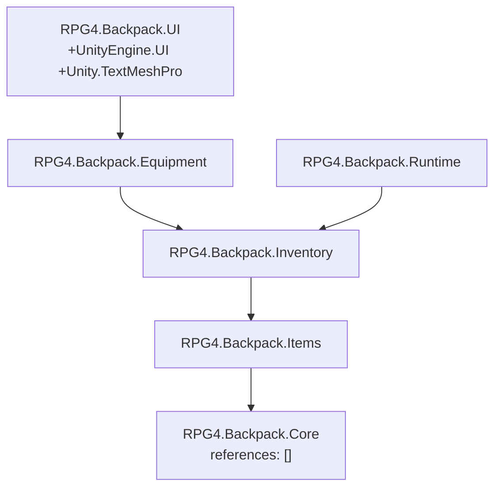

# F1 / F2 · 程序集划分 · 目录结构与命名规范（RPG_4 工程）

> 落盘根：`Assets/backpack/`，等价路线图中的 `Assets/_Project/`（本工程既有 `Assets/Scenes`、`Assets/Settings`、`Assets/TutorialInfo`，为免交叉污染整体下沉一层）。
> 上游权威文档（蓝本工程）：`e:/github/ZDXT2/Assets/backpack/Docs/规范/工程架构/F1_F2_程序集与目录命名规范.md`
> 路线图：`e:/github/ZDXT2/Assets/backpack/Docs/里程碑/路线图/Unity多人背包系统执行顺序方案.md`
> 工程环境：Unity 2022.3.62f3 LTS + URP 14.0.12，`productName: RPG_4`。

---

## 1. F1 程序集划分

### 1.1 已落盘（7 个运行时程序集）

| 程序集 | 定义文件 | references | 职责 |
|---|---|---|---|
| `RPG4.Backpack.Core` | `Scripts/Core/RPG4.Backpack.Core.asmdef` | `[]`（地基） | 事件总线 · 标签 · Utils/日志 · 基础类型契约（F3–F6） |
| `RPG4.Backpack.Items` | `Scripts/Items/RPG4.Backpack.Items.asmdef` | `Core` | Fragment 家族 · 物品清单 · 运行时物品（M1） |
| `RPG4.Backpack.Inventory` | `Scripts/Inventory/RPG4.Backpack.Inventory.asmdef` | `Core` `Items` | 库存真相源 · 占用矩阵 · 空间查询（M2） |
| `RPG4.Backpack.Equipment` | `Scripts/Equipment/RPG4.Backpack.Equipment.asmdef` | `Core` `Items` `Inventory` | 装备组件 · 装备 Actor（M7） |
| `RPG4.Backpack.UI` | `Scripts/UI/RPG4.Backpack.UI.asmdef` | `Core` `Items` `Inventory` `Equipment` `UnityEngine.UI` `Unity.TextMeshPro` | 网格 · 槽位 · 悬停物 · 弹窗 · HUD（M5–M6） |
| `RPG4.Backpack.Network` | `Scripts/Network/RPG4.Backpack.Network.asmdef` | `Core` `Items` `Inventory` `Mirror` | 网络基座 · 生命周期日志 · 物品标识生成器托管（F7） |
| `RPG4.Backpack.Runtime` | `Scripts/Runtime/RPG4.Backpack.Runtime.asmdef` | `Core` `Items` `Inventory` | 单机背包宿主 · 索引（S1） |

### 1.2 目标态（待后续阶段补齐）

| 程序集 | 何时 | 补齐内容 |
|---|---|---|
| `RPG4.Backpack.Network` 的 `Unity.InputSystem` 引用 | M4 / M6 | 安装 `com.unity.inputsystem` 后补进 references（F7 已落盘，程序集本体见 §1.1） |
| `RPG4.Backpack.Core.Editor` | F5 后续轮（2026-10-05 暂缓） | `Scripts/Core/Editor/` 独立程序集，`includePlatforms: ["Editor"]`，仅依赖 `Core`；与 `BackpackTagDrawer` / `TagRegistryValidator` / 注册表链路注入修复同批落盘。**不含**蓝本的 `EventBusSelfCheck`（F6 已按「无 Editor 自检」落盘，2026-10-05 选型） |
| `RPG4.Backpack.Content.Editor` | 内容构建 | `Editor/` 独立程序集，`includePlatforms: ["Editor"]` |
| `RPG4.Backpack.Tests` | 单测落地 | `Tests/` 独立程序集，`Editor` + `UNITY_INCLUDE_TESTS` + `nunit.framework.dll` |
| `Equipment` / `UI` 的 Mirror 依赖 | F7 未回填 → M3 / M5 / M7 | 追加 `RPG4.Backpack.Network` 与 `Mirror`；F7 轮无代码消费，按选型顺延（`UI` 另需 `Unity.InputSystem`，随该包安装一并补） |
| `RPG4.Backpack.UI` 的 `RPG4.Backpack.Runtime` 引用 | S1 UI 接入阶段（2026-10-05 延后） | 单机自动绑定走 `BackpackRegistry.TryGetPrimary`；本轮 UI 不引用 Runtime（S1 只落数据层，见《S1_单机背包宿主与索引》） |

> 本轮**禁止**把 `Mirror` / `Unity.InputSystem` 写进任何 `references`：两者尚未安装，写了会直接触发 "Assembly Definition reference not found"，违反 F1 完成标志「空工程可编译通过」。

### 1.3 依赖方向（硬约束）



- 只允许**由上向下**引用；`references` 一律写**程序集名字符串**，不用 `GUID:`（可读、可 merge）。
- `Core` 的 `references` 必须为空数组——一旦引用上层即成环，分层失效。
- `UI` 不出现在任何其他程序集的 `references` 里（表现层是叶子）。
- `Inventory` 及以下**不得持有任何 UI 引用**（路线图修正项 H）。
- `Runtime` 与 `Network` 互不依赖，二者都只经 `Inventory` 向上暴露（S1：`Runtime → Inventory` 单向；`Runtime` 不引用 UI / Network / Mirror）。

---

## 2. F2 目录结构

```
Assets/backpack/                     ← 工作区根（已落，配 .meta）
├─ Scripts/
│  ├─ Core/           RPG4.Backpack.Core.asmdef        已落
│  │  ├─ Types/         基础类型契约（F3）                已落（六类型已填）
│  │  ├─ Utils/         坐标换算 / Bounds / 二维遍历 / 日志分级（F4）  已落（日志四文件 + GridUtils 已填）
│  │  ├─ Tags/          层级标签 + 精确匹配（F5）          已落（三文件 + .meta）
│  │  ├─ Events/        事件总线（F6）                    已落（三文件 + .meta）
│  │  └─ Editor/        Core.Editor 程序集落点（F5）        已落（空目录，asmdef 与抽屉/校验器暂缓；F6 的 EventBusSelfCheck 不移植）
│  ├─ Items/          RPG4.Backpack.Items.asmdef       已落
│  │  ├─ Fragments/      Fragment 家族（M1）             已落（空）
│  │  ├─ Manifest/       物品清单 SO（M1）                已落（空）
│  │  ├─ Runtime/        运行时物品实例（M1）              已落（空）
│  │  └─ Consumables/    消耗效果接口与注册表（M8）          已落（空）
│  ├─ Inventory/      RPG4.Backpack.Inventory.asmdef   已落（M2：InventoryContainer + InventoryPlacement；Backpack / BackpackData 为原型，不接入）
│  ├─ Runtime/        RPG4.Backpack.Runtime.asmdef     已落（S1：BackpackInventory 宿主组件 + BackpackRegistry 索引；UI 接入延后）
│  ├─ Equipment/      RPG4.Backpack.Equipment.asmdef   已落
│  ├─ UI/             RPG4.Backpack.UI.asmdef          已落
│  │  ├─ Grid/           网格 / 槽位 / 悬停物（M5、M6）      已落（空）
│  │  └─ HUD/            背包开关 · 拾取提示（M5）          已落（空）
│  └─ Network/        RPG4.Backpack.Network.asmdef     已落（asmdef + BackpackNetworkManager / BackpackNetworkPlayer 两脚本）
├─ Editor/            空目录（`RPG4.Backpack.Content.Editor.asmdef` 待内容构建时落）  已落
├─ Data/
│  ├─ Items/            Manifest 与 Fragment 资产         已落（空）
│  ├─ LogSettings.asset 日志分级配置（F4）                已落
│  └─ TagRegistry.asset 标签注册表种子（F5）               已落（9 条）
├─ Prefabs/             拾取物 · 装备 Actor · UI 预制体     已落（空；F7 的 PF_NetworkPlayer 由使用者手搭）
├─ Scenes/              阶段场景                          已落（空；F7 的 F7_NetworkBootstrap 由使用者手搭）
├─ Tests/               空目录（`RPG4.Backpack.Tests.asmdef` 待单测落地时新建）  已落
│  ├─ Content/ Equipment/ Inventory/ Network/ Support/
└─ Docs/
   ├─ 工程架构/         程序集与目录命名规范（本文）
   └─ 核心契约/         阶段契约副本（已落 F3_网格类型契约.md、F4_工具与日志分级.md、F5_标签系统.md、F6_事件总线.md、F7_Mirror网络基座.md）
```

- **空目录必须先有 `.meta` 才能在 Unity 中可见**：本工程非 git 仓库，目录 `.meta` 为手工生成、GUID 32 位十六进制且全局唯一。
- 每个目录与每个 `.asmdef` **成对**持有 `.meta`；新增层级目录前先改本文档，避免目录漂移。

---

## 3. 命名规范

### 3.1 程序集 / 命名空间

- 程序集：`RPG4.Backpack.<层名>`，与目录一一对应（`Core / Items / Inventory / Equipment / UI / Network / Tests`）。
- 命名空间：**与程序集同名，一层到底**。子目录不再切分命名空间，避免 `Core.Events.X` 这类深链 `using`。
  - 例：`Scripts/Core/Events/EventBus.cs` → `namespace RPG4.Backpack.Core`，类型 `EventBus`。
- 跨层引用只写 `using RPG4.Backpack.Core;`，不写全限定长链。
- 改名说明：`RPG4` 前缀于 2026-10-05 由蓝本前缀统一改来（蓝本源码与文档未动），逐行对照时按层名对应即可。

### 3.2 类型与文件

| 对象 | 规则 | 示例 |
|---|---|---|
| 文件 | 与其中**唯一 public 类型**同名；一文件一主类型 | `ItemManifest.cs` → `class ItemManifest` |
| 例外 | 纯数据小类型（枚举、只读 struct、同族 Fragment）可并入所有者文件 | `ItemFragments.cs` 内多个 `[Serializable]` struct |
| 类 / 结构体 / 枚举 | PascalCase 单数 | `GridSlot`、`TileParams` |
| 接口 | `I` 前缀 | `IItemFragment` |
| 抽象基类 | 不加前缀，语义表达即可 | `LabeledNumberFragment` |
| 泛型参数 | `T` 打头 PascalCase | `TChannel` |
| 枚举成员 | PascalCase | `SlotState.Empty` |

#### 3.2.1 复杂类型的内部封装与成员分区

- 同一宿主类型内语义相关的字段、缓存、订阅句柄及其辅助方法 / 属性，必须优先收拢到 `private` 嵌套 `class` 或 `struct`，避免继续堆叠平铺状态与平行容器。
- 按生命周期与可变性选择包装类型：需要跨帧持有可变集合或引用状态时使用 `private sealed class`；表示不可变计算参数或一次性快照时使用 `private readonly struct`（确需修改的值语义快照才使用 `struct`）。
- 包装类型只暴露宿主需要的最小成员。仅为分组不得新增 `public` / `internal` API、程序集依赖或独立 `.cs` 文件；原有序列化字段名、公开签名与 Unity Inspector 接线必须保持不变。
- 复杂宿主文件必须使用一层 `#region` / `#endregion` 按职责分类序列化字段、内部类型、运行时状态、属性、生命周期方法、业务方法与私有辅助方法。每个区域必须成对、不得跨类型边界；区域内部不再嵌套 `#region`，区域名称写在 `#region` 行尾并保持顺序稳定。
- 属性与方法必须放入其所属职责区，不得用 `#region` 掩盖未收拢的重复状态或替代真实的职责拆分。`#region` 只服务于阅读折叠，不改变运行时语义。

### 3.3 成员

- 公开成员 / 属性 / 方法：PascalCase（`TryAddItem`、`HasRoomForItem`）。
- 私有序列化字段：camelCase **无下划线**：

  ```csharp
  [SerializeField]
  private List<Skill> skills;         // 私有字段小驼峰
  public List<Skill> Skills { get; }  // 对外以大驼峰属性暴露
  ```

- 常量 / 静态只读：PascalCase（`MaxStack`、`DefaultGridSize`）。
- 布尔：`is / has / can / allow` 打头，**禁止** `b` 前缀（不沿用 UE 命名）。
- 事件与回调：`On<名词><动词过去式>`（`OnSlotChanged`）；事件总线投递方法用动词原形（`Publish`、`Subscribe`）。

### 3.4 事件频道键（F6）

三个静态常量类承载三频道，键格式 `域.对象.动作`：

| 类 | 前缀 | 方向 | 示例 |
|---|---|---|---|
| `InvChannels` | `Inv.` | 数据层 → UI 状态广播 | `Inv.Stack.Changed` |
| `CmdChannels` | `Cmd.` | UI → 数据层意图 | `Cmd.Item.Drop` |
| `UiChannels` | `Ui.` | UI 内部事件 | `Ui.GridSlot.Clicked` |

- 键必须定义成常量，**禁止**裸字符串字面量出现在业务代码里。
- source key 统一用**组件实例**（多实例定向投递不串台）；需要接收全部来源时用 `EventBus.AnySource`。

### 3.5 资产

- Fragment / Manifest 资产：`Data/Items/` 下，Manifest 以内容名命名；Catalog 用 `ItemManifestCatalog.asset`。
- 单例配置资产：`Data/` 根下，与类同名（`LogSettings.asset`、`TagRegistry.asset`），全工程只保留一份实例。
- 预制体：`Prefabs/` 下，游戏对象 `PF_<名称>.prefab`，UI 用 `UI_<名称>.prefab`。
- 场景：`Scenes/` 下 `<阶段>_<用途>.unity`；联机冒烟场景与离线玩法场景分目录存放。
- 资产命名与类名对应，禁止 `NewItem (1)` 之类默认名入库。

---

## 4. 验收清单

1. `Assets/backpack/` 下 7 个 asmdef 的 `name` 全局唯一，`references` 悬空数 = 0。
2. `Core` 的 `references` 为空数组；`UI` 不出现在任何其他程序集的 `references` 里。
3. 每个目录 / asmdef / 文档均有 `.meta`，GUID 为 32 位十六进制且全局唯一。
4. Unity 打开工程 → Console 无 CS 报错、无 "Assembly Definition reference not found"。
5. `Assets/Scenes` 等既有资产不受影响。

---

## 5. 下一步

- **F3 + F4 已全量落盘（2026-10-05）**：`Core/Types/` 六类型（`GridCoord` / `TileQuadrant` / `TileParams` / `SlotAvailability` / `SlotAvailabilityResult` / `SpaceQueryResult`）与 `Core/Utils/GridUtils.cs`（换算 / Bounds / Clamp / 二维遍历）已落盘；`Core/Utils/` 日志四文件 + `Data/LogSettings.asset` 同期落盘。配套规范副本见 `Docs/核心契约/F3_网格类型契约.md`、`F4_工具与日志分级.md`。`Core.asmdef` 仍为 `references: []`。
- **命名统一（2026-10-05）**：5 个程序集、其命名空间与跨程序集引用统一为 `RPG4.Backpack.*`（原为蓝本同名前缀）；`LogSettings` 的 `CreateAssetMenu` 菜单路径改为 `RPG4/Backpack/Log Settings`。改名后 asmdef 的 GUID 不变，`Data/LogSettings.asset` 不受影响。
- **零单测（2026-10-05 选型）**：`Tests/` 目前只有 5 个空子目录、**尚无 asmdef**；F3 验收按「人工核对 + Unity 编译确认」执行，回归网待 M 阶段统一补（取舍见《F3_网格类型契约》第 6 节）。
- **F5 运行时部分已落盘（2026-10-05）**：`Core/Tags/` 三文件（`BackpackTag` / `BackpackTagConstants` / `TagRegistry`）与 `Data/TagRegistry.asset`（9 条种子，与常量严格一致）已落盘；命名空间 `RPG4.Backpack.Core`，`TagRegistry` 的 `CreateAssetMenu` 为 `RPG4/Backpack/Tag Registry`。配套规范副本见 `Docs/核心契约/F5_标签系统.md`。`Core.asmdef` 仍为 `references: []`。
- **F5 Editor 部分暂缓（2026-10-05 选型）**：`Core/Editor/` 的 `RPG4.Backpack.Core.Editor.asmdef`、`BackpackTagDrawer`、`TagRegistryValidator` 与「注册表链路注入修复」（显式赋值 `TagRegistry.Current`，否则抽屉读到空表）同批实施；Editor 菜单路径沿用蓝本 `Tools/Backpack/*`。
- **F6 事件总线已落盘（2026-10-05）**：`Core/Events/` 三文件（`EventBus` / `EventSubscription` / `EventChannels`，含 `.meta`，GUID 沿用蓝本且工程内已核对唯一）已落盘，命名空间 `RPG4.Backpack.Core`；除命名空间前缀改名外与蓝本 `Scripts/Core/Events/` 逐字节一致（已用脚本按前缀替换后全等校验）。频道键按 F6 规范落**最小集 9 条**：`Inv.PickupPrompt` / `Inv.Equipment.Changed` 属 M4/M7 落点，本轮未落并已登记在 `EventChannels.cs` 尾部注释。**未移植**蓝本 `Core/Editor/EventBusSelfCheck.cs`、未新建 `Core.Editor` 程序集。验收口径由路线图的「通过单测」降级为**编译 + 人工核对**（用户选型，同零单测口径），配套规范见 `Docs/核心契约/F6_事件总线.md`。`Core.asmdef` 仍为 `references: []`。
- **F7 Mirror 网络基座已落盘（2026-10-05）**：新建第 6 个程序集 `RPG4.Backpack.Network`（`references = Core / Items / Inventory / Mirror`，**不含 `Unity.InputSystem`**）与 `Scripts/Network/` 两脚本（`BackpackNetworkManager` 192 行 / `BackpackNetworkPlayer` 90 行，除命名空间与菜单前缀改名外与蓝本逐字节一致，`.meta` GUID 沿用蓝本且工程内唯一）。网络库 `Assets/Mirror` 早已在工程内（96.0.1，2270 文件与蓝本文件集合一致、1259 个 `.meta` 哈希全等），**未安装任何包、未改 `Packages/manifest.json`**；「物品 Id 生成器」由 M1 已落的 `Items/Runtime/ItemId.cs` + `ItemIdGenerator.cs` 达标。**场景与预制体由使用者手搭**（清单见 `Docs/核心契约/F7_Mirror网络基座.md` §4），`Equipment` / `UI` 的网络依赖、`Unity.InputSystem`、Build Settings 登记均顺延。验收口径：Unity 刷新无 CS 报错 + 双端 Play（Host / Client）冒烟。
- **M2 库存真相源与空间查询已落盘（2026-10-05）**：`Scripts/Inventory/` 新增 `InventoryPlacement.cs`（53 行，前缀替换后与蓝本全等）与 `InventoryContainer.cs`（609 行照搬 + 本工程 F6 广播注入，共 643 行；**2026-10-06 就地精简重构为 608 行、自此不再与蓝本逐行对应**，公共 API / 广播 / 原子性 / 零 GC 逐条不变，5 个调用方零改动），命名空间 `RPG4.Backpack.Inventory`，`.meta` 沿用蓝本 GUID 且工程内唯一；程序集与依赖不变（`Core` / `Items`）。**唯一功能性偏差**：4 处变更成功路径接 F6 事件总线（`Inv.ItemAdded` / `Inv.ItemRemoved` / `Inv.StackChanged`，source 为容器实例），其中 `Inv.ItemRemoved` 为 M2 轮新补的 `InvChannels` 常量；F6 键表与未落清单已同步。`Backpack.cs` / `BackpackData.cs` 保留但**标注为原型、不接入**（职责已被容器覆盖，后续 M 阶段不再引用）。零单测口径延续，配套规范见 `Docs/核心契约/M2_库存真相源与空间查询.md`。
- **S1 单机背包宿主与索引已落盘（2026-10-05）**：新建第 7 个运行时程序集 `RPG4.Backpack.Runtime`（`references = Core / Items / Inventory`，不含 UI / Network / Mirror / InputSystem）与 `Scripts/Runtime/` 两个脚本——`BackpackInventory`（宿主组件：挂玩家或箱子、各自持一份 `InventoryContainer`，本地完成增 / 删 / 并堆叠 / 拆分 / 改数量的校验与提交，失败零变更；帧末合并派发一次 `Changed`）与 `BackpackRegistry`（静态索引：本地玩家包 `Primary` / 按物体 `TryGet`），命名空间 `RPG4.Backpack.Runtime`，`.meta` 手工生成且 GUID 全局唯一。**本轮范围限定为数据层**：不改 UI / Network / Inventory 既有文件、不落 `IBackpackSource`、不做场景与预制体接线；UI 接入（接口 + UI 改绑 + UI asmdef 追加 Runtime 引用）登记在《S1_单机背包宿主与索引》§7。验收口径：Unity 编译无 CS 报错 + 临时脚本冒烟（零单测口径延续），配套规范见 `Docs/核心契约/S1_单机背包宿主与索引.md`。
