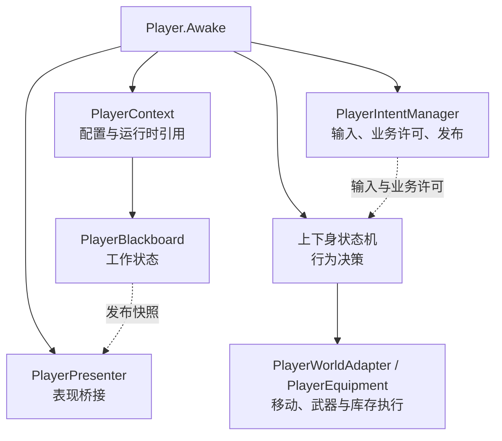
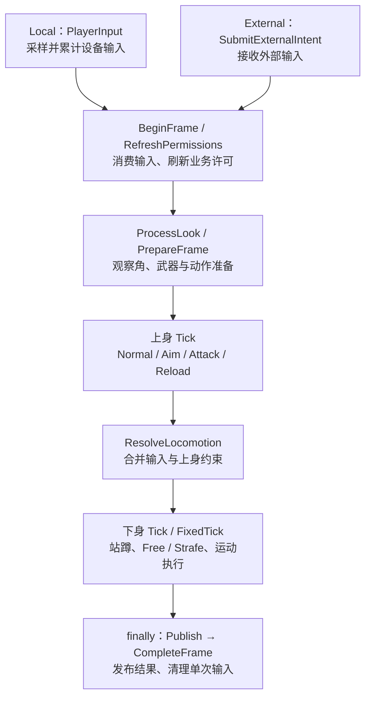
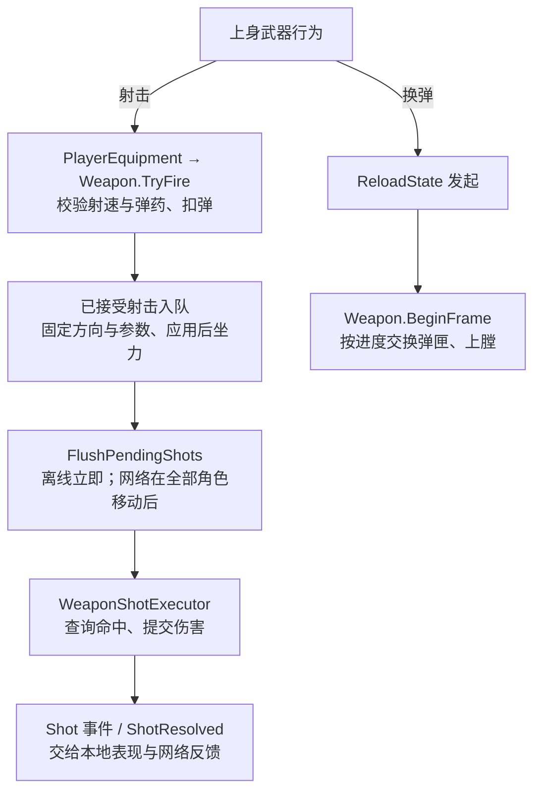
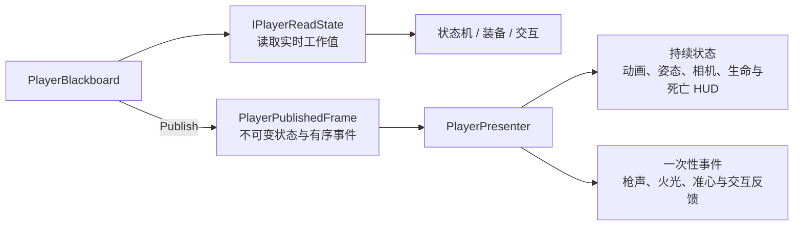
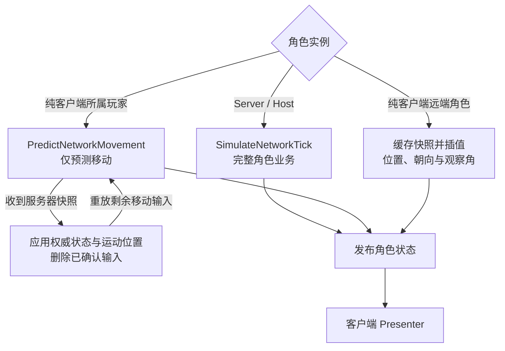

# Player 组件架构与调用时序

更新日期：2026-11-01。以当前工作区实现为准；应用入口与会话切换见[游戏运行流程图](游戏运行流程图.md)，网络部署与库存同步见[网络权威处理与部署方向](网络权威处理与部署方向.md)。

本文描述角色生成后的组件调度。当前客户端从 `ClientBootstrap → MainMenu` 登录独立服务器，再进入 `OnlineGame`；服务器从 `ServerBootstrap` 启动并加载 `OnlineGame`。下文的离线与 Host 分支属于保留的兼容能力，不能据此将旧 `Main` 场景视为当前产品入口。

## 组件总览

`Player` 负责装配与调度，`PlayerContext` 持有每个角色唯一的工作黑板。

角色依赖刚体、胶囊体、`PlayerInput` 与 `CharacterAttributes`。模型、相机和动画不决定移动、扣弹或伤害是否成立。

## 输入与固定步

下图表示存活角色一次 `SimulateTick` 的主流程。

- 离线由 `Player.FixedUpdate` 驱动；Server / Host 由 `SimulateNetworkTick` 驱动。死亡分支跳过状态机，仍发布状态。
- 窗口与焦点控制本地输入；存活、刚体和武器事实决定业务许可。单次按下和观察增量只消费一次，切换来源会清空旧输入。
- 移动计划与实际姿态分开：站起仍须通过碰撞检查。离线使用动态刚体，网络使用运动学胶囊移动；不使用动画根运动。

## 射击与换弹

射击使用逻辑观察角和身体锚点，不读取模型枪口。已接受的射击不会因同 Tick 随后死亡而撤销；换弹取消不回滚已提交的库存变化。

## 数据与表现

表现关闭后逻辑仍可推进；重新启用时恢复最新状态，不补播历史事件。当前仍在 Unity 主线程运行，发布快照不代表支持并发写入。

库存窗口与武器面板使用独立通道：

| 显示内容 | 数据来源 |
|---|---|
| 背包、物品详情、角色概览 | 库存 / 装备 / 属性视图。Host 私人库存读取权威数据，共享箱子仍须等获权镜像就绪。 |
| 离线 / Host 武器 UI | `PlayerEquipment.WeaponUi` 发布的武器快照。 |
| 纯客户端武器 UI | `BackpackNetworkInventory.WeaponUi` 根据网络镜像发布的武器快照。 |

## 网络角色分工

当前在线入口由服务器在认证及世界就绪校验通过后，按受信任生成配置初始化角色，再发布到连接。客户端还须等待场景、所属角色和 UI 绑定就绪；`ClientSessionController` 进入 `Playing` 后才放行本地游戏输入。场景切换、就绪丢失或断线时会关闭输入。

- Host 本地输入直接进入服务器缓冲，只执行一次权威业务；独立服务器关闭表现。纯客户端不重放扣弹、伤害或库存事务。
- 网络状态投影使用 `ApplyNetworkPresentation`，射击反馈使用 `ApplyNetworkShot`；两者都不重新执行业务。生命快照可恢复生死与受伤状态，但完整受击方向事件尚未复制。
- 死亡会停止角色行为并更新 HUD，复活会清空旧输入。网络会话中的死亡窗口不提供本地场景重启。

## 源码入口

| 关注点 | 入口 |
|---|---|
| 装配与黑板 | [Player](../Scripts/PlayerMovement/Player.cs)、[PlayerContext](../Scripts/PlayerMovement/PlayerContext.cs)、[PlayerBlackboard](../Scripts/PlayerIntent/PlayerBlackboard.cs) |
| 输入与上下身 | [PlayerIntentManager](../Scripts/PlayerMovement/PlayerIntentManager.cs)、[上身状态](../Scripts/PlayerMovement/States/UpperBodyRootState.cs)、[下身状态](../Scripts/PlayerMovement/States/LowerBodyRootState.cs) |
| 移动与战斗 | [PlayerWorldAdapter](../Scripts/PlayerMovement/PlayerWorldAdapter.cs)、[PlayerEquipment](../Scripts/PlayerMovement/PlayerEquipment.cs)、[Weapon](../backpack/Scripts/Equipment/Weapon.cs) |
| 发布与表现 | [PlayerPublishedFrame](../Scripts/PlayerIntent/PlayerPublishedFrame.cs)、[PlayerPresenter](../Scripts/PlayerMovement/PlayerPresenter.cs) |
| 网络角色 | [NetworkPlayerController](../Scripts/Networking/NetworkPlayerController.cs)、[NetworkPlayerSimulation](../Scripts/Networking/NetworkPlayerSimulation.cs) |
| 在线生成与输入放行 | [AuthoritativeNetworkManager](../Scripts/Networking/AuthoritativeNetworkManager.cs)、[ClientSessionController](../Scripts/Frontend/ClientSessionController.cs) |

本文用于说明当前静态调用关系；多客户端同步与交互效果仍需运行验证。
