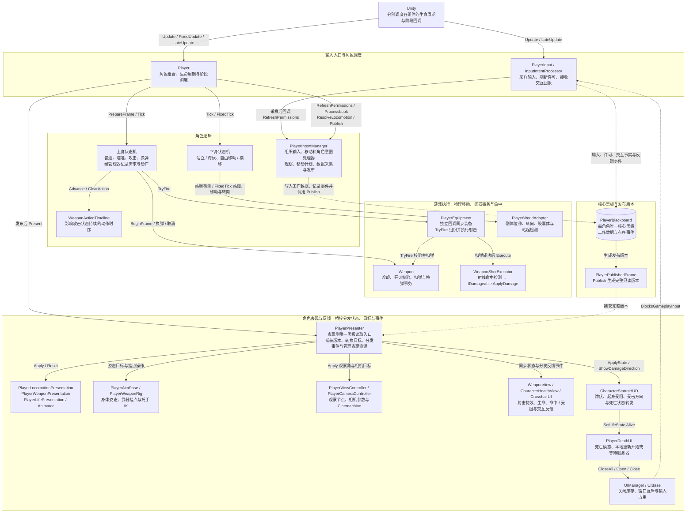
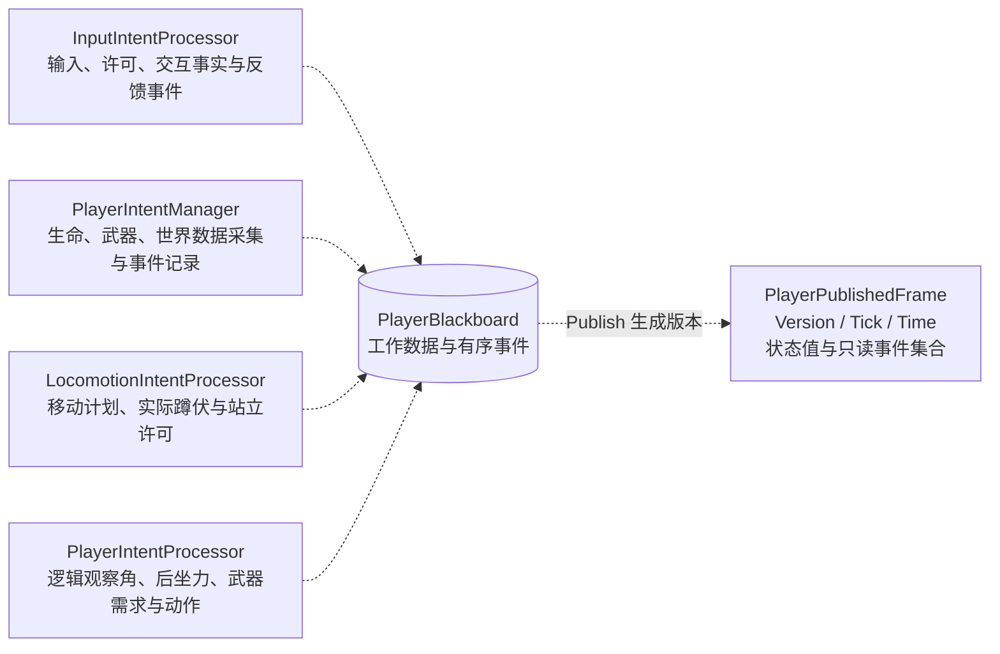
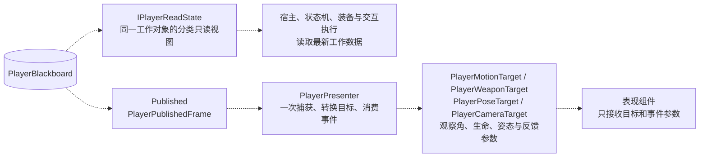
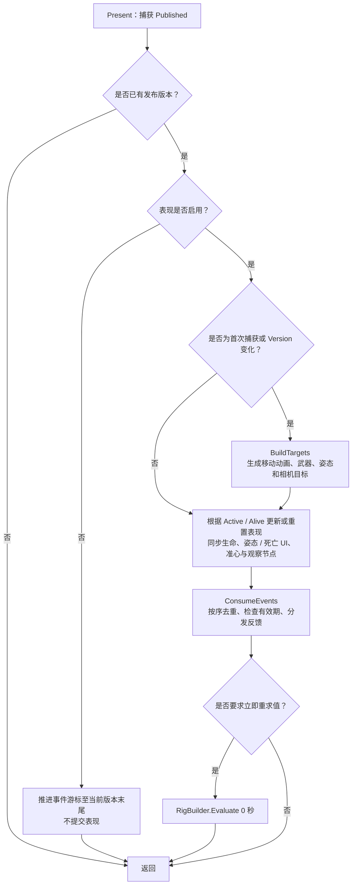
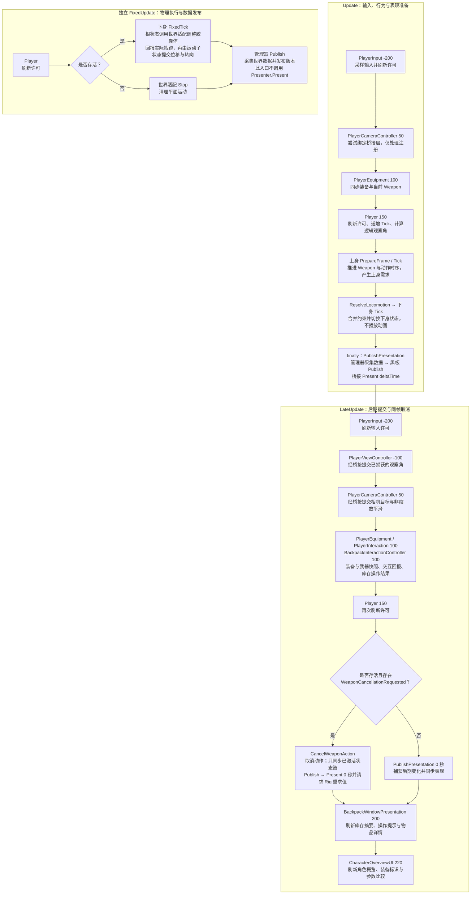

# Player 组件框架与调用时序

基于当前 `Assets/Scripts`、`Assets/backpack/Scripts` 及相连武器控制器的实现，说明主要组件、核心黑板、桥接层、角色 UI 和调用顺序。省略具体状态切换条件、射击参数与骨骼求解算法。图表使用 Mermaid。

当前实现为**单线程的逻辑与表现解耦**：每个角色保留唯一的 `PlayerBlackboard`，逻辑侧使用工作数据，表现侧由 `PlayerPresenter` 统一捕获已发布版本，再向各表现组件提交值参数。`PlayerPresenter`、世界适配和动画执行器是由宿主创建的普通 C# 对象，无需另外挂载到预制体。

角色生命、姿态、受击方向、准心与死亡入口接入上述发布帧链路；背包、角色概览及武器检视另有库存数据与事件通道。固定 UI 层级、锚点和组件引用保存在场景或预制体中，代码负责绑定数据、切换显隐及更新布局尺寸。

## 整体框架图

实线表示主要调度或执行关系，虚线表示数据读写与结果传递。物理移动和命中属于游戏执行，与视觉表现分别组织。总图保留主要调用链，具体写入者和分类读取边界在后两图展开。

`Update` 主链为：**输入采样与许可 → Player 调度逻辑观察 → 上身准备与状态推进（可同步执行射击或换弹）→ 合成移动计划 → 下身状态推进 → 管理器采集并发布黑板 → Presenter 捕获版本、转换目标并提交表现**。图中实线从实际调用方指向被调用方，数据回报沿虚线返回；输入、装备同步及观察／相机回调由 Unity 分别调度。

物理执行另走 **Player.FixedUpdate → 下身 FixedTick → PlayerWorldAdapter → 管理器采集并发布**；该入口不调用 `Presenter.Present`。射击则走 **上身攻击状态 → PlayerEquipment.TryFire → Weapon.TryFire 校验并扣弹 → PlayerEquipment 调用 WeaponShotExecutor.Execute 处理命中与伤害**，成功后经宿主记录后坐力、实际伤害命中和枪口受阻结果，发布后再触发视觉、音效与准心反馈。

- `PlayerContext` 保存状态机的只读工作入口、配置、意图管理器、装备及世界适配引用；当前没有独立的 `PlayerLogic` 类。
- `PlayerStateData` 保留行为参数、动画资源和组件引用。宿主负责初始化这些引用，表现组件沿用现有序列化绑定。
- `WeaponActionTimeline` 维护会影响攻击状态退出的活动与淡出阶段；`PlayerWeaponPresentation` 只执行上身动画。
- 下身状态在 `FixedTick` 中直接调用世界适配；攻击状态通过 `PlayerEquipment.TryFire()` 执行射击。当前没有跨线程的物理命令队列。
- 装备准入、模型预备与绑定仍由 `PlayerEquipment` 同步调用桥接层；正常射击也可以向桥接查询可用枪口挂点。这些是当前主线程适配接口。

## 核心黑板的写入与发布

工作数据的业务写入集中在以下四个类，黑板自身负责事件保留与发布构造。桥接层只读取 `Published`，不把镜头目标、IK 权重等派生表现数据写回黑板。

`PlayerBlackboard` 由每个角色的 `InputIntentProcessor` 创建，管理器和桥接层共用该对象。它承担角色数据交换和发布，不替代 `CharacterAttributes`、库存容器和 `Weapon` 各自持有的运行时状态；发布版本包含这些状态的必要投影。

| 数据 | 内容与来源 |
|---|---|
| 输入与许可 | 移动、观察、缩放、操作按键及操作许可，由输入处理器写入。 |
| 行为状态 | `UpperBodyDemand`、`WeaponActionSnapshot`、瞄准与换弹状态、逻辑观察角和换弹进度。 |
| 移动计划与事实 | `LocomotionPlan`、`PhysicallyCrouched`、`CanStand`；发布时采集世界适配的平面移动速度与刚体朝向。发布帧还携带 `CrouchHeld`，供姿态 UI 判断是否尝试起身。 |
| 生命与武器投影 | 发布时采集生命值、受伤截止时间、当前武器 ID、射击序号及动作持续时间。 |
| 交互状态 | 可见性、是否存在目标及提示文本。工作数据保留 `InteractionTarget` 引用，发布版本只传布尔值和文本。 |
| 有序事件 | 射击、受伤、死亡、复活、武器动作取消与交互反馈；包含序号、时间、武器标识、数量、文本、`Success`、`Direction` 和 `Obstructed` 等值数据。`Shot.Success` 表示实际造成伤害，`InteractionFeedback.Success` 表示交互结果。 |

`PlanarVelocity` 是世界适配缓存的平面移动速度，用于动画输入，并非碰撞求解后 `Rigidbody.velocity` 的完整采样；`BodyYaw` 来自刚体旋转。

发布规则：

- `Version` 每次 `Publish()` 都递增。`Tick` 只在 `Player.Update` 中递增，同一 `Tick` 可以因物理更新、后期更新或即时取消产生多个发布版本。
- `Time` 是发布时的 `Time.timeAsDouble`。当前尚未建立独立于 Unity 的后台逻辑时钟。
- `PlayerPublishedFrame.Active` 表示宿主启用且上下身状态机均有活动状态链；`Alive` 单独表示存活状态。
- 发布版本复制所需状态值，不携带 Animator、Transform、可变武器或库存对象；事件变化时创建新的只读事件集合，旧版本不会被后续写入修改。
- `Published` 使用 `Volatile.Read/Write` 切换完整版本引用。这不意味着工作黑板、事件队列、输入或库存事务已支持并发写入。

## 黑板的两种读取边界

逻辑与游戏执行侧通过 `IPlayerReadState` 读取实时工作数据；角色表现侧只有 `PlayerPresenter` 读取核心黑板发布的版本。库存窗口、角色概览和未被接管的生命视图不读取这个发布帧，分别使用已绑定的库存、属性组件或库存快照。

`PlayerInput.ReadState`、`Player.ReadState` 与 `PlayerContext.ReadState` 指向同一黑板的分类入口；这些工作视图不复制数据，也不提供快照一致性。

| 工作分类 | 访问入口 | 当前内容与主要使用方 |
|---|---|---|
| 输入 | `ReadState.Input` | 输入许可、移动、观察、缩放和武器操作按键；输入宿主、上身状态。 |
| 移动 | `ReadState.Locomotion` | 移动许可、实际蹲伏、站立许可和计划；下身状态。 |
| 观察 | `ReadState.View` | 观察许可、水平角和俯仰角；装备射击执行。相机目标距离和 FOV 已移出此接口。 |
| 武器 | `ReadState.Weapon` | 武器许可、上身需求、动作阶段、换弹进度、瞄准状态和取消请求；宿主、上下文、上身状态及装备。 |
| 姿态语义 | `ReadState.Pose` | 保留观察许可、水平角、瞄准与换弹语义；新表现链路不读取该接口。 |
| 交互 | `ReadState.Interaction` | 交互许可与按键；输入宿主、交互组件。 |

IK 权重、上身动画层权重、相机目标与探索距离由桥接层维护。表现执行器不保存实时黑板或逻辑上下文；`Player.WeaponIKEnabled` 从桥接目标读取，旧 `Character_Weapon_Controller` 据此处理 IK 许可。

## 桥接层的表现流程

- 相机注册时也会初始化探索距离并重建目标；相机的实际平滑提交在独立的 `LateUpdate` 回调中完成。
- 正时长的表现推进每个渲染帧最多执行一次。`Present(0f)` 仍能同步状态、处理新事件和撤销姿态，不重复推进平滑时间。
- 持续状态用于恢复当前装备、姿态、动画阶段和界面；瞬时反馈通过事件触发。射击动画根据射击序号与当前动作阶段恢复，火光和枪声不补播历史记录。
- 核心黑板最多保留 128 条事件。桥接使用 `lastEventSequence` 去重；检测到已消费序号之后的保留缺口时输出警告，持续表现仍读取最新状态。
- `Present` 先同步生命与 `CharacterStatusHUD.ApplyState`，再消费事件。即使死亡后 `Active = false`，`Alive` 仍会传给状态 HUD，使死亡窗口能够打开。

| 事件 | 当前消费规则 |
|---|---|
| `Shot` | 要求当前活动且存活、武器 ID 匹配，并在发布版本时间的 0.25 秒窗口内；调用 `WeaponView.PlayShot`，并将 `Success / Obstructed` 交给 `CrosshairUI.ShowShotFeedback`。 |
| `Hurt` | 在 1.25 秒窗口内触发生命 HUD 的受伤提示，并向状态 HUD 传递伤害方向；受伤动画还可通过持续状态恢复。 |
| `InteractionFeedback` | 在 2.5 秒窗口内调用 `CrosshairUI.ShowFeedback`；成功结果优先显示在侧边通知区，失败结果显示在交互反馈区。 |
| `WeaponCancelled` | 当前未换弹时恢复右手挂点。 |
| `Revived` | 重置生命 HUD 的反馈；死亡窗口根据持续的 `Alive` 状态关闭，姿态和挂点也根据存活状态转换恢复。 |
| `Died` | 保留死亡事件；死亡动画和死亡窗口均由持续的 `Alive` 状态驱动，不依赖收到一次死亡脉冲。 |

上述事件窗口使用发布版本的缩放时间；相机平滑、HUD 闪烁和反馈显示时长则由相应表现组件使用非缩放时间处理。

## 主要调用时序

各组件由 Unity 分别调度。图中只列项目的主要调用；Cinemachine 内部更新按其配置执行，未展开。

- `FixedUpdate` 与渲染帧独立，一次渲染帧可以对应零次或多次物理更新，因此没有把物理流程串在 `Update` 或 `LateUpdate` 之后。存活分支还要求 `fixedDeltaTime > 0` 才推进状态机。
- 死亡时跳过正常状态机推进，但 `Player.Update` 的 `finally` 仍发布数据并更新生命与死亡表现。
- `PlayerViewController` 不再在 `Update` 处理观察输入；逻辑观察角由 `Player` 调用意图处理器更新。相机组件也不再读取输入黑板或生成黑板中的相机参数。
- `PlayerEquipment`、`PlayerInteraction` 与 `BackpackInteractionController` 的顺序值均为 100，不保证同一阶段内三者先后。交互引起的界面占用会在后续许可检查中反映。
- 常规武器中断已在 `Update` 的准备与状态推进中处理；`Player.LateUpdate` 只消费后续出现的取消请求，不直接按“武器不可用或时间步非正”重复执行取消。
- 相机 `LateUpdate` 使用此前捕获的目标；`Player.LateUpdate` 后续发布不会倒流重跑本帧已执行的相机阶段。
- 伤害、复活、停止或装备回调也可能即时发布新版本，不能把发布理解为每帧固定一次。

### 射击的游戏执行与视觉反馈

上身攻击状态调用 `PlayerEquipment.TryFire()`：取得瞄准射线与锚点 → `Weapon.TryFire()` 校验并扣弹 → `WeaponShotExecutor.Execute()` 处理命中和伤害 → 汇总本发各弹丸的 `DamageApplied / MuzzleObstructed` → 更新逻辑后坐力并记录 `Shot` 事件 → 发布后由桥接分发火光、抛壳、音效与准心反馈。

扣弹与伤害不经过可丢弃的表现事件通道。表现开启且有可用场景引用时沿用相机射线和模型枪口；表现关闭时使用逻辑观察角与独立锚点，没有可用相机或模型时也有对应回退。

`CrosshairUI` 仅在实际造成伤害时显示命中标记；枪口受阻提示来自本次射击结果，不包含瞄准期间的提前探测。受伤时 `Player.OnDamaged` 将伤害方向写入事件；方向缺失但存在伤害来源时，使用来源到角色的方向回退。状态 HUD 将其反向、投影到水平面，再按发布的观察水平角转换为屏幕方向；无有效水平方向时不显示方向标记。

## 角色 HUD、库存窗口与死亡流程

### 组件与数据来源

| 组件 | 数据来源与职责 |
|---|---|
| `CharacterHealthView` | 玩家视图由 Presenter 调用 `ApplyHealth / ShowDamage`；显示生命、受伤闪屏和低血量警告。靶子等未接管视图继续订阅自身属性组件。 |
| `CharacterStatusHUD` | Presenter 在匹配属性源的生命视图同根获取此组件；接收存活、实际蹲伏、站立许可、蹲伏按键和观察角，维护姿态提示、受击方向并向死亡窗口转发存活状态。 |
| `CrosshairUI` | 接收 Presenter 的准心状态与反馈事件；在自身 `Update` 中维护命中、受阻、交互失败和侧边通知的显示时长。 |
| `UIManager / UIBase` | 注册、打开、关闭窗口并维护互斥。`BlocksGameplayInput` 在窗口打开期间及开关当帧阻断角色输入；已打开的 `BlocksOtherWindows` 窗口阻止其他窗口打开。 |
| `BackpackWindowPresentation` | 读取当前窗口的库存视图与交互会话，刷新摘要、操作提示和物品详情；空手时显示悬停物品，无悬停时回退到已选物品，携带或选择拆分数量期间隐藏详情。 |
| `CharacterOverviewUI` | 从已绑定背包拥有者读取属性，从装备视图读取当前武器；刷新角色概览、装备标识、详情／装配页签和参数比较。此组件不经过角色发布帧，也不提交装备事务。 |
| `WeaponAmmoHUD / WeaponInspectionPanel` | 使用库存事件通道的 `WeaponHudSnapshot / WeaponInspectionSnapshot`。本地由 `PlayerEquipment` 的武器 UI 部分发布，网络模式沿用已有投影与请求通道。 |
| `PlayerUiPreferences / UiTextScale` | 偏好保存至本地 `PlayerPrefs`；`Changed` 通知已接线文字缩放，以及详情重新排版。提供 100%、125%、150% 字号、命中反馈与低血量脉冲开关。 |

`PlayerUiPreferences` 是静态显示配置；其余表中视图和窗口组件通过场景或预制体挂载。`UiTextScale` 只处理明确接线的文本引用，武器 HUD 和装配面板仍沿用各自的现有显示规则。

### 窗口输入与刷新顺序

| 阶段与顺序 | 入口 | 当前工作 |
|---|---|---|
| `Awake -900` | `UIManager` | 实例化配置中的窗口预制体并注册。 |
| `Update 30` | `WeaponInspectionPanel` | 维护库存来源、检查请求、操作等待及快照显示。 |
| 输入动作回调 / `Update 50` | `InventoryUIInputRouter` | 动作回调处理背包开关并排队点击；`Update` 转发指针、取消、F 键与已排队点击。F 键经角色概览切到对应装配目标。 |
| `Update / LateUpdate 100` | `BackpackInteractionController` | 消费本帧输入，维护选择、携带、拆分与拖放；后期处理异步操作结果。 |
| `LateUpdate 200` | `BackpackWindowPresentation` | 在库存操作结果与角色后期发布之后刷新窗口摘要和详情。 |
| `LateUpdate 220` | `CharacterOverviewUI` | 读取当前装备及预览物品，刷新角色与比较信息。 |

`InventoryInputScope` 捕获、恢复光标，并在拥有者存在 Input System `PlayerInput` 时临时停用、恢复该组件；项目的 `RPG4.Input.PlayerInput` 仍通过 `UIManager.BlocksGameplayInput` 刷新许可。打开库存不会修改 `Time.timeScale`，世界继续运行。

### 视口适配与物品详情

- `BackpackContainerUI` 保留库存实际行列数。启用 `fitColumnsToViewport` 时，根据视口宽度、列数和间距计算显示格尺寸；`cellSize` 是上限，`minimumCellSize` 是下限。超过最小格尺寸仍放不下的库存继续使用滚动区域。
- `GridMetrics` 使用 `displayedCellSize` 统一格子绘制、物品尺寸、屏幕命中与抓取偏移；行列或适配尺寸变化时重建显示网格，不改变库存布局数据。
- 点击物品后，交互会话保留选择及边框；悬停可以临时预览其他物品，结束会话时清除选择。参数比较使用各自当前弹药和配件的实际计算结果；缺少有效弹药时说明无法进行实战比较。
- `BackpackItemDetailsUI.docked` 启用后固定在右栏，不再跟随指针。内容区使用伸缩锚点，属性正文按首选高度扩展，`ScrollRect / RectMask2D / Scrollbar` 负责裁剪与滚动；详情与比较区分别占用固定区域。
- 角色 HUD 位于 `PlayerHealthHUD.prefab`，准心反馈位于 `CrosshairUI.prefab`；角色概览和页签位于背包／箱子预制体。固定节点及引用预接线，运行时只按数据更新尺寸、显隐和可复用列表项。

### 死亡窗口的进入与退出

1. 致死伤害使 `HealthState` 先触发 `Died`，随后才通知 `Changed / Damaged`。`Player.OnDied` 记录事件并执行 `Stop`，发布的 `Alive = false` 经 Presenter 传给 `CharacterStatusHUD.ApplyState`。
2. 状态 HUD 调用 `PlayerDeathUI.SetLifeState(false)`。死亡窗口首次打开前先执行 `UIManager.CloseAll`，让库存窗口结束交互、拆分和拖拽，释放原输入与光标会话。
3. 随后打开死亡模态窗口，显示光标并接管输入。预制体配置 `BlocksOtherWindows`，因此背包开关键不能在死亡窗口上方再打开库存。
4. 无网络会话、场景有效且已加入构建设置时，“重新开始”异步重载死亡窗口所在场景并重置本局。网络客户端或服务器活动时隐藏该按钮，只显示等待服务器安排重生；当前 UI 不发起网络重生请求。
5. 收到存活状态时关闭死亡窗口并恢复光标；关闭角色表现时也会清理姿态和受击方向、关闭死亡窗口。

## 生命周期与恢复

| 入口或变化 | 当前行为 |
|---|---|
| `Awake` | 初始化上下文、世界适配、意图管理器、两套状态机及桥接；绑定观察、Rig、准心、匹配属性源的生命视图及同根状态 HUD。 |
| `OnEnable` | 订阅生命事件，应用表现开关并清空按键会话；已有死亡状态立即进入死亡处理。 |
| `CancelWeaponAction` | 清除动作与武器输入；只对已激活状态链执行零时长同步，不发起新射击或换弹，随后发布并重求值姿态。 |
| `Stop` / 禁用、失焦、应用暂停 | 停止状态机、清理平面运动与输入，保留实际胶囊体姿态；禁用宿主时同时关闭桥接表现。 |
| 受伤、死亡、复活 | 更新逻辑状态并记录事件；由发布版本驱动动画、生命、受击方向及死亡窗口。复活清空武器按键会话，持续按住不会自动恢复开火。 |
| `PresentationEnabled = false` | 重置动画与姿态、隐藏武器模型、清理状态 HUD 并关闭死亡窗口，停止本桥接的反馈更新并跳过历史事件；角色逻辑继续由宿主推进。 |
| 重新启用表现 | 从最新版本恢复持续状态；换弹根据进度恢复动画，并解析素材中此前的挂点事件来重建武器位置，不重放库存事务。 |
| `OnDestroy` | 解除输入管理器绑定，释放桥接持有的装备和准心，解除生命视图的外部驱动。 |

玩家生命和状态 HUD 由桥接接管后使用值数据；共用 `CharacterHealthView` 的靶子／其他非接管对象继续使用原属性订阅模式。角色概览直接读取已绑定的库存与属性，武器 HUD 和检查面板沿用库存快照通道，三者均不由 Presenter 接管。

## 当前边界与验证范围

当前仍通过 Unity 主线程运行，已建立完整版本读取和表现调用边界，未启用后台逻辑线程、Jobs/Burst 或双缓冲调度。时间读取、输入、物理调用、装备预备、库存提交和全局事件回调仍需后续按线程所有权处理，不能直接把整套角色更新放到工作线程。

已有静态核对覆盖相关 C# 语法、程序集依赖和预制体引用。最近一次库存 UI 修复已使用 Unity MCP 在 `Main` 场景、1920×1080 下复查背包 10×10、箱子 8×6、武器装配页、普通／150% 字体、末格坐标定位与长说明滚动，复查时控制台没有错误。

上述运行记录只覆盖所列库存与 UI 路径。移动、射击、换弹、命中／受阻反馈、受击方向、死亡与重新开始、网络重生、暂停恢复和 Rig 视觉效果不在这次 UI 复查范围内。本次文档更新仅按当前源码核对职责、调用顺序和链接，未新增运行验证。

## 对照源码

- [角色宿主与生命周期](../Scripts/PlayerMovement/Player.cs)
- [意图管理器](../Scripts/PlayerMovement/PlayerIntentManager.cs)、[观察与武器需求处理](../Scripts/PlayerMovement/PlayerIntentProcessor.cs)、[移动计划处理](../Scripts/PlayerMovement/PlayerLocomotion.cs)
- [上身状态](../Scripts/PlayerMovement/States/UpperBodyRootState.cs)、[攻击状态](../Scripts/PlayerMovement/States/AttackState.cs)、[下身状态](../Scripts/PlayerMovement/States/LowerBodyRootState.cs)、[独立动作时序](../Scripts/PlayerMovement/WeaponActionTimeline.cs)
- [核心黑板](../Scripts/PlayerIntent/PlayerBlackboard.cs)、[分类只读接口](../Scripts/PlayerIntent/PlayerReadState.cs)、[发布版本与事件](../Scripts/PlayerIntent/PlayerPublishedFrame.cs)
- [桥接层](../Scripts/PlayerMovement/PlayerPresenter.cs)、[表现目标](../Scripts/PlayerMovement/PlayerPresentationTargets.cs)
- [下身动画](../Scripts/PlayerMovement/PlayerLocomotionPresentation.cs)、[武器动画](../Scripts/PlayerMovement/PlayerWeaponPresentation.cs)、[生命动画](../Scripts/PlayerMovement/PlayerLifePresentation.cs)
- [世界执行适配](../Scripts/PlayerMovement/PlayerWorldAdapter.cs)、[装备与射击入口](../Scripts/PlayerMovement/PlayerEquipment.cs)、[命中执行](../Scripts/Combat/WeaponShotExecutor.cs)、[武器运行时](../backpack/Scripts/Equipment/Weapon.cs)
- [观察节点](../Scripts/PlayerMovement/PlayerViewController.cs)、[相机](../Scripts/PlayerMovement/PlayerCameraController.cs)、[瞄准姿态](../Scripts/PlayerMovement/PlayerAimPose.cs)、[武器挂点与握持](../Scripts/PlayerMovement/PlayerWeaponRig.cs)
- [输入宿主与处理器](../Scripts/Input/PlayerInput.cs)、[交互执行](../Scripts/Interaction/PlayerInteraction.cs)、[准心反馈](../Scripts/Interaction/CrosshairUI.cs)、[生命 HUD](../Scripts/UI/CharacterHealthView.cs)
- [生命状态与事件顺序](../Scripts/CharacterAttributes/HealthState.cs)、[属性组件](../Scripts/CharacterAttributes/CharacterAttributes.cs)、[伤害数据](../Scripts/CharacterAttributes/DamageInfo.cs)
- [状态 HUD](../Scripts/UI/CharacterStatusHUD.cs)、[死亡窗口](../Scripts/UI/PlayerDeathUI.cs)、[窗口宿主](../Scripts/UI/UIManager.cs)、[窗口基类](../Scripts/UI/UIBase.cs)
- [库存输入路由](../backpack/Scripts/UI/InventoryUIInputRouter.cs)、[窗口协调](../backpack/Scripts/UI/InventoryUICoordinator.cs)、[库存输入会话](../backpack/Scripts/UI/InventoryInputScope.cs)、[物品交互](../backpack/Scripts/UI/BackpackInteractionController.cs)
- [窗口表现](../backpack/Scripts/UI/BackpackWindowPresentation.cs)、[角色概览与比较](../backpack/Scripts/UI/CharacterOverviewUI.cs)、[容器显示与视口适配](../backpack/Scripts/UI/BackpackContainerUI.cs)、[物品详情](../backpack/Scripts/UI/BackpackItemDetailsUI.cs)
- [本地武器快照发布](../Scripts/PlayerMovement/PlayerEquipment.WeaponUi.cs)、[武器弹量 HUD](../backpack/Scripts/UI/WeaponAmmoHUD.cs)、[武器装配面板](../backpack/Scripts/UI/WeaponInspectionPanel.cs)、[武器快照构造](../backpack/Scripts/Inventory/WeaponUiSnapshots.cs)
- [显示偏好](../Scripts/UI/PlayerUiPreferences.cs)、[文字缩放](../Scripts/UI/UiTextScale.cs)
- [角色 HUD 预制体](../player/PlayerHealthHUD.prefab)、[准心预制体](../player/Interaction/CrosshairUI.prefab)、[背包预制体](../backpack/Prefabs/背包UI.prefab)、[箱子界面预制体](../backpack/Prefabs/和箱子交互ui.prefab)、[物品详情预制体](../backpack/Prefabs/ItemDetails.prefab)
- [武器模型与特效](../Scripts/Combat/WeaponView.cs)、[旧武器事件与 IK 适配](../CombatGirlsCharacterPack/Biperworks_Tools/CombatGirls_Weapon_Control/Character_Weapon_Controller.cs)
