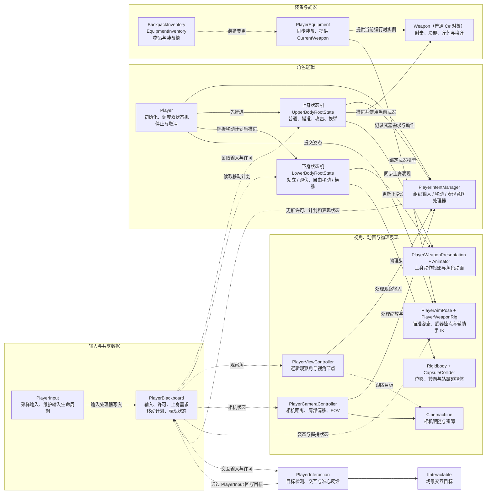
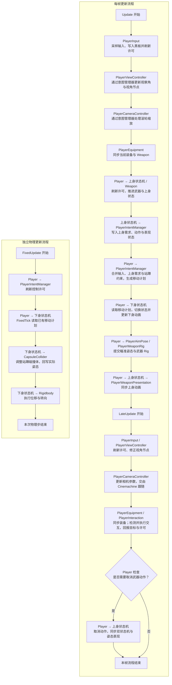

# Player 组件框架与调用时序

基于当前 `Assets/Scripts` 中的实现，只展示主要组件、职责和调用关系，省略状态切换条件、射击参数与骨骼求解细节。使用支持 Mermaid 的 Markdown 预览查看图表。

## 整体框架图

实线表示主要调用或执行关系，虚线表示数据读写、引用或状态同步。框内的普通 C# 对象用于组织逻辑，并不都是挂在 GameObject 上的组件。整体沿用分组流程图格式，按 1:1 比例调整布局。

核心关系：**上身产生需求 → 意图管理器合并输入与约束 → 下身执行移动计划**。共享黑板负责保存数据，由组件主动读写；`PlayerContext` 汇集黑板、配置和装备引用，`PlayerStateData` 保存参数与组件引用，二者不单独驱动更新。

## 主要调用流程图

下图以正常启用且已初始化的角色为例，按 `Update`、`LateUpdate` 和独立的 `FixedUpdate` 组织流程。箭头表示处理先后；各组件的生命周期入口由 Unity 分别调度，具体组件调用写在节点内。

- 核心顺序为：**输入 → 上身需求 → 移动计划 → 下身执行 → 动画与姿态表现**。上身通过 `PlayerContext.Weapon` 访问 `PlayerEquipment.CurrentWeapon`。
- `FixedUpdate` 与渲染帧独立，按 Unity 物理步调度；一次渲染帧可能对应零次或多次物理更新，两个流程之间没有固定的串行箭头。
- `PlayerEquipment` 与 `PlayerInteraction` 的执行顺序相同，图中合并展示，不保证两者先后。图中省略 Cinemachine 内部更新、重复许可检查及装备事件回调。
- 武器许可丢失、暂停或收到取消请求时进入取消分支；`Player` 禁用、失焦或暂停的生命周期清理不在图中展开。

## 对照源码

- [Player、意图管理器与双状态机](../Scripts/PlayerMovement/)
- [输入采样与输入处理器](../Scripts/Input/PlayerInput.cs)
- [共享黑板](../Scripts/PlayerIntent/PlayerBlackboard.cs)
- [交互组件](../Scripts/Interaction/PlayerInteraction.cs)
- [武器运行时逻辑](../backpack/Scripts/Equipment/Weapon.cs)
