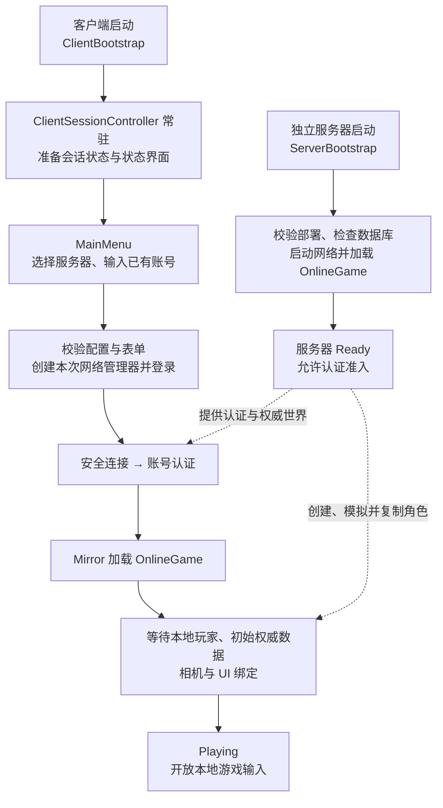
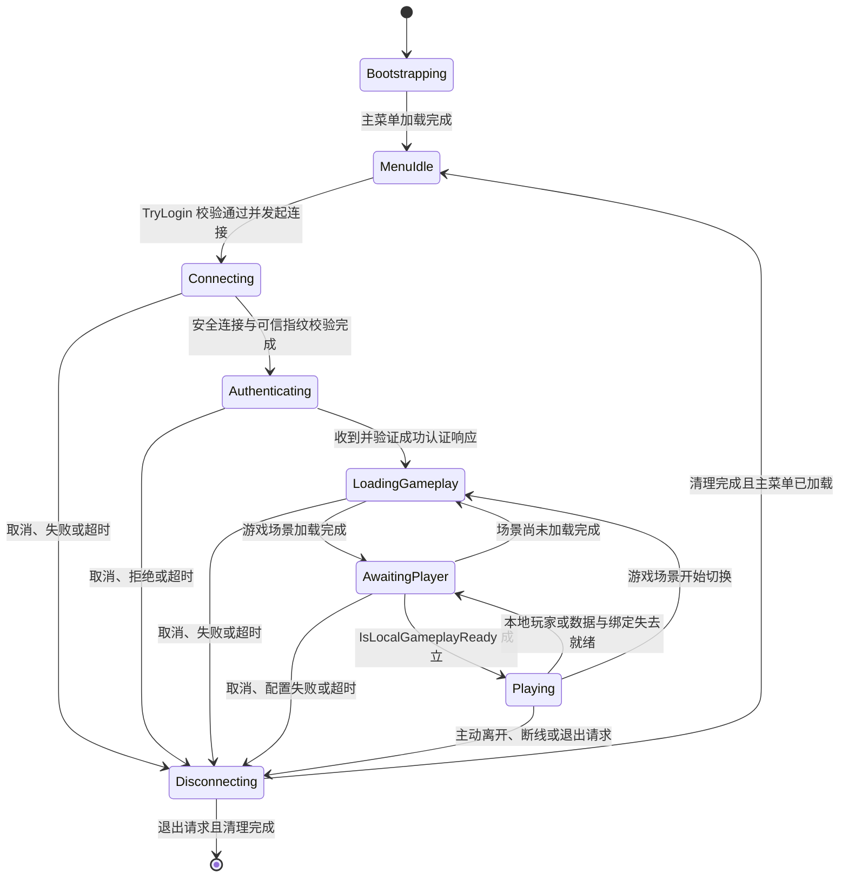
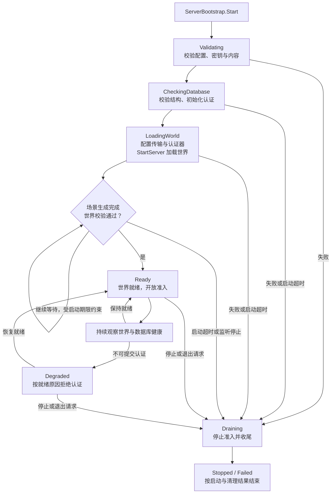
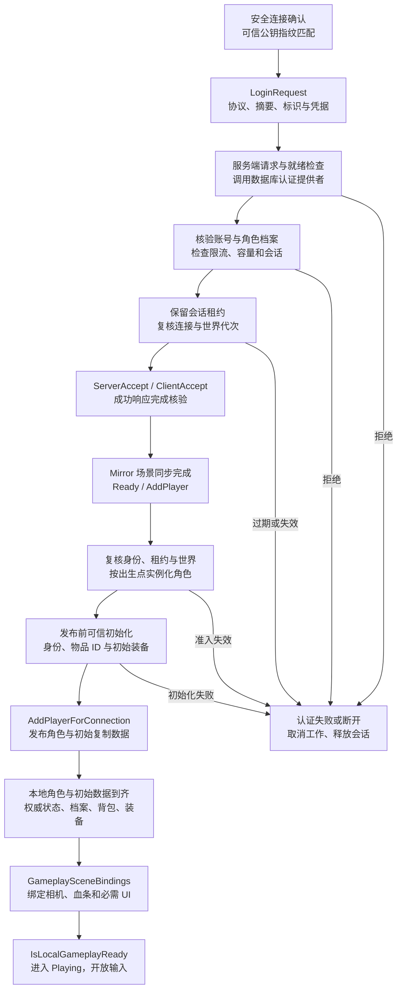
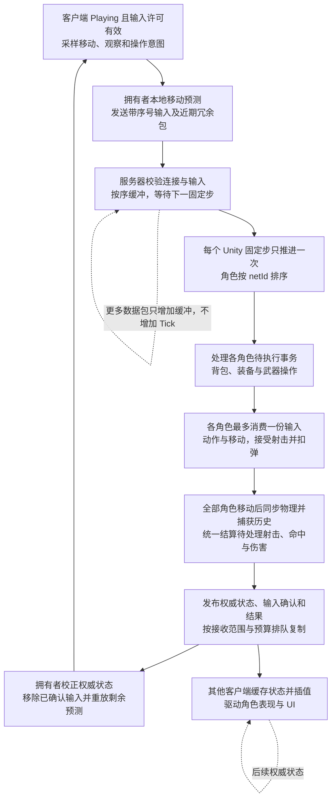
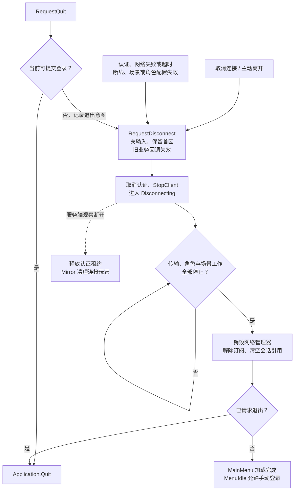

# 游戏运行流程图

更新日期：2026-11-01。依据当前工作区实现，描述客户端连接独立服务器的运行路径；本文为源码核对结果，未启动游戏、服务器或数据库进行联机验证。

角色内部调用见 [Player 组件架构与调用时序](Player组件框架与调用时序.md)，权威处理和部署边界见 [网络权威处理与部署方向](网络权威处理与部署方向.md)。

## 入口与场景关系

客户端构建场景依次为 `ClientBootstrap → MainMenu → OnlineGame`；独立服务器使用单独的 `ServerBootstrap → OnlineGame` 构建列表。菜单界面由 `MainMenuPresenter` 驱动，跨场景的会话控制由 `ClientSessionController` 持有。直接打开 `MainMenu` 缺少控制器时会提示从 `ClientBootstrap` 启动。

旧 `Main` 场景、离线角色和兼容 Host 路径仍存在，但不属于上图的当前客户端主入口。目录中已有地址或开发配置，也不代表对应服务器已经启动并就绪。

源码：[构建入口与场景列表](../Editor/Build/GameBuild.cs)、[客户端会话控制](../Scripts/Frontend/ClientSessionController.cs)、[菜单交互](../Scripts/Frontend/MainMenuPresenter.cs)。

## 客户端会话状态

这些是控制器中的八个实际状态；网络回调先记录事实，状态机随后消费事实推进。安全连接、账号成功、场景加载完成和可操作角色分别属于不同阶段，不能用“已连接”统一表示。

任一尚未进入 `Disconnecting` 的状态收到断开请求，都会优先转入 `Disconnecting`，包括初始化或同步回调仍处于 `Bootstrapping / MenuIdle` 的阶段；图中未逐一展开这些异常边。

| 阶段 | 当前判定与效果 |
| --- | --- |
| `Bootstrapping / MenuIdle` | 准备主菜单；仅空闲且上一会话已释放时允许提交登录。 |
| `Connecting` | 建立加密传输，按受信任服务器目录校验公钥指纹。修改地址与端口不会修改服务器标识和可信指纹。 |
| `Authenticating` | 在安全通道提交账号；核对响应请求标识、协议、内容摘要、地图和会话字段。 |
| `LoadingGameplay` | 等待服务器指定的 `OnlineGame` 正常场景切换完成；不自行重复发送 Mirror 的 Ready/AddPlayer。 |
| `AwaitingPlayer` | 本地玩家属于当前连接、当前场景，且初始权威状态、身份档案、背包和装备均已就绪，相机、血条和必需 UI 已绑定该玩家。 |
| `Playing` | 控制器开放本地游戏输入；就绪失效立即关输入并重新等待。 |
| `Disconnecting` | 禁止新登录，停止本次连接并等待网络和场景工作真正结束。 |

控制器默认阶段超时为连接 15 秒、认证 15 秒、场景 60 秒、玩家就绪 20 秒；认证器另有协议认证期限。`SessionStatusView` 显示当前阶段和首个失败原因，连接中可取消，游戏中可主动离开。密码不写入偏好设置，提交和凭据派发时清空密码输入框。

源码：[状态转换与清理](../Scripts/Frontend/ClientSessionController.cs)、[状态节点](../Scripts/Frontend/ClientSessionStates.cs)、[服务器信任目录](../Scripts/Frontend/ClientServerCatalog.cs)、[状态界面](../Scripts/Frontend/SessionStatusView.cs)。

## 独立服务器启动与就绪

数据库初始化发生在启动网络之前。`LoadingWorld` 中监听可以先建立，但认证还要同时通过世界和提供者就绪检查；监听成功不等于服务器 `Ready`。启动只校验现有数据库结构和部署密钥，不自动迁移数据库或生成密钥。

停止时先关闭准入、取消后台任务、`StopServer`，再有界等待认证工作、会话释放、健康检查和场景加载收尾。清理超时或释放失败会记录失败结果；数据库健康恢复也不等于客户端自动重连。

源码：[服务器启动、健康观察与关闭](../Scripts/Server/ServerBootstrap.cs)、[数据库认证提供者](../Scripts/Server/MySqlAuthenticationProvider.cs)、[世界有效性判定](../Scripts/Networking/AuthoritativeNetworkManager.cs)、[场景绑定校验](../Scripts/Networking/GameplaySceneBindings.cs)。

## 认证准入到可操作角色

认证通过只代表取得本次会话身份。服务端发布角色前仍会复核当前世界和租约；初始化失败会销毁未成功发布的角色并断开连接，不会先生成默认角色再补数据。当前初始物品来自 `OnlineSpawnConfiguration` 的可信配置，数据库准入档案提供角色身份和出生配置版本；本流程不表示已经实现位置、背包或游戏进度的存档恢复。

客户端的角色、数据与 UI 回调可能交错到达，图中最后三步表示最终必须汇合的条件，并非保证所有回调严格按此顺序发生。控制器按管理器、本次尝试、连接和生命周期版本过滤旧回调，避免取消后旧认证或旧场景结果重新开放输入。

源码：[账号认证器](../Scripts/Networking/Authentication/AccountAuthenticator.cs)、[入口协议](../Scripts/Networking/Contracts/EntryProtocol.cs)、[角色准入与就绪条件](../Scripts/Networking/AuthoritativeNetworkManager.cs)、[可信出生初始化](../Scripts/Networking/OnlineSpawnConfiguration.cs)、[UI 与相机绑定](../Scripts/Networking/GameplaySceneBindings.cs)。

## 游戏运行循环

客户端预测用于移动响应；服务器决定实际移动、弹药、命中、伤害和库存结果。输入超时会清除角色意图，并不自行触发重连。死亡受现有角色逻辑处理，本图不假设自动复活。更细的角色状态机、复制范围及发送预算见前述两篇文档。

源码：[统一固定步](../Scripts/Networking/NetworkPlayerSimulation.cs)、[输入、预测、权威发布与插值](../Scripts/Networking/NetworkPlayerController.cs)。

## 取消、失败、断线与退出回流

`Cancel` 与游戏内离开使用同一条清理路径；空闲菜单的退出可以直接结束应用。`ClientConnectionEnded` 仅是断线通知，不能代替 `IsClientSessionStopped`；未结束的场景加载仍由管理器收尾，控制器确认完成后才销毁管理器并返回菜单。因此取消或断线后可能暂留“正在断开连接并返回菜单”。

回菜单后保留可展示的首个失败原因，下一次有效登录创建新的网络管理器和尝试标识。当前没有自动重试登录、自动重连或会话恢复；若主菜单本身未加入构建等配置错误使回流无法完成，代码显示相应失败，不宣称已恢复可登录。

源码：[取消、退出与清理等待](../Scripts/Frontend/ClientSessionController.cs)、[网络及场景停止判定](../Scripts/Networking/AuthoritativeNetworkManager.cs)、[认证工作和租约释放](../Scripts/Networking/Authentication/AccountAuthenticator.cs)。
