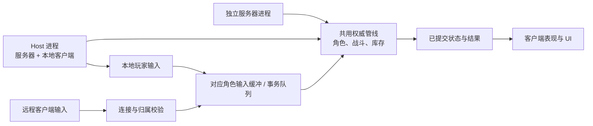
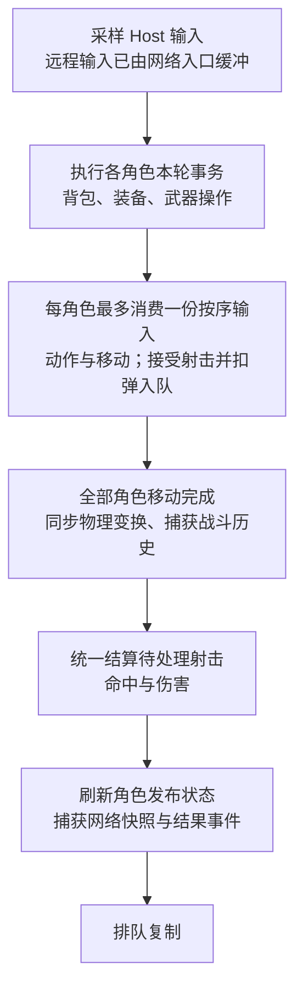
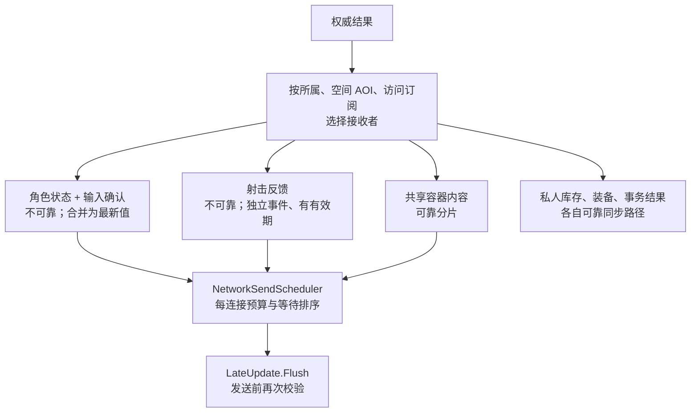
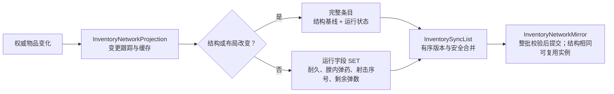
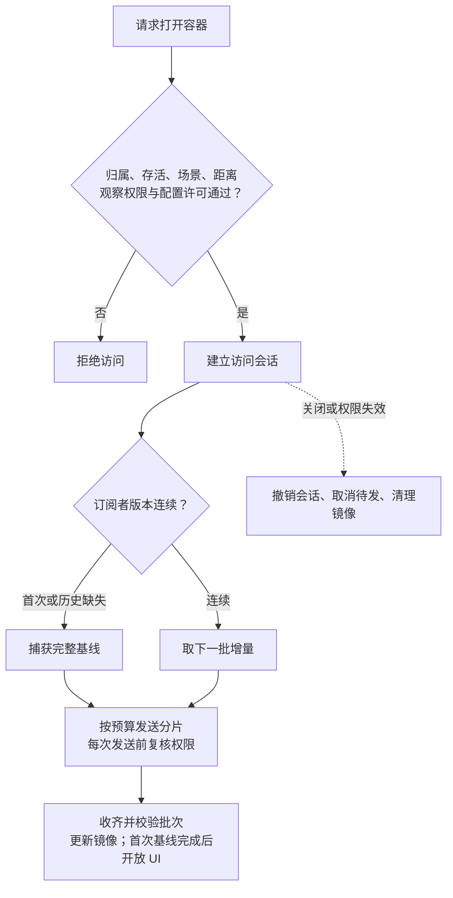

# 网络权威处理与部署方向

更新日期：2026-11-01。以当前工作区实现为准；应用入口与完整会话流程见[游戏运行流程图](游戏运行流程图.md)，角色内部流程见 [Player 组件架构与调用时序](Player组件框架与调用时序.md)。

## 部署目标与现状

**当前产品入口是纯客户端连接独立服务器；Host 与旧离线流程保留兼容，单人迁移到 Host 仍是后续目标。**

默认客户端构建场景依次为 `ClientBootstrap → MainMenu → OnlineGame`，登录使用受信任服务器目录与账号认证。`ClientSessionController` 负责连接、认证、场景加载、等待角色、游戏中及断线清理；仅在角色与界面就绪后放行本地输入，清理完成后返回菜单。独立服务器使用单独构建列表 `ServerBootstrap → OnlineGame`，先校验部署配置、已有密钥和数据库，再启动网络并等待世界就绪。

旧 `Main` 不在当前客户端构建列表中，其默认启动模式仍为 `None`，保留旧离线角色及手动 Host 路径。下图描述复用的权威管线，其中 Host 为兼容能力，不是当前主菜单登录流程。

Host 本地玩家直接使用权威结果，不再运行客户端移动预测。当前主菜单通过已配置的受信任端点加入独立服务器；单人仅本地连接策略、局域网自动发现与加入、主机迁移均尚未完成。

## 权威 Tick

`NetworkPlayerSimulation` 在每个 Unity 固定步只推进一次，角色按 `netId` 排序；当前默认步长为 0.02 秒。

数据包只增加待处理输入，不增加模拟步数。装备事务先于开火，已接受射击不因随后死亡而撤销；跨容器事务由库存核心统一提交或回滚。远程命中回溯由服务器测得的 RTT 与配置决定，Host 本地回溯延迟为零。

## 复制与发送预算

- 所属玩家快照优先；等待过久的项目按截止时间优先，预算不足仍会延后。预算只覆盖已接入的载荷，不是总带宽上限。
- AOI 按场景、网格与变化标记更新观察者，仍有周期扫描。看见容器外壳不代表可以读取内容。
- 客户端收到快照后校正所属角色或插值远端角色；不复制整块黑板，也不重放武器和物品事务。角色静止降频、字段差量与量化仍未实现。

## 库存增量

混装弹序保存在结构基线中；仅消耗弹药可发运行差量，增加或重排弹药须更新结构。完整恢复同时需要结构与运行载荷。

## 共享容器访问

每片载荷为 1 KiB。慢订阅者缺失历史时恢复完整基线；在途基线先发完，再追赶变化。旧会话分片被忽略，损坏或不连续批次会关闭访问；取放物品还须在事务执行时再次校验权限。

## 单人 Host 迁移

当前仍需保留的边界：

- `WorldPickup` 拒绝网络会话拾取，包括 Host；不能只改默认启动模式。
- 旧 `Main` 的联机启停会暂停、恢复旧离线角色，不自动转移位置、背包与装备；停止 Host 不回滚共享箱子。新的在线入口启用 `GameplaySceneBindings`，不恢复旧离线替身，客户端断线后清理会话并返回主菜单。
- 纯客户端只预测移动，完整受击方向事件未复制；调度器目前推进已注册网络角色，不是通用 AI / 世界循环。
- 多客户端争抢、回溯、丢包校正、预算拥塞与分片恢复的运行效果及实际带宽，不能由静态文档核对确认。

## 源码入口

| 关注点 | 入口 |
|---|---|
| 会话与固定步 | [AuthoritativeNetworkManager](../Scripts/Networking/AuthoritativeNetworkManager.cs)、[NetworkPlayerSimulation](../Scripts/Networking/NetworkPlayerSimulation.cs) |
| 客户端与独立服务器入口 | [ClientSessionController](../Scripts/Frontend/ClientSessionController.cs)、[ServerBootstrap](../Scripts/Server/ServerBootstrap.cs)、[GameBuild](../Editor/Build/GameBuild.cs) |
| 输入与角色复制 | [NetworkPlayerController](../Scripts/Networking/NetworkPlayerController.cs)、[PlayerInputPacket](../Scripts/Networking/PlayerInputPacket.cs) |
| 复制范围与预算 | [BackpackSpatialInterestManagement](../backpack/Scripts/Network/BackpackSpatialInterestManagement.cs)、[NetworkSendScheduler](../backpack/Scripts/Network/NetworkSendScheduler.cs) |
| 库存差量与恢复 | [InventoryNetworkProjection](../backpack/Scripts/Network/Inventory/InventoryNetworkProjection.cs)、[InventorySyncList](../backpack/Scripts/Network/Inventory/InventorySyncList.cs)、[InventoryNetworkMirror](../backpack/Scripts/Network/Inventory/InventoryNetworkMirror.cs) |
| 共享权限与分片 | [BackpackNetworkInventory.Access](../backpack/Scripts/Network/Inventory/BackpackNetworkInventory.Access.cs)、[BackpackNetworkInventory.SharedStream](../backpack/Scripts/Network/Inventory/BackpackNetworkInventory.SharedStream.cs) |

本文用于说明当前权威边界与部署方向；运行效果及带宽仍以实际验证为准。
