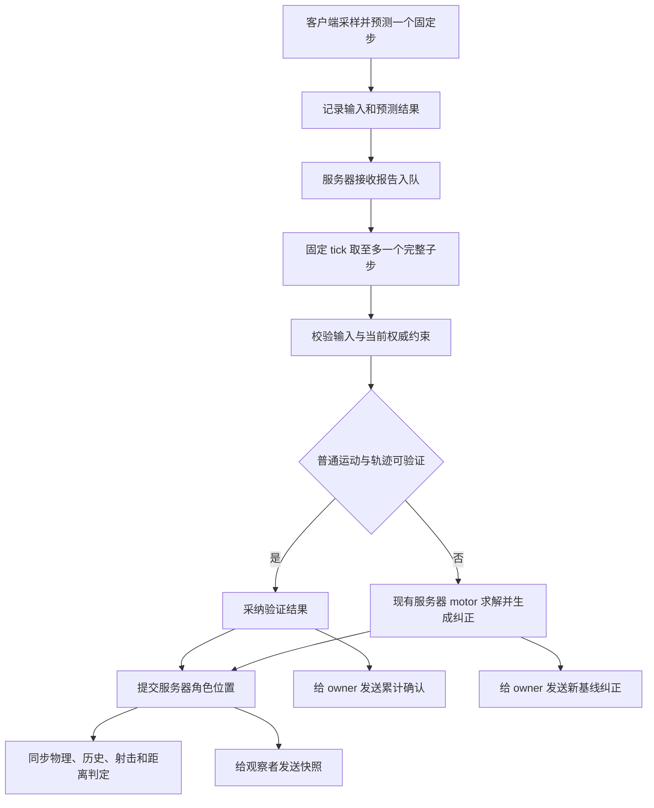

# 客户端移动结果验证与按需纠正 Implementation Plan

> **For agentic workers:** REQUIRED SUB-SKILL: Use superpowers:subagent-driven-development (recommended) or superpowers:executing-plans to implement this plan task-by-task. Steps use checkbox (`- [ ]`) syntax for tracking.
> 本任务的执行方式已由用户选定为 **superpowers:executing-plans**；本轮仅编写计划，审阅后再实施。

**Goal:** 客户端立即预测普通移动及模式切换，服务器分别验证输入、状态转换和运动结果，认可后更新服务器位置；所属客户端通常只接收确认，发生分歧时才恢复和重放。

**Architecture:** 采用已选方案二：普通移动走“上报结果、验证后采纳”，复杂运动保留现有服务器 motor 作为纠正路径。权威武器/生命逻辑继续每个固定步运行；服务器提交运动结果后，才同步物理、记录战斗历史和结算射击。将所属客户端的移动确认、运动纠正、业务状态，以及观察者快照分开。

**Tech Stack:** Unity 2022.3.62f3、C#、项目内 Mirror/KCP、现有 uGUI/角色状态机、已安装的 Unity Test Framework 1.1.33；不新增第三方依赖。

**Spec:** `docs/superpowers/plans/2026-11-04-validated-player-movement.md` 的 [已确认设计与实施边界](#已确认设计与实施边界) 是随计划保存的设计依据，来源为本次对话；本文件其余具体接口和数值均为待审阅的实现选择，不冒充用户已指定的要求。

## Global Constraints

- 用户原话：“角色位置的关键相关交互和判断以服务器为主”。命中、伤害、拾取/容器访问距离和碰撞使用服务器认可的位置；客户端报告不得在验证前写入服务器 Transform、Rigidbody 或战斗历史。
- 用户已选择方案二：“服务器验证，认可后采用”；不能以只优化快照、仍永久完整重算所有普通移动的方案一作为最终交付。
- 客户端立即预测移动、瞄准移动及状态切换；生命、弹药、伤害、换弹完成和装备事务继续由服务器决定。
- 保留 `Time.fixedDeltaTime = 0.02s`、输入超时 `0.25s`、缺口等待 `2` 个服务器 tick、客户端预测历史 `128` 条、服务器队列 `64` 条的现有边界；网络包数量不得增加每个服务器固定步的逻辑/武器推进次数。
- 初始角色身份、完整背包、装备镜像、场景绑定和运动基线均完成后才开放输入；不能等待首个客户端移动包才发送初始基线。
- 不重放射击、扣弹、伤害、装备事务和本地一次性特效。移动确认不表示开火或换弹请求成功。
- 新文件随文件保留稳定 `.meta`；不修改无关场景、字体、模型、数据库或账号逻辑。
- 当前 `main` 有大量既有修改和未跟踪角色代码。计划编写不切分支、不提交这些内容；实施前按既有工作区偏好建立/确认隔离，并把相关既有修改作为基线保留，禁止 reset、clean 或自动 stash 覆盖用户工作。
- 验证限定本次改动的基础检查与少量持久化 EditMode 测试，不新增临时 runner、测试场景或调试入口，不运行压力测试、性能基准、全项目回归或构建。
- 当前会话未提供 Unity MCP。实施时先重新发现并核对实例；不可用时不安装替代工具、不启动批处理编辑器、不将静态检查记作测试通过。尚未取得的编译/RED→GREEN 证据明确标为未验证。

## Review Focus

1. 输入缺失、过期或已跳过时，处理游标不得伪装为移动认可，也不得授权可靠开火请求；覆盖 Task 3/5 的 `MissingInputRequiresRebase`、`SkippedInputNeverAuthorizesAction`。
2. 换弹、受伤、死亡、装备变化与旧移动报告交错时，旧约束不能恢复新近撤销的权限；覆盖 Task 5/6 的 `AuthorityChangeInvalidatesInFlightPrediction`。
3. 墙角、站起受阻、移动物体、查询缓冲饱和和非平坦地面，必须进入服务器运动路径，不能仅凭终点不重叠就接收；覆盖 Task 4 的 `NonClearPathRequiresAuthority`，真实物理行为再用现有场景基础验证。
4. 客户端时钟加速、连续小偏差和突发积压，不能获得额外运动时间或每包容差赠送；覆盖 Task 3/4 的 `OneServerTickCannotConsumeTwoSteps`、`RepeatedToleranceDoesNotCreateTravelBudget`。
5. Host、断线重连、停用/恢复、本地 UI 撤销输入和新旧 epoch 消息交错，不得二次推进角色或重新开放旧会话；覆盖 Task 7 的 `OldEpochMessagesCannotReadyNewSession`、`HostDoesNotApplyItsOwnCorrection`。

---

## 已确认设计与实施边界

### 用户已确定的目标

- 普通移动和状态切换不等待服务器往返；服务器分别判断输入、状态及转换是否合法。
- 服务器接受合法运动结果后，原客户端继续当前预测，其他客户端接收服务器认可后的状态。
- 关键位置相关判定以服务器为主，服务器有权拒绝或纠正移动结果。
- 表现层消费逻辑状态；动画、IK、相机不能决定权威移动、扣弹和伤害。

### 已比较的实现方式

| 方式 | 服务器行为 | 取舍 |
| --- | --- | --- |
| 方案一 | 完整重算移动，误差允许时只确认 | 接近现有架构，主要减少下行与重放，服务器运动计算量变化小 |
| **方案二，用户已选** | 独立验证普通运动报告，通过后采用结果；必要时服务器计算纠正 | 增加报告和验证协议，可减少重复状态/复杂物理求解，仍需服务器几何检查 |

### 本计划提出的实现选择

- 首个可采纳路径覆盖：静态平坦地面上的站立/蹲伏、自由/瞄准侧向移动及其切换。侧向移动许可和速度始终按服务器业务事实推导。
- 空中、斜坡、台阶、接触墙体后的滑动/解穿透、动态支撑、外力/强制位置变化，以及无法证明安全的几何查询，使用现有服务器 motor 并向客户端纠正。该路径不视为作弊证据。
- 合法普通移动仅重用纯数值规则与运动递推，避免重复运行下身物理解算；仍可做胶囊路径和支撑查询。不能承诺验证一定比现有 motor 更快。
- 不新增跳跃、冲刺、翻滚、移动平台等功能；不以“识别脚本”作为验收目标，合法输入自动化不等于协议违规。
- 初始容差提案：位置/支撑高度 `0.002m`、平面速度 `0.005m/s`、朝向 `0.1°`、转向速度 `0.05°/s`、平坦支撑法线与 Up 点积不低于 `0.999`。这些是数值/量化容差，不是服务器允许穿墙或长期超速的范围；集中配置，基础验证发现不合适时记录依据后调整。
- 保留独立参考运动累计值：可采纳位置允许贴近该参考，但不把客户端每包的小偏差写回参考积分起点。只有权威基线/严格 motor 结果重建参考，阻止逐包积累容差。
- 首次接线保持每 tick 发送；最后一项任务才把默认发送间隔设为 `2` 个本地步，即 `25Hz`，每包最多携带最新及前两份完整报告。每份报告仍代表一个 `20ms` 子步。

### 当前实现依据

- `NetworkPlayerController.SampleOwner()` 保存输入并调用 `PredictNetworkMovement()`；`CmdInputs()` 上报最新及前两帧输入。
- `ServerPlayerInputBuffer.Consume()` 会合并多个输入并只推进一个服务器固定步。因此旧 `Sequence` 不能直接作为服务器 tick，更不能把旧 `Acknowledged` 当作结果认可。
- `TargetState()` 当前对 owner 每次执行恢复状态、恢复 motor、重放未确认输入；观察者通过 `PlayerSnapshotTimeline` 插值。
- `Player.SimulateTick()` 当前先运行上身/武器，再运行下身 motor；`NetworkPlayerSimulation.FixedStep()` 随后统一同步物理、捕获历史、结算射击、发布快照。
- `PlayerWorldAdapter.MoveNetwork()` 已实现平滑运动、胶囊碰撞、滑动及解穿透，是严格纠正路径的现成实现。
- `PlayerRenderPose` 的 `2m/60°` 默认值属于显示重置阈值，不能用作运动合法性容差。
- 工作区没有可复用的项目测试源码；根目录旧 `RPG4.PlayerMovement.Tests.csproj` 指向的文件已不存在，不将它当作有效测试套件。



## 文件职责和接口约定

所有下列新类型名是计划规定的接口。网络类型位于 `RPG4.Networking`；共享规则/运动类型位于 `RPG4.PlayerMovement`。后者不引用 Networking，避免程序集循环。

| 新建文件 | 职责 |
| --- | --- |
| `Assets/Scripts/Networking/Movement/PlayerMovementMessages.cs` | 报告、ACK、基线、纠正、业务状态与原因枚举 |
| `Assets/Scripts/Networking/Movement/PlayerMovementSerialization.cs` | 有界、显式的 Mirror 读写 |
| `Assets/Scripts/Networking/Movement/ServerMovementTimeline.cs` | 报告排序、固定步预算、输入消费凭证、epoch/缺口处理 |
| `Assets/Scripts/Networking/Movement/PlayerMovementValidator.cs` | 输入、模式、数值轨迹与参考累计验证 |
| `Assets/Scripts/Networking/Movement/OwnerMovementHistory.cs` | owner 预测记录、确认清理与纠正后的输入重放列表 |
| `Assets/Scripts/Networking/NetworkPlayerController.Movement.cs` | 现有网络组件的运动协议接线，不新增 NetworkBehaviour |
| `Assets/Scripts/PlayerMovement/PlayerMovementStep.cs` | 共享约束、规则结果、查询和决策接口 |
| `Assets/Scripts/PlayerMovement/PlayerAuthoritySnapshot.cs` | 角色层业务状态值契约，供网络包装与角色应用共享 |
| `Assets/Scripts/PlayerMovement/PlayerMovementRules.cs` | 共享逻辑许可与移动计划生成 |
| `Assets/Scripts/PlayerMovement/PlayerMotorKinematics.cs` | 无场景副作用的速度/朝向递推 |
| `Assets/Tests/Networking/RPG4.Networking.Tests.asmdef` | 本计划的持久化 Editor 测试程序集 |

修改既有文件：`PlayerInputPacket.cs`、`NetworkPlayerController.cs`、`NetworkPlayerSimulation.cs`、`Player.cs`、`PlayerWorldAdapter.cs`、`PlayerMovementDemand.cs`、`PlayerLocomotion.cs`、`States/LowerBodyRootState.cs`、`PlayerNetworkState.cs`、`PlayerStateSerialization.cs`、`Contracts/EntryProtocol.cs`、必要的程序集友元声明及网络预制体字段。业务背包执行器、射击执行器和表现执行器不另起实现。

### 网络记录

- `PlayerMovementReport`：`uint Epoch, CorrectionId, ConstraintRevision; ulong Step; PlayerInputPacket Input; PlayerMotorState PredictedMotor; bool Aiming, Strafe;`。`Input.Sequence` 是全会话输入序号，`Step` 是当前 epoch 从 `1` 起的本地固定步序号；两者均不是服务器 tick。`CorrectionId` 表示生成预测时已安装的纠正版本。不上传客户端自定义速度上限、步长或生命数据。
- `PlayerMovementAck`：`uint Epoch, CorrectionId, ConstraintRevision; ulong AcceptedStep, ProcessedInputSequence; long ServerTick;`。`AcceptedStep` 只覆盖该纠正基点之后连续验证通过的报告；处理但未认可的输入必须由纠正闭合，不能伪造连续认可。
- `PlayerMovementBaseline`：`uint Epoch, CorrectionId, ConstraintRevision; ulong Step, ProcessedInputSequence; PlayerNetworkState State;`。`State.Tick/Time` 是服务器时钟。初始/硬重建时 `Step=0, CorrectionId=0`；普通纠正携带已处理 Step，同一 epoch 内 Step 不重新从 1 开始，输入 `Sequence` 也继续单调递增。
- `PlayerMovementCorrection`：`PlayerMovementBaseline Baseline; MovementRejectReason Reason;`。原因枚举固定为 `None, InvalidInput, StaleEpoch, MissingInput, TimeBudget, InvalidMode, Kinematics, Collision, AuthorityChanged, HistoryOverflow, Disabled`。
- 角色层 `PlayerAuthoritySnapshot`：`long Tick; double Time, HurtUntil, ShotTime; float Health, MaxHealth, ReloadPhase, ShotDuration, FadeDuration, ReloadDuration; bool Alive, WeaponAvailable, Reloading; ulong WeaponId, ShotSequence; WeaponActionSnapshot Action;`。不含运动位置、视角和 `LocomotionPlan`。
- 网络层 `PlayerAuthorityState`：`uint Revision, ConstraintRevision; PlayerAuthoritySnapshot Snapshot;`。业务状态直接包装角色层值契约，不使角色层反向引用网络程序集。
- `PlayerMovementRecord`：本地保存 `PlayerMovementReport Report; PlayerNetworkState PredictedState;`；完整输入/预测读取点在同一本地子步结束处，保留至认可或纠正闭合。

### 时钟、重复包与恢复

1. 网络回调只做有界校验和入队；每个服务器 tick 至多取一个报告，固定步长来自服务器。基线建立后的总消费步数不得超过服务器实际经过的固定步数。
2. 队列按 `(Epoch, Step)` 去重。相同纠正版本下内容冲突要求纠正；完全重复则忽略。客户端安装服务器已发出的较新 `CorrectionId` 并重放后，可以替换尚未处理 Step 的预测结果，前提是对应 `Input` 完全相同。旧版本不能覆盖新预测，已处理 Step 不再执行，未知/未来纠正版本不能被接受。
3. 缺口最多等 `2` tick；期间保留最后认可位置，不把多个收到的 Look 累加到一次运动。缺口仍未补齐就发送新 epoch 的权威纠正，不跨过缺口发送成功 ACK。
4. 超过 `0.25s` 未收到有效输入，清 held 与扳机会话，并由严格服务器路径维持必要重力/碰撞；后续恢复先建立基线。落后积压不通过多跑固定步追赶。
5. 认可步骤和实际消费输入凭证分开保存。保留现有可靠动作请求的去重、容量和时效检查，只有实际消费过且新鲜的关联输入能授权动作。
6. 普通碰撞/数值纠正递增 `CorrectionId`，保持 Epoch/Step 连续；客户端重放后续输入并更新尚未处理的预测报告。只有会话/控制权重建、死亡/复活、传送、输入缺口或历史溢出等无法连续恢复的情况才递增 Epoch、重置 Step。严格 motor 可继续逐 tick 消费有效输入，合并发布最新纠正，不能因等待网络往返反复冻结正常移动。
7. `ProcessedStep` 与 `AcceptedStep` 分开：严格 motor 已处理但未认可的报告，通过对应 Step 的纠正基点闭合；建立这个基点后才累计后续成功 ACK。客户端未取得 ACK 引用的纠正基点时不能清理历史。
8. `ConstraintRevision` 仅在许可、有效速度规则、武器身份或权威运动约束变化时递增，不随插值进度逐帧递增；业务 `Revision` 与之分开。所有约束更新带服务器生效 tick。
9. 旧约束不能覆盖新权限。旧报告遇到当前规则不同则返回纠正，不把正常网络延迟计为作弊。ACK 引用的约束版本尚未到达客户端时，暂存 ACK，等待业务状态或请求新基线。
10. 所有向 owner 实际发出的基线/ACK/业务更新都维护已发布服务器时钟；更新旧的 `lastPublishedTick`/`ownerPublications`，否则停发完整状态后现有输入时效校验会误拒绝。

### 网络接线签名

在同一 `NetworkPlayerController` partial 组件中增加以下私有入口，不新增组件或改变 Mirror 组件顺序：

- `[Command(channel = Channels.Unreliable)] CmdMovement(PlayerMovementReport newest, PlayerMovementReport previous, PlayerMovementReport older)`；未填充位置用零 Step，接收侧忽略空报告。
- `[Command] CmdRequestMovementBaseline(uint installedEpoch)`；每连接最多每 `0.25s` 接受一次请求。请求不能修改服务器处理游标或赋予运动时间。
- `[TargetRpc] TargetMovementBaseline(NetworkConnectionToClient target, PlayerMovementBaseline baseline)`。
- `[TargetRpc] TargetMovementCorrection(NetworkConnectionToClient target, PlayerMovementCorrection correction)`。
- `[TargetRpc(channel = Channels.Unreliable)] TargetMovementAck(NetworkConnectionToClient target, PlayerMovementAck ack)`。
- `[TargetRpc] TargetAuthorityState(NetworkConnectionToClient target, PlayerAuthorityState state)`。

同 epoch 的纠正保持连续 Step，普通纠正不反复清空尚未处理输入；硬重建旧报告失效。旧纠正消息不能覆盖已安装的较新 `(Epoch, CorrectionId)`。原 `TargetState` 最终只服务观察者，owner 的初始数据来自显式基线。

## 基础验证入口

- 新测试是本计划待批准的持久化测试，不是临时调试脚本；只覆盖协议、纯规则和决策。测试程序集引用 `RPG4.Networking`、`RPG4.PlayerMovement`、`RPG4.PlayerIntent`、`Mirror`，`includePlatforms=[Editor]`、`optionalUnityReferences=[TestAssemblies]`。内部辅助类通过明确的 `InternalsVisibleTo("RPG4.Networking.Tests")` 测试，不为测试扩大运行时公开 API。
- 下文 `EditMode(filter: <fixture>)` 表示在 Unity Test Runner 中执行指定 fixture，通过执行时真实可用的 Unity MCP 工具发起；这不是虚构的工具名或 shell 命令。调用前先发现实际 API 并核对项目路径。
- 每项先写最小失败测试、读取失败原因，再实现并运行相同 fixture；协议缺失导致尚不能编译时先补仅供编译的接口声明，行为断言必须实际失败后才实现行为。
- 当前没有 MCP，计划编写阶段不运行测试。后续若仍不可用，完成允许的文件和静态工作，保留 RED/GREEN/编译未验证标记，不搭建替代测试环境。
- 真实胶囊扫掠、重力、Host 和双客户端交互只在现有 `OnlineGame` 做短时基础验证；不通过新建测试场景、对象或压力数据替代。

### Task 1: 定义有界运动协议与序列化

**Files:** 创建 `PlayerMovementMessages.cs`、`PlayerMovementSerialization.cs`、角色层 `PlayerAuthoritySnapshot.cs`；创建 `Assets/Tests/Networking/PlayerMovementProtocolTests.cs`、测试 asmdef 和对应 `.meta`。

**Interfaces:** 产生前述网络/角色记录与原因枚举；产生 `WritePlayerMovementReport(this NetworkWriter w, PlayerMovementReport value)` / `ReadPlayerMovementReport(this NetworkReader r)`，以及 ACK/基线/纠正/业务状态的成对读写。基线复用现有 `WritePlayerNetworkState`，避免两份角色状态布局。

- [ ] **Step 1: 写失败测试。** fixture `PlayerMovementProtocolTests` 包含字段 round-trip、每个浮点字段 NaN/Infinity 拒绝、零 epoch/零 step 拒绝，以及三报告 payload 不超过当前 KCP 不可靠上限 `1194` 字节。核心断言：
  ```csharp
  Assert.That(roundTrip.Epoch, Is.EqualTo(report.Epoch));
  Assert.That(roundTrip.Input.Sequence, Is.EqualTo(report.Input.Sequence));
  Assert.That(roundTrip.PredictedMotor.Position, Is.EqualTo(report.PredictedMotor.Position));
  Assert.That(reportWithNaN.IsValid, Is.False);
  Assert.That(serializedThreeReportBytes + rpcEnvelopeBytes, Is.LessThanOrEqualTo(1194));
  ```
- [ ] **Step 2: 执行 `EditMode(filter: PlayerMovementProtocolTests)`。** Expected: 行为测试因记录校验或读写缺失而失败；不能把拼写错误或其他程序集错误记为 RED。
- [ ] **Step 3: 实现记录、`PlayerMovementReport.IsValid` 和显式读写。** 数值检查涵盖完整 motor，包括 `VerticalVelocity`、`TurnVelocity`；`rpcEnvelopeBytes` 从当前 Mirror 实际封包写入测试中取得，不猜常数。最多三个报告，禁止无上限数组和客户端自带 dt。
- [ ] **Step 4: 重跑同一 fixture。** Expected: 全部通过，所有字段守恒、非法值在运动提交前拒绝，实际包长满足上限。
- [ ] **Step 5: 提交本任务明确列出的文件。** Commit: `feat: define validated player movement protocol`；不使用 `git add -A` 混入既有修改。

### Task 2: 统一普通运动规则和纯数值递推

**Files:** 创建 `PlayerMovementStep.cs`、`PlayerMovementRules.cs`、`PlayerMotorKinematics.cs`；修改 `Player.cs`、`PlayerMovementDemand.cs`、`PlayerLocomotion.cs`、`PlayerWorldAdapter.cs`；创建 `Assets/Tests/Networking/PlayerMovementRulesTests.cs`。

**Interfaces:**

- `MovementRuleContext` 提供 Active/Alive、CanUseWeapon/IsHurt、Reloading/ShotActive/FadingOut/WaitingAutomatic、PhysicallyCrouched/CanStand、ViewYaw，以及现有探索/瞄准/腰射/换弹/蹲伏速度和输入阈值；由 `Player` 从真实配置及业务事实构造，网络客户端不提交这些配置值。
- `MovementRuleResult` 包含 `LocomotionPlan Plan; UpperBodyDemand Demand; bool Aiming;`；`public static MovementRuleResult PlayerMovementRules.Evaluate(in MovementRuleContext context, in PlayerInputFrame input)` 是预测与服务器共用入口。
- `MovementKinematicsSettings` 包含现有方向/速度平滑、自由/侧向转向平滑及重力参数；`PlayerMotorKinematics.Step(in PlayerMotorState from, in LocomotionPlan plan, in MovementKinematicsSettings settings, bool resetTurn, float dt)` 返回纯数值候选，不执行 Physics 或写 Transform。
- `PlayerMovementEvaluation` 提供 StartMotor、规则结果、数值配置、逻辑 ViewYaw/ViewPitch、当前服务器 tick/time；`PlayerMovementCommit` 提供 `bool UseAuthorityMotor; PlayerMotorState Motor;`；`IPlayerNetworkMovementResolver.Resolve(in PlayerMovementEvaluation evaluation)` 返回 commit，供 Task 5 接线。
- 跨程序集需要的值类型/接口为 public；私有 `PlayerStateData` 不外泄，也不为纯规则引用 Networking。

- [ ] **Step 1: 写失败测试。** `PlayerMovementRulesTests` 覆盖普通→瞄准侧向→普通、蹲伏限速、站起受阻、死亡禁止移动、换弹限制和 `180°` 方向反转。使用 context 的探索速度 `6`、瞄准速度 `3`、蹲伏速度 `2` 固定断言：
  ```csharp
  Assert.That(aim.Plan.Strafe, Is.True);
  Assert.That(aim.Plan.MoveSpeed, Is.EqualTo(3f));
  Assert.That(crouchedAim.Plan.MoveSpeed, Is.EqualTo(2f));
  Assert.That(blockedStand.Plan.Crouched, Is.True);
  Assert.That(dead.Plan.CanMove, Is.False);
  ```
- [ ] **Step 2: 执行 `EditMode(filter: PlayerMovementRulesTests)`。** Expected: 新规则尚未提供统一语义，测试失败。
- [ ] **Step 3: 实现共享规则并复用现有 `PlayerMotionMath.SmoothMove`。** 两侧统一输入死区、权限和模式切换时的 turn reset；旧 motor 保留原碰撞/重力求解，仅复用纯数值部分，离线调度保持原入口。
- [ ] **Step 4: 重跑 fixture 并做改动文件的类型/引用检查。** Expected: 规则测试通过，角色层不引用 Networking，不出现第二份速度/模式判断。
- [ ] **Step 5: 提交任务文件。** Commit: `refactor: share player movement rules and kinematics`。

### Task 3: 建立固定预算的报告时间线和消费凭证

**Files:** 创建 `ServerMovementTimeline.cs`；修改 `PlayerInputPacket.cs` 中可复用的范围校验/凭证逻辑，不在未接线时删除旧入口；创建 `Assets/Tests/Networking/ServerMovementTimelineTests.cs`。

**Interfaces:** `ServerMovementTimeline.Reset(in PlayerMovementBaseline baseline, long serverTick)`；`bool Enqueue(in PlayerMovementReport report, long receivedTick)`；`MovementTakeResult Take(long serverTick, out PlayerMovementReport report)`；`CommitResult(in PlayerMovementReport report, bool accepted)`；`CommitCorrection(in PlayerMovementBaseline baseline)`；`RecordConsumedInput(ulong sequence, long receivedTick)`；`bool TryGetConsumedInputReceipt(ulong sequence, out long receivedTick)`。`MovementTakeResult` 为 `None, Ready, RebaseRequired`。提供只读 `ProcessedStep`、`AcceptedStep`、`ProcessedInputSequence`、`RebaseReason`；容量 `64`，相同 tick 最多一次 Ready。Reset 用于新 epoch；CommitCorrection 在同 epoch 建立纠正基点而不重置 Step。

- [ ] **Step 1: 写失败测试。** fixture `ServerMovementTimelineTests` 覆盖排序、相同内容去重、冲突重复、预算、过期、缺口、旧 epoch，以及 `ReplayedPendingReportCanReplaceOnlyItsPrediction`。后者断言只有服务器已发布的较新纠正版本可替换未处理 Step 的预测字段，修改输入、倒退版本或重放已处理 Step 均无效。关键断言：
  ```csharp
  Assert.That(timeline.Take(101, out _), Is.EqualTo(MovementTakeResult.Ready));
  Assert.That(timeline.Take(101, out _), Is.EqualTo(MovementTakeResult.None));
  Assert.That(timeline.AcceptedStep, Is.Zero); // Take 还不是验证成功
  // step 1 缺失、step 2 在 tick 101 收到，等待 2 tick 后要求重建基线。
  Assert.That(gapped.Take(103, out _), Is.EqualTo(MovementTakeResult.RebaseRequired));
  Assert.That(gapped.TryGetConsumedInputReceipt(missingSequence, out _), Is.False);
  ```
- [ ] **Step 2: 执行 `EditMode(filter: ServerMovementTimelineTests)`。** Expected: 未建立报告时间线和独立认可语义，断言失败。
- [ ] **Step 3: 实现时间线。** 每个本地 Step 是固定 `20ms`，不接受客户端 dt；按服务器经过 tick 限制总消费预算。恢复基线时清旧队列但保留会话输入序号单调性。超时 tick 数沿用 `CeilToInt(0.25/0.02)=13`；缺口/过期绝不生成成功认可。
- [ ] **Step 4: 重跑 fixture。** Expected: `OneServerTickCannotConsumeTwoSteps`、`MissingInputRequiresRebase` 和凭证测试通过，无无限 gap 恢复和无界内存。
- [ ] **Step 5: 提交任务文件。** Commit: `feat: validate movement timelines and input receipts`。

### Task 4: 验证数值轨迹并限定可采纳的几何路径

**Files:** 创建 `PlayerMovementValidator.cs`；修改 `PlayerMovementStep.cs`、`PlayerWorldAdapter.cs`，向 `Player` 提供只读几何查询桥接；创建 `Assets/Tests/Networking/PlayerMovementValidatorTests.cs`。

**Interfaces:**

- 在角色层定义 `IPlayerMovementWorld.CheckPath(in PlayerMotorState from, in PlayerMotorState proposed)`，返回 `MovementPathResult`，其 `Kind` 为 `ClearFlatGround, RequiresAuthority, Blocked`，另有 `float GroundedRootY; bool CanStand;`。`GroundedRootY` 是服务器支撑查询及胶囊尺寸换算后的角色根高度，不是客户端提供的地面值。实现复用已有 `Blocks`/胶囊形状、层碰撞和 IgnoreCollision 规则，不依赖模型/Animator。
- `MovementValidationContext` 绑定当前 epoch/step、约束版本、`PlayerMovementEvaluation`、独立参考 motor、服务器 step 长度及容差。
- `PlayerMovementValidator.Validate(in MovementValidationContext context, in PlayerMovementReport report, IPlayerMovementWorld world)` 返回 `MovementValidationResult`，包括 `Accepted, UseAuthorityMotor, Reason, Motor, ReferenceMotor`。失败时 `Motor` 不得被当成有效采纳结果。
- `Player` 通过只读 `IPlayerMovementWorld MovementWorld` 暴露查询；真正写入运动仍只由模拟宿主执行。

- [ ] **Step 1: 写失败测试。** 纯验证 fixture 使用小型确定性查询实现，覆盖正常/瞄准/蹲伏采纳、模式和速度不符、额外垂直/转向速度、受阻路径、动态支撑及累计漂移。核心断言：
  ```csharp
  Assert.That(clearResult.Accepted, Is.True);
  Assert.That(tooFastResult.Accepted, Is.False);
  Assert.That(blockedResult.UseAuthorityMotor, Is.True);
  Assert.That(dynamicSupportResult.UseAuthorityMotor, Is.True);
  Assert.That(accumulatedDriftResult.Accepted, Is.False);
  ```
- [ ] **Step 2: 执行 `EditMode(filter: PlayerMovementValidatorTests)`。** Expected: 未提供验证/参考累计边界，断言失败。
- [ ] **Step 3: 实现分层校验。** 先做有限值、模式、时间和数值界限，避免恶意远距离报告触发巨大物理查询。再检查完整胶囊扫掠与两端支撑，终点不重叠不能代替路径检查。快速路径要求静态平坦支撑、同一支撑平面、无穿透、查询不饱和；接触/障碍/非平坦情况返回严格 motor。只有服务器确认静态平坦支撑后，才能将纯数值候选的 Y 投影到 `GroundedRootY`、将向下 `VerticalVelocity` 归零，再比较报告；不能把客户端“落地”声明当重力豁免。站起和路径胶囊按目标姿态计算，验证前不修改真实胶囊或 Transform。更新独立参考 motor，不将报告偏差逐包注入参考。
- [ ] **Step 4: 重跑 fixture，静态检查实际查询与现有 `Blocks` 语义一致。** Expected: `NonClearPathRequiresAuthority`、`RepeatedToleranceDoesNotCreateTravelBudget` 通过。明确这些纯测试不能证明实际 PhysX 行为；实际墙体/蹲姿/斜坡留在现有场景验收。
- [ ] **Step 5: 提交任务文件。** Commit: `feat: verify reported movement before accepting server poses`。

### Task 5: 接入服务器固定步和权威战斗顺序

**Files:** 创建 `NetworkPlayerController.Movement.cs`；修改 `NetworkPlayerController.cs` 为同一个 sealed partial 组件；修改 `Player.cs`、`States/LowerBodyRootState.cs`、`NetworkPlayerSimulation.cs`；创建 `Assets/Tests/Networking/ServerMovementCommitTests.cs`。

**Interfaces:** 新增 `Player.SimulateNetworkTick(PlayerInputFrame input, long tick, double now, float dt, IPlayerNetworkMovementResolver resolver)` 重载，原签名保留。网络组件实现 resolver：在角色上身逻辑和移动计划产生后，验证待处理报告，返回采纳 motor 或 `UseAuthorityMotor=true`。所有提交发生在原有一次 `SimulateTick` 的 try/finally 内。

- [ ] **Step 1: 写失败测试。** `ServerMovementCommitTests` 对提交决策和消费凭证验证以下行为：认可报告使用该 motor；被拒绝候选不能成为可查询位置；严格路径走现有 motor；跳过输入不能授权动作；同一次可靠请求只消费一次。重点断言：
  ```csharp
  Assert.That(acceptedCommit.UseAuthorityMotor, Is.False);
  Assert.That(acceptedCommit.Motor.Position, Is.EqualTo(validatedPosition));
  Assert.That(rejectedCommit.UseAuthorityMotor, Is.True);
  Assert.That(canAuthorizeActionUsingSkippedInput, Is.False);
  ```
- [ ] **Step 2: 执行 `EditMode(filter: ServerMovementCommitTests)`。** Expected: 新提交策略/凭证接线尚缺，行为失败。
- [ ] **Step 3: 接入调度。** 固定顺序为：排空既有物品事务 → 取一个运动报告/有效控制输入 → 现有上身与武器逻辑推进一次 → 生成服务器规则 → 采纳验证 motor 或运行原 motor → 发布逻辑帧 → 所有角色 `Physics.SyncTransforms()` → 历史捕获 → 射击结算 → 网络发布。
  - 正常采纳时仍完成必要的姿态/逻辑状态记录，下身状态切换可推进但不得再次 FixedTick 移动；避免 `RestoreMotor` 后的 OnEnter 清掉刚认可的 turn 状态。
  - 严格路径只跑一次现有 motor，结果成为新参考并要求纠正；无论收到多少包，上身、武器、伤害都不额外推进。
  - 可靠动作仍要求新鲜的实际消费输入凭证；运动 ACK 不进入 `WasNetworkActionAccepted` 或动作回执路径。
  - 保留 `PlayerEquipment.FlushPendingShots()` 依据最终服务器位移平移逻辑起点的行为；既已接受的射击不因稍后死亡被重放或撤销。
  - 报告间隙/未补齐缺口保持最后认可位置；需要重力/接触求解时走严格路径并重建基线，不把未经校验的外推位置用于命中或距离判断。
- [ ] **Step 4: 重跑 fixture，核对所有位置提交均早于历史与射击结算。** Expected: `SkippedInputNeverAuthorizesAction` 通过；代码审查确认网络回调零物理写入。真实射击/碰撞顺序在最后的现有场景验证。
- [ ] **Step 5: 提交任务文件。** Commit: `feat: commit validated player movement before combat resolution`。

### Task 6: owner 确认、纠正与业务状态分流

**Files:** 创建 `OwnerMovementHistory.cs`；修改 `NetworkPlayerController.Movement.cs`、`NetworkPlayerController.cs`、`Player.cs`、`PlayerNetworkState.cs`、`PlayerStateSerialization.cs`；创建 `Assets/Tests/Networking/OwnerMovementHistoryTests.cs`。

**Interfaces:** `OwnerMovementHistory.Store(in PlayerMovementRecord record)` 返回是否成功；`Acknowledge(in PlayerMovementAck ack)` 返回本次是否推进确认；`TryRebase(in PlayerMovementBaseline baseline, out PlayerInputPacket[] replay)` 只接受有效的新基点并返回后续输入；`Reset(bool acceptsOwnerMessages)` 清会话并设置角色门控；提供只读 `HasBaseline, Epoch, CorrectionId, ConstraintRevision`。Host 的服务器角色、停用或失去控制权时门控为 false，ACK/基线均不能推进历史或调用角色恢复。容量 `128`，满时请求基线并暂停新预测，不静默移除尚未闭合的历史；等待约束或纠正的 ACK 只保存最新一条。角色层入口固定为 `Player.ApplyNetworkAuthorityState(in PlayerAuthoritySnapshot state)`。

- [ ] **Step 1: 写失败测试。** `OwnerMovementHistoryTests` 覆盖累计 ACK、重复/乱序 ACK、旧 epoch、历史溢出、纠正后只重放后续输入、权限更新不恢复 motor、旧约束不能复活瞄准，以及 `DelayedCorrectionDoesNotRestartMovementSteps`：普通纠正 Step=120 后，保留的后续报告仍为 Step=121、122；仅新 epoch 才重置 Step。核心断言：
  ```csharp
  Assert.That(history.Acknowledge(validAck), Is.True);
  Assert.That(history.Acknowledge(validAck), Is.False);
  Assert.That(history.Acknowledge(oldEpochAck), Is.False);
  Assert.That(replay.Select(p => p.Sequence), Is.EqualTo(expectedUnprocessedSequences));
  Assert.That(ownerMotorAfterAuthorityOnlyUpdate, Is.EqualTo(ownerMotorBefore));
  ```
- [ ] **Step 2: 执行 `EditMode(filter: OwnerMovementHistoryTests)`。** Expected: 原路径每快照恢复/重放，新分流行为尚不满足。
- [ ] **Step 3: 接线客户端采样与接收。** 一个本地固定步：消费输入/提交可靠动作 → 移动预测 → 捕获报告和预测帧 → 入历史 → 按频率发送；同一步不能同时走 `CmdInputs` 和新报告。
  - 初始基线与运动纠正采用可靠 TargetRpc；普通纠正递增 CorrectionId，硬重建才使用新 epoch。客户端安装更新基点后，以它的 tick/time 重新推演后续输入。重复的同一 `(Epoch, CorrectionId)` 不得再次清历史或触发表现。
  - ACK 仅退休认可历史、更新服务器观察时钟，禁止调用 `RestoreMotorState`、`ApplyNetworkPresentation` 或重新进入相同动画状态。
  - 业务变化通过 `PlayerAuthorityState` 单独应用到生命、武器事实与约束，不覆盖本地位置/视角/移动计划；动作阶段可由权威起点/时间推导。
  - `Player.ApplyNetworkPresentation` 保留给观察者/完整基线；新 `ApplyNetworkAuthorityState(in PlayerAuthoritySnapshot state)` 只接收 Task 1 的角色层契约。更新已确认业务事实后以零运动步重新评估许可，不重复运行武器逻辑，不覆盖本地 motor/view；死亡同时由运动基线完成必要位置纠正。
  - 纠正后保留未处理输入的原 `Sequence`；同 epoch 保持原 Step、更新 CorrectionId 和预测结果，新 epoch 才从 1 编号。不重复发送 `CmdAction` 或播放已预演一次性效果。新采样继续递增全会话序号。
  - 权限变化采用服务器生效 tick/revision；旧报告/ACK不能把已撤销的权限写回来。纠正后的运动结果再交 `PlayerRenderPose` 平滑，小数值容差与其显示阈值分开。
- [ ] **Step 4: 重跑 fixture。** Expected: 普通 ACK 不改变运动状态；`AuthorityChangeInvalidatesInFlightPrediction` 通过；后续输入恰好重放一次，武器和伤害执行次数不变。
- [ ] **Step 5: 提交任务文件。** Commit: `feat: acknowledge owner movement without routine rollback`。

### Task 7: 发布、生命周期、协议升级与基础验收

**Files:** 修改 `NetworkPlayerController.cs` / `.Movement.cs`、`Contracts/EntryProtocol.cs`，必要时修改 `AuthoritativeNetworkManager.cs` 的初始运动基线就绪判断；修改 `Assets/player/OnlinePlayer.prefab`、`Assets/player/NetworkPlayer.prefab` 的新增发送间隔字段；生成 `Assets/Settings/EntryContentManifest.asset`；创建 `Assets/Tests/Networking/MovementLifecycleTests.cs`。

**Interfaces:** owner ACK 和观察者快照走独立 `NetworkSendScheduler.QueueLatest` 流；现有 `StateStream=1` 只用于观察者，保留 `ShotStream=2`，新增 `OwnerAckStream=3`。业务更新/基线/纠正使用可靠 TargetRpc 按需发送；避免将逐帧换弹 phase 放入可靠消息。所有流在停用、断线和失去控制权时取消。

- [ ] **Step 1: 写失败测试。** `MovementLifecycleTests` 对 Task 6 的真实历史/角色门控方法验证旧 epoch、重复基线、初始门控、Host、控制权丢失与停用；源组件必须用这些返回值决定是否恢复角色。发送取消和实际 Host 调度在 Step 5 的现有场景验证，不能用自增假计数冒充实际角色调用。固定断言：
  ```csharp
  Assert.That(currentSessionHistory.TryRebase(oldEpochBaseline, out _), Is.False);
  Assert.That(freshHistory.HasBaseline, Is.False);
  hostHistory.Reset(acceptsOwnerMessages: false);
  Assert.That(hostHistory.TryRebase(incomingBaseline, out _), Is.False);
  disconnectedHistory.Reset(acceptsOwnerMessages: false);
  Assert.That(disconnectedHistory.HasBaseline, Is.False);
  ```
- [ ] **Step 2: 执行 `EditMode(filter: MovementLifecycleTests)`。** Expected: 旧完整状态接收/清理路径尚不满足新 epoch/流语义。
- [ ] **Step 3: 完成发布和恢复。**
  - 初始基线主动发送，`Epoch/CorrectionId` 有单调序号，客户端第一份有效报告确认已安装的基点；普通纠正合并、最多 `10Hz`，死亡/重生/强制位置变化立即发可靠基线。硬重建后不再确认旧 epoch；普通纠正期间继续按固定预算消费合法输入，ACK 必须引用覆盖已处理分歧的纠正基点。
  - 正常 owner 只发最新累计 ACK，初始上限 `25Hz`；观察者先保留当前 `snapshotEveryTicks=1` 和现有插值，不将 owner 确认处理用于远端角色。
  - 本地每 `2` 步发送最新/前一/前二报告，每份仍完整可独立排序；丢包恢复不跨 epoch 携带历史。单包大小执行 Task 1 的实际封包检查。
  - 更新实际已发送的 owner 时钟记录，涵盖 ACK/基线/业务消息；清输入或预测溢出后请求新基线，不产生一次性的旧 held 恢复。
  - Host 仍从同一固定步运行一次权威逻辑，采用本机输入直接走服务器提交路径；不接收自己的 ACK/纠正作二次模拟。新旧会话的角色/场景代次也参与消息有效性判断。
  - 协议不向旧客户端伪兼容：`EntryProtocol.Version=3`、`Name="rpg-entry-v3"`，通过现有认证版本检查拒绝 v2。保留 content generation rule，使用现有 `RPG4/Build/Generate Authority Content Manifest` 生成真实 manifest，不手填 hash，不触发客户端或服务器构建。
- [ ] **Step 4: 运行本计划七个 fixture 的一次相关测试集合、脚本编译和新控制台错误检查。** Expected: 全部相关测试通过且无本次新增编译错误。然后只运行现有 `RPG4/Build/Validate Entry Configuration`；实际无 MCP 时记为未验证，不能虚报成功。
- [ ] **Step 5: 在现有场景做短时基础检查（有 MCP 才执行）。** 一名普通客户端和观察者：移动/瞄准/蹲伏正常确认，墙体/站起受阻由服务器处理，关键交互按服务器位置，开火/换弹不重复；Host 不二次模拟；断线重连旧消息无效。不新建场景/对象、不运行压测或构建；实际物理及双端检查无法执行时逐项注明未覆盖。
- [ ] **Step 6: 提交本任务文件。** Commit: `feat: enable validated movement replication lifecycle`。生成 manifest 的资源修改属于本任务；不提交其他现存资源变化。

## 执行前的依赖检查

| 生产者 → 消费者 | 必须一致的接口/语义 |
| --- | --- |
| Task 1 → 3/4/6/7 | `Epoch/Step` 与全会话 `Input.Sequence` 分开；ACK 不含隐式动作成功 |
| Task 2 → 4/5 | 规则 context 完全来自角色配置/业务事实；纯数值候选不写物理 |
| Task 3 → 5/6 | `Take` 不等于认可；缺口通过纠正闭合；实际消费凭证独立 |
| Task 4 → 5 | 只有 Accepted 结果可以跳过严格 motor；查询不确定就回退 |
| Task 5 → 6/7 | 单次模拟/武器推进，提交位置先于历史/射击；基线引用已经完成的服务器 tick |
| Task 6 → 7 | ACK 不恢复运动；可靠基线单调；业务状态更新不覆盖预测位置 |

## 自审与交付条件

- 已覆盖用户指定的服务器位置裁决、客户端即时移动、分别验证输入/状态、合法确认和异常纠正；Task 4/5 必须真正采纳合法结果，不能只实现新消息后仍落回方案一。
- 状态规则、消息、时间线、验证器和 owner 历史的职责独立；中间提交允许未接线，但 Task 7 完成前不得宣称功能已交付。
- 新增持久测试和具体默认值是本计划的待审阅实施范围；编写计划本身不创建测试代码、不运行编辑器、不产生测试通过结论。
- 最终整体审查重点检查未经验证坐标写入、过期消息生效、时间预算增发、每包误差累积、上身/武器二次推进、跨程序集循环和缺失恢复路径；使用执行技能规定的一次独立整体审查，不安排逐任务子代理。
- 只交付实际修改、实际验证与未覆盖项。确认/字节数的收益不等同服务器 CPU 收益；没有性能测试证据就不报告百分比或吞吐提升。
- 本轮交付为这一份计划；后续保留已选 `executing-plans` 执行方式，用户审阅本计划后再进入实施。
