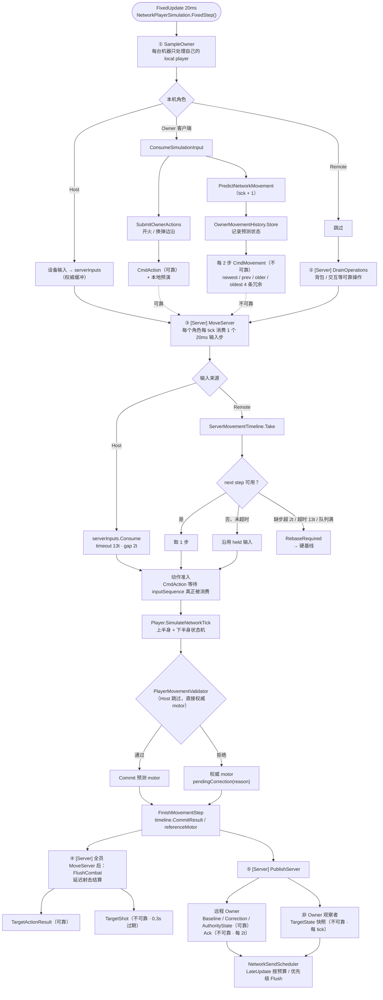
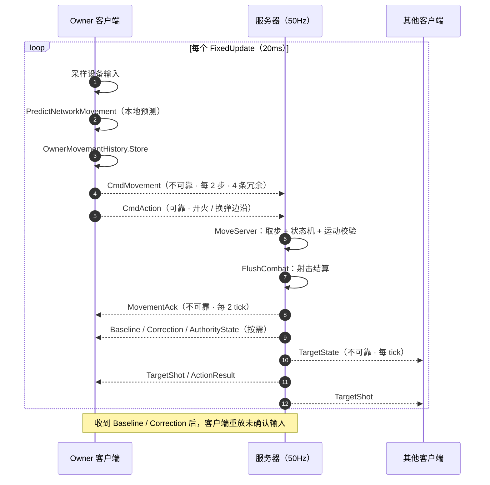
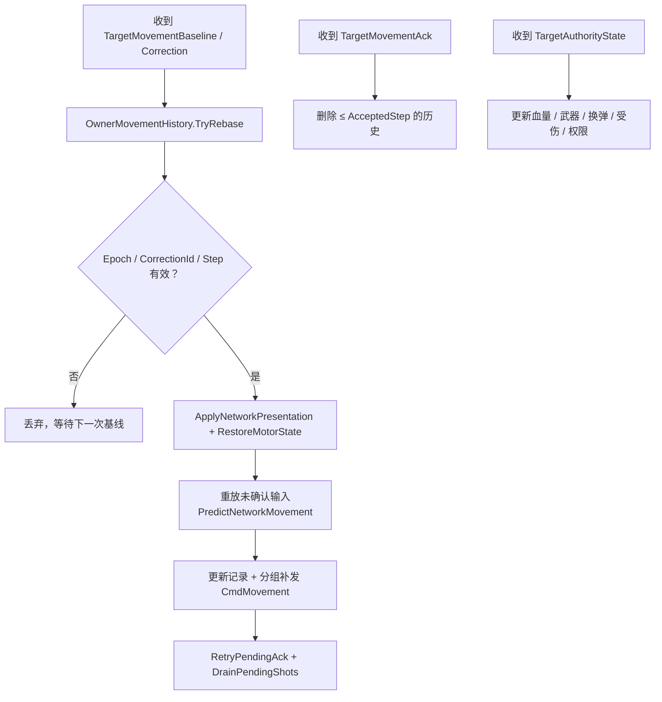

# 角色网络更新流程图（当前实现）

> 50Hz 服务器权威模拟 · Owner 本地预测 · 远端 100ms 插值快照
>
> 代码基线：当前工作树

## 1. 单次 FixedUpdate 主流程

## 2. 三方消息时序

## 3. Owner 客户端对账流程

## 4. 消息与频率

| 方向 | 消息 | 可靠性 | 触发 | 内容 |
|---|---|---|---|---|
| C→S | `CmdMovement` | 不可靠 | 每 2 步 | 4 条 `PlayerMovementReport`（输入 + 预测 motor + epoch/step/revision） |
| C→S | `CmdAction` | 可靠 | 开火 / 换弹边沿 | requestId、kind、weaponId、inputSequence |
| C→S | `CmdRequestMovementBaseline` | 可靠 | 缺基线 / 预测暂停，0.3s 重试 | epoch |
| S→Owner | `TargetMovementBaseline` | 可靠 | 首次 / 硬恢复 | 全量 `PlayerNetworkState` |
| S→Owner | `TargetMovementCorrection` | 可靠 | 校验拒绝且距上次 ≥5t | baseline + reason |
| S→Owner | `TargetAuthorityState` | 可靠 | 权限指纹变化 | 血量 / 武器 / 换弹 / 受伤 / 动作 |
| S→Owner | `TargetMovementAck` | 不可靠 | 无待纠正时每 2t | epoch、AcceptedStep、ProcessedInputSequence |
| S→Owner | `TargetActionResult` | 可靠 | 动作裁决后 | requestId、accepted、weaponId、shot |
| S→All | `TargetShot` | 不可靠 | 射击结算后 | 命中 / 枪口 / 方向 / 序号，0.3s 过期 |
| S→非 Owner | `TargetState` | 不可靠 | 每 tick（默认） | 全量表现状态 |

## 5. 关键约束

- 服务器每 tick 只消费一个 20ms 输入步，突发包不会加速模拟；超过 13 tick（250ms）没有有效输入就清空意图并触发硬基线。
- 客户端输入包带 `ObservedServerTick`，服务器按 RTT 窗口校验它是否观察到了真正发布过的状态；过期或引用未来状态直接丢弃。
- 纠正最多每 5 tick 发一次；客户端在服务器基线上重放未确认输入，所以表现为回滚重放而不是简单瞬移。
- Owner 永远不收 `TargetState`：它的权威状态来自全量 `Baseline` 和增量 `AuthorityState`，`Ack` 只推进历史窗口。
- Host 完全跳过预测往返：设备输入直接进 `serverInputs`，`Resolve` 直接返回权威 motor。

## 6. 代码入口

| 环节 | 文件 |
|---|---|
| 全局 20ms 调度 | `Assets/Scripts/Networking/NetworkPlayerSimulation.cs:43` |
| Owner 采样 / 预测 | `Assets/Scripts/Networking/NetworkPlayerController.Movement.cs:67` |
| 服务器权威步进 | `Assets/Scripts/Networking/NetworkPlayerController.cs:391` |
| 运动校验 | `Assets/Scripts/Networking/Movement/PlayerMovementValidator.cs:28` |
| 服务器时间线 | `Assets/Scripts/Networking/Movement/ServerMovementTimeline.cs:59` |
| Owner 发布（Baseline / Ack / Authority） | `Assets/Scripts/Networking/NetworkPlayerController.Movement.cs:247` |
| 客户端重放 / 对账 | `Assets/Scripts/Networking/NetworkPlayerController.Movement.cs:301` |
| 远端快照发布 | `Assets/Scripts/Networking/NetworkPlayerController.cs:462` |
| 远端插值 | `Assets/Scripts/Networking/PlayerSnapshotTimeline.cs:25` |
